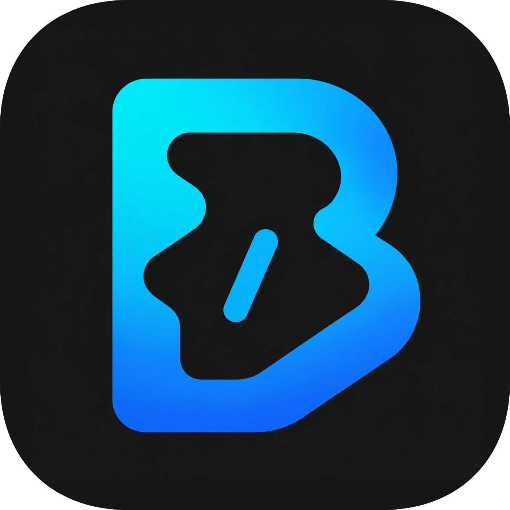

# BeCoder

A Windows programming environment for OI / ICPC and everyday C/C++ practice.

[简体中文](README.md) · **English**

[Download](https://github.com/Bc408/BeCoder-IDE/releases) · [User guide](docs/getting-started.md) · [Documentation](docs/README.md) · [Feedback](https://github.com/Bc408/BeCoder-IDE/issues)

BeCoder brings editing, compilation, code intelligence, sample testing and problem reading into one application. Start writing and running C/C++ after installation. Beacon, the optional AI companion, helps explain problems, discuss code and prepare learning notes.

## Features

| Capability | What it provides |
| --- | --- |
| Ready to use | Bundled GCC 16.2.0 and clangd, C17 / C++20 defaults, completion, navigation, formatting and compiler diagnostics |
| Compile and run | Run / Run With Input, a dedicated BC panel and the native terminal; a same-directory `input` file can supply stdin |
| Problems and samples | Import problems from supported websites in the integrated browser; edit, run and compare samples with CPH |
| Reading and notes | Offline PDF reading, Markdown / Mermaid and BeCoder NoteBook with user-run C/C++ code blocks |
| Beacon | DeepSeek, Alibaba Cloud Bailian, Moonshot and Ollama; streamed responses, formulas, image input and controllable file access and web search |
| Familiar editing | Simplified Chinese / English, One Monokai, Modern UI and compact layout; extensions through Open VSX or local VSIX files |

Beacon requires your own model configuration. Model and network features depend on the provider; editing, compilation and ordinary sample testing do not require AI. See the [user guide (Chinese)](docs/getting-started.md) and [Beacon reference](extensions/becoder.beacon/README.md) for details and current limitations.

## Download and get started

Supports **64-bit Windows 10 and later**. Download Setup from [GitHub Releases](https://github.com/Bc408/BeCoder-IDE/releases) and choose the application or Portable edition. Both include the toolchain and request administrator authorization during installation.

1. Choose a dedicated installation folder containing ASCII characters only, no longer than 70 characters, and not a drive root.
2. The first launch opens the bundled `coding/helloCoder.cpp`.
3. Write C/C++ and use the editor's upper-right run actions, or press **Ctrl+Alt+B** to run CPH samples.
4. Open an OJ from Welcome, import samples from a supported problem page, then submit your solution yourself on the website.

Reinstallation deletes and replaces the entire existing installation directory, including `data` and any files you put there. Back up everything you need first. Only workspaces, `.beaconWork` and `.notebook` outside that directory are unaffected. See [installation, data and removal (Chinese)](docs/getting-started.md).

## Documentation and development

- [User guide (Chinese)](docs/getting-started.md): installation, importing problems, running code, layout and data management.
- [Development guide (Chinese)](docs/development.md): dependencies, source checks, builds and contributions.
- [Documentation index (Chinese)](docs/README.md): feature references, confirmed requirements and implementation status.
- [GitHub Issues](https://github.com/Bc408/BeCoder-IDE/issues) · [Security policy](SECURITY.md).

BeCoder is based on **Code - OSS 1.140.0** and **Electron 43.7.3**, with application data independent of system Visual Studio Code installations.

## Acknowledgements and license

Many of BeCoder's core experiences build on the work of open-source authors. Special thanks to these projects and their contributors:

| Project | Author / team | Contribution to BeCoder |
| --- | --- | --- |
| [Competitive Programming Helper (CPH)](https://github.com/agrawal-d/cph) | Divyanshu Agrawal and contributors | The foundation for sample management, judging interactions and output comparison |
| [Competitive Companion](https://github.com/jmerle/competitive-companion) | Jasper van Merle and contributors | Problem and sample parsers for multiple online judges |
| [C/C++ Compile Run](https://github.com/danielpinto8zz6/c-cpp-compile-run) | Daniel Pinto and contributors | The upstream foundation for BeCoder Runner's compile-and-run workflow |
| [CodeSnap](https://github.com/kufii/CodeSnap) | Adrien Pyke (adpyke) and contributors | Code screenshots and sharing |
| [One Monokai Theme](https://github.com/azemoh/vscode-one-monokai) | Joshua Azemoh and contributors | The foundation for BeCoder One Monokai's colors and syntax presentation |
| [PDF Viewer](https://github.com/mathematic-inc/vscode-pdf) / [PDF.js](https://github.com/mozilla/pdf.js) | Mathematic Inc, Mozilla and contributors | The integrated PDF problem viewer and document rendering |

Special thanks to [KevinHuangIsLearning](https://github.com/KevinHuangIsLearning) and the contributors to [ShortestPath IDE](https://github.com/KevinHuangIsLearning/shortestpath-ide). Its exploration of integrating competitive-programming workflows into Code - OSS inspired BeCoder's product direction and user experience.

We also thank [Code - OSS](https://github.com/microsoft/vscode), [Electron](https://github.com/electron/electron), [GCC](https://gcc.gnu.org/), [clangd](https://clangd.llvm.org/) and the authors and maintainers of other bundled components. See the [license index](licenses/README.md) and [component inventory](resources/oi-defaults/BUNDLED-COMPONENTS.json) for sources and licenses.

The BeCoder product is licensed under [GPL-3.0-or-later](LICENSE). Inherited Code - OSS code and bundled third-party components retain their own licenses; see [ThirdPartyNotices.txt](ThirdPartyNotices.txt). Provider marks identify services and do not imply endorsement.
