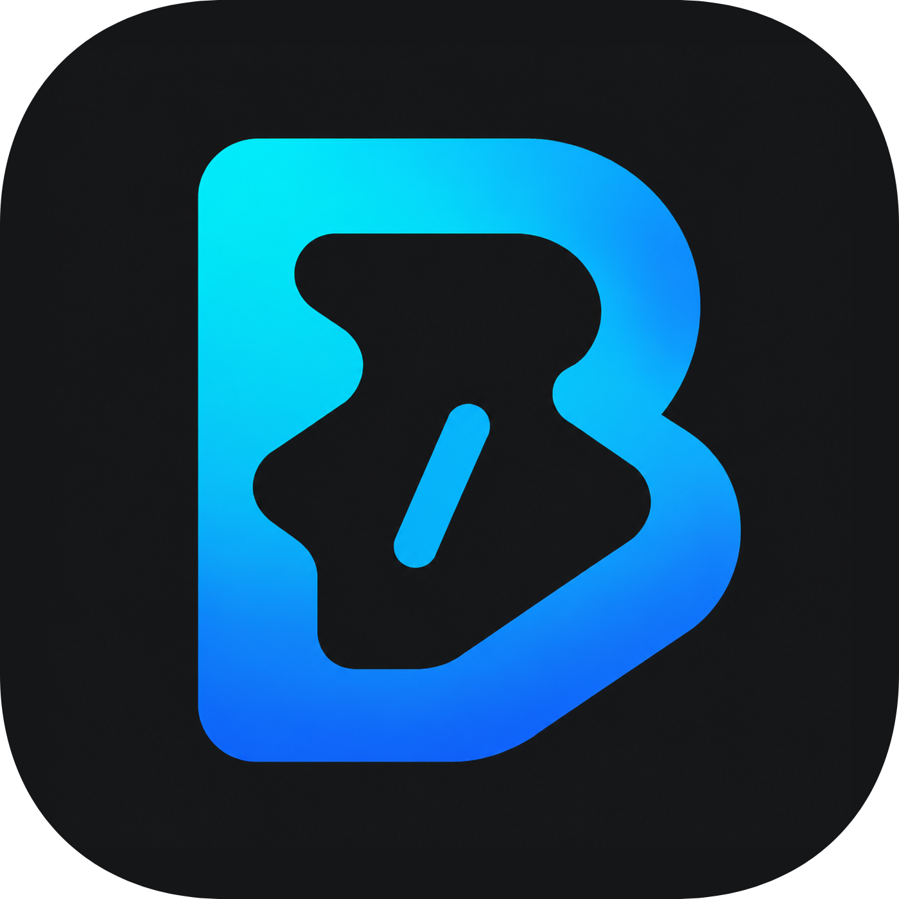

# BeCoder

A Windows programming environment for OI / ICPC and everyday C/C++ practice.

[简体中文](README.md) · **English**

[Download](https://github.com/Bc408/BeCoder-IDE/releases) · [User guide](docs/getting-started.md) · [Documentation](docs/README.md) · [Feedback](https://github.com/Bc408/BeCoder-IDE/issues)

BeCoder brings problem reading, coding, local sample testing, submission and judge results into one editing environment. Start writing and running C/C++ after installation. OJ Connect links the editor to five popular online judges; Beacon, the optional AI companion, helps explain problems, discuss code and generate content for learning notes.

## Features

| Capability | What it provides |
| --- | --- |
| Ready to use | Bundled GCC 16.2.0 and clangd, local C17 / C++20 defaults, completion, navigation, formatting and compiler diagnostics |
| Compile and run | Run / Run With Input, a dedicated BC panel and the native terminal; a same-directory `input` file can supply stdin |
| OJ Connect | Luogu, AtCoder, Codeforces, Nowcoder ACM and public Lanqiao practice; read problems, select a site compiler, submit on your command and follow the resulting judge record from the current source |
| Local sample testing | Explicitly import problem samples into CPH for the same source; import more problem sources from the browser, edit samples, run them in batches and compare output |
| Home and browser | Search, open an OJ or create C/C++ files and NoteBooks from Home; switch between website login, problems and source in one workbench |
| Reading and notes | Offline PDF reading, Markdown / Mermaid and BeCoder NoteBook with user-run C/C++ code blocks |
| Beacon | DeepSeek, Alibaba Cloud Bailian, Moonshot and Ollama; streamed responses, formulas, image input and controllable file access and web search |
| Familiar editing | Simplified Chinese / English, One Monokai, Modern UI and compact layout; extensions through Open VSX or local VSIX files |

Beacon requires your own model configuration. Model and network features depend on the provider; editing, compilation and ordinary sample testing do not require AI. See [Beacon usage](extensions/becoder.beacon/README.md) for current capabilities and the [user guide (Chinese)](docs/getting-started.md) for installation and core programming workflows.

## Download and get started

Supports **64-bit Windows 10 and later**. Download Setup from [GitHub Releases](https://github.com/Bc408/BeCoder-IDE/releases) and choose the application or Portable edition. Both include the toolchain and request administrator authorization during installation.

1. Choose a dedicated installation folder containing ASCII characters only, no longer than 70 characters, and not a drive root.
2. The first launch opens the bundled `coding/helloCoder.cpp`.
3. Open and trust your practice workspace. Open an OJ from Home and click **Get Problem** on a supported problem page to open its source and a dedicated problem panel. For an existing source, press **Ctrl+Alt+P** to read its problem.
4. Write your solution and use the editor's upper-right run actions. After importing samples with the problem panel's CPH icon, press **Ctrl+Alt+B** to run local samples.
5. Sign in through the integrated browser. Focus the source and press **Ctrl+Alt+S**, or click the problem panel's submit icon, to submit the current draft and view its judge result. See the [OJ Connect reference (Chinese)](extensions/becoder.oj-connect/README.md) for supported scopes and verification that requires manual action.

Local sample results and official judge results are shown separately. Submission is initiated by you and includes unsaved source edits. The browser's **Import to CPH** action supports additional problem sources; that coverage is maintained separately from OJ Connect's five-site submission support.

Reinstallation deletes and replaces the entire existing installation directory, including `data` and any files you put there. Back up everything you need first. Only workspaces, `.beaconWork` and `.notebook` outside that directory are unaffected. See [installation, data and removal (Chinese)](docs/getting-started.md).

## Documentation and development

- [User guide (Chinese)](docs/getting-started.md): installation, importing problems, running code, layout and data management.
- [Development guide (Chinese)](docs/development.md): dependencies, source checks, builds and contributions.
- [Beacon requirements and architecture (Chinese)](docs/beacon/README.md): capability requirements, current tool contracts, foundation architecture and implementation/validation status; future requirements are not delivered features.
- [Product direction (Chinese)](VISION.md): experience goals, module responsibilities and long-term boundaries.
- [Documentation index (Chinese)](docs/README.md): feature references, confirmed requirements and implementation status.
- [GitHub Issues](https://github.com/Bc408/BeCoder-IDE/issues) · [Security policy](SECURITY.md).

BeCoder is based on **Code - OSS 1.140.0** and **Electron 43.7.3**, with application data independent of system Visual Studio Code installations.

## Acknowledgements and license

Many of BeCoder's core experiences build on the work of open-source authors. Special thanks to these projects and their contributors:

| Project | Author / team | Contribution to BeCoder |
| --- | --- | --- |
| [Competitive Programming Helper (CPH)](https://github.com/agrawal-d/cph) | Divyanshu Agrawal and contributors | The foundation for sample management, judging interactions and output comparison |
| [Competitive Companion](https://github.com/jmerle/competitive-companion) | Jasper van Merle and contributors | Problem and sample parsers for multiple online judges |
| [vscode-luogu](https://github.com/yltx/vscode-luogu) | 引领天下 (yltx) and contributors | The foundation for OJ Connect's reused problem, submission and judge-result components, and Luogu interactions |
| [C/C++ Compile Run](https://github.com/danielpinto8zz6/c-cpp-compile-run) | Daniel Pinto and contributors | The upstream foundation for BeCoder Runner's compile-and-run workflow |
| [CodeSnap](https://github.com/kufii/CodeSnap) | Adrien Pyke (adpyke) and contributors | Code screenshots and sharing |
| [One Monokai Theme](https://github.com/azemoh/vscode-one-monokai) | Joshua Azemoh and contributors | The foundation for BeCoder One Monokai's colors and syntax presentation |
| [PDF Viewer](https://github.com/mathematic-inc/vscode-pdf) / [PDF.js](https://github.com/mozilla/pdf.js) | Mathematic Inc, Mozilla and contributors | The integrated PDF problem viewer and document rendering |

Special thanks to [KevinHuangIsLearning](https://github.com/KevinHuangIsLearning) and the contributors to [ShortestPath IDE](https://github.com/KevinHuangIsLearning/shortestpath-ide). Its exploration of integrating competitive-programming workflows into Code - OSS inspired BeCoder's product direction and user experience.

We also thank [Code - OSS](https://github.com/microsoft/vscode), [Electron](https://github.com/electron/electron), [GCC](https://gcc.gnu.org/), [clangd](https://clangd.llvm.org/) and the authors and maintainers of other bundled components. See the [license index](licenses/README.md) and [component inventory](resources/oi-defaults/BUNDLED-COMPONENTS.json) for sources and licenses.

The BeCoder product is licensed under [GPL-3.0-or-later](LICENSE). Inherited Code - OSS code and bundled third-party components retain their own licenses; see [ThirdPartyNotices.txt](ThirdPartyNotices.txt). Provider marks identify services and do not imply endorsement.
