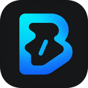

# BeCoder

面向 OI / ICPC 与日常 C/C++ 练习的 Windows 竞赛编程环境。

**简体中文** · [English](README.en.md)

[下载安装](https://github.com/Bc408/BeCoder-IDE/releases) · [使用指南](docs/getting-started.md) · [文档](docs/README.md) · [反馈问题](https://github.com/Bc408/BeCoder-IDE/issues)

BeCoder 将编辑器、编译器、代码智能、样例评测和题面阅读整合在一起。安装后即可编写和运行 C/C++；可选的 AI 助手 Beacon 用于讲题、分析代码和整理学习笔记。

## 主要功能

| 能力 | 说明 |
| --- | --- |
| 开箱即用 | 内置 GCC 16.2.0 与 clangd，默认 C17 / C++20，提供补全、跳转、格式化与编译诊断 |
| 编译与运行 | Run / Run With Input、独立 BC 面板与原生终端；同目录 `input` 文件可作为程序输入 |
| 题目与样例 | 内置浏览器导入支持站点的题目，CPH 编辑样例、批量运行并对比输出 |
| 阅读与笔记 | 离线 PDF 阅读、Markdown / Mermaid，以及可运行 C/C++ 程序块的 BeCoder NoteBook |
| Beacon | 接入 DeepSeek、阿里云百炼、月之暗面与 Ollama，支持流式回答、公式、图片输入和可控的文件访问与联网 |
| 熟悉的编辑体验 | 简体中文 / 英文、One Monokai、Modern UI 与紧凑布局；通过 Open VSX 或本地 VSIX 安装扩展 |

Beacon 需要自行配置模型服务；模型与网络能力取决于服务商。编辑、编译和样例测试无需配置 AI。完整能力与当前限制见[使用指南](docs/getting-started.md)和 [Beacon 说明](extensions/becoder.beacon/README.md)。

## 下载与上手

支持 **64 位 Windows 10 及以上版本**。从 [GitHub Releases](https://github.com/Bc408/BeCoder-IDE/releases) 下载 Setup，选择应用版或 Portable 版。两种模式均包含工具链，安装时均请求管理员权限。

1. 选择专用安装目录：仅使用 ASCII 字符，路径不超过 70 个字符，不能直接安装到磁盘根目录。
2. 首次启动打开随附的 `coding/helloCoder.cpp`。
3. 编写 C/C++，使用编辑器右上角的运行按钮，或按 **Ctrl+Alt+B** 运行 CPH 样例。
4. 从欢迎页打开 OJ，导入支持页面的样例，完成解答后自行在网站提交。

重新安装会完整删除并替换已有安装目录，包括其中的 `data` 和自行存放的文件，请先备份。只有安装目录外的工作区、`.beaconWork` 与 `.notebook` 不在替换范围内。详见[安装、数据与卸载](docs/getting-started.md)。

## 文档与开发

- [使用指南](docs/getting-started.md)：安装、题目导入、运行、布局和数据管理。
- [开发指南](docs/development.md)：依赖、源码检查、构建与贡献。
- [文档目录](docs/README.md)：功能说明、正式需求与当前实现状态。
- [问题反馈](https://github.com/Bc408/BeCoder-IDE/issues) · [安全问题](SECURITY.md)。

BeCoder 基于 **Code - OSS 1.140.0**，桌面运行时为 **Electron 43.7.3**，应用数据与系统 Visual Studio Code 独立。

## 致谢与许可

BeCoder 的许多核心体验建立在开源作者的工作之上。特别感谢以下项目的作者与贡献者：

| 项目 | 作者 / 团队 | 对 BeCoder 的帮助 |
| --- | --- | --- |
| [Competitive Programming Helper（CPH）](https://github.com/agrawal-d/cph) | Divyanshu Agrawal 及贡献者 | 样例管理、评测交互与输出对比的基础 |
| [Competitive Companion](https://github.com/jmerle/competitive-companion) | Jasper van Merle 及贡献者 | 支持多个 OJ 的题目与样例解析器 |
| [C/C++ Compile Run](https://github.com/danielpinto8zz6/c-cpp-compile-run) | Daniel Pinto 及贡献者 | BeCoder Runner 编译与运行流程的上游基础 |
| [CodeSnap](https://github.com/kufii/CodeSnap) | Adrien Pyke（adpyke）及贡献者 | 代码截图与分享功能 |
| [One Monokai Theme](https://github.com/azemoh/vscode-one-monokai) | Joshua Azemoh 及贡献者 | BeCoder One Monokai 配色与语法视觉主题的基础 |
| [PDF Viewer](https://github.com/mathematic-inc/vscode-pdf) / [PDF.js](https://github.com/mozilla/pdf.js) | Mathematic Inc、Mozilla 及贡献者 | 内置 PDF 题面阅读器与文档渲染能力 |

特别感谢 [KevinHuangIsLearning](https://github.com/KevinHuangIsLearning) 及 [ShortestPath IDE](https://github.com/KevinHuangIsLearning/shortestpath-ide) 的贡献者。该项目将竞赛编程工作流整合进 Code - OSS 的探索，为 BeCoder 的产品方向与使用体验带来了启发。

同时感谢 [Code - OSS](https://github.com/microsoft/vscode)、[Electron](https://github.com/electron/electron)、[GCC](https://gcc.gnu.org/)、[clangd](https://clangd.llvm.org/) 及其他内置组件的作者与维护者。完整来源与许可证见[许可索引](licenses/README.md)和[内置组件清单](resources/oi-defaults/BUNDLED-COMPONENTS.json)。

BeCoder 主产品使用 [GPL-3.0-or-later](LICENSE)。继承的 Code - OSS 代码与内置第三方组件保留各自许可，详见 [ThirdPartyNotices.txt](ThirdPartyNotices.txt)；品牌标识不代表相关服务商对 BeCoder 的背书。
