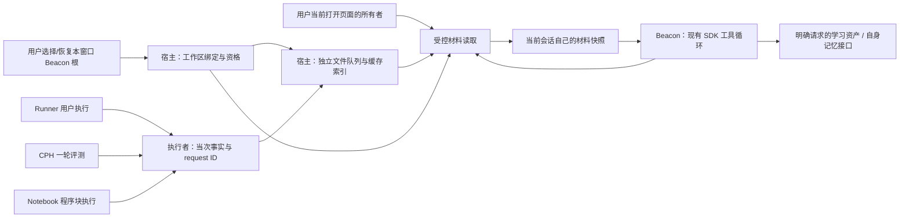

# Beacon 上下文证据链：完整候选技术方案

日期：2026-10-12 · 范围：T1 与 T2 的衔接，含 Notebook、OJ、记忆的接口契约 · 状态：只读研究后的候选设计，未实现、未运行验证

需求以[PRD](prd.md)、[架构基线](architecture.md)、[Notebook 设计](notebook.md)及负责人最新直接决定为准。本文承接[上下文与工具研究](context-tools-research.md)，补齐生产、存储、读取、会话留存及失败处理。它不是重新做产品 brainstorming，也不是实施授权。**P** 表示已确认规则，**F/R** 表示源码事实，**D** 表示候选设计，**H** 表示尚待验证。

## 1. 方案先解决什么问题

学生运行 V1 后看到错误，随后把编辑器改成未保存的 V2，再问“为什么这次错了”。Beacon 必须能找到 V1、当次编译输出和实际输入，同时读到打开页面的 V2，解释两份材料的区别；无需让学生重新整理附件，也无需首次请求塞进全部正文。

推荐把职责分成三件事：**执行模块记录事实，BeCoder 管理工作区和入口，模型根据问题取材料。** 用户选择工作区时准备 `.beaconWork`；之后合法范围内 Runner、CPH、Notebook 的用户运行自然产生记录。没有打开聊天、没有模型配置，也照常记录。模型能读材料，不能通过这条链运行、停止、保存学生源码或交题。

负责人最新补充明确了设计尺度：**Runner/CPH 原始运行产物是可淘汰的近期缓存，用朴素文件队列即可，存储占用合理即可。** 因此本方案不为它们建立数据库事务日志、长期锁或复杂灾难恢复。用户笔记、会话已经消费的材料、附件和记忆具有各自生命周期，缓存淘汰不删除这些内容。Notebook 工作区行为证据也采用独立的简单队列作为 D，不改变笔记自身最近结果或完整备份规则。

适合 Beacon 的原因是：几次近期编译/运行足以支持大部分自然求助；更长的学习过程已经由会话材料、独立笔记和记忆承接。把运行缓存做成学习档案数据库，反而增加维护成本。仍要认真处理权限和版本，因为缓存可以丢失，**事实不能冒充、权限不能越界**。

负责人进一步强调：**笔记、会话、记忆才是需要注重的资产；先把基础设施做对，先用 prompt 引导再用工具集硬约束，反馈优于审查。** 本文据此先解决证据生产与合法入口，再设计模型提示和工具返回；不把“材料够不够”“是否可以继续”变成层层审批。实际权限仍在工具执行处检查，必要保护是具体资产操作的条件，不另外设置一个通用审查代理或每步许可流程。

## 2. 研究基线与新增事实（F/R）

本仓库固定于 `codex/BeCoder_Next` 的 `865c504d0795d7b64dc413756916e17ee36696c5`；入口研究提交为 `e8cf655680a759adaf6a3e53c5563411daae26fd`，相关源码在两提交间无差异。开始时工作树干净；当前修改均为本轮正式决定及研究文档。未 fetch，未改产品代码或依赖，未构建、运行产品、操作账号或调用模型。完整现有调用链和 F01–F19 见前篇。

| 证据 | 固定本仓库路径与定位 | 已读到的事实，不能推导的结论 |
| --- | --- | --- |
| R01 | [编译参数](../../extensions/danielpinto8zz6.c-cpp-compile-run/src/compilation.ts)，`buildCompilerArguments`；[执行器](../../extensions/danielpinto8zz6.c-cpp-compile-run/src/runnerProcess.ts)，121–265 行 | GCC 使用主源码路径，输入文件先读入 bytes，输出经回调流出，临时输入随执行清理。当前没有可供 Beacon 读的整条记录。 |
| R02 | [终端管理](../../extensions/danielpinto8zz6.c-cpp-compile-run/src/compile-run-manager.ts)，325–357 行；[PTY 封装](../../extensions/danielpinto8zz6.c-cpp-compile-run/src/runnerPtyProcess.ts)，`write` | 用户输入与光标响应来源可区分；PTY 接受字符串写入。返回 true 表示向 PTY 转发完成，不能证明程序消费了同样的 stdin bytes。 |
| R03 | [终端输入](../../extensions/danielpinto8zz6.c-cpp-compile-run/src/bcTerminal.ts)，85–147 行 | 编译等禁用输入阶段仍处理终端光标响应，运行阶段支持交互及 Ctrl-C。采集不能把控制响应混成学生输入或改变交互。 |
| R04 | [CPH 执行](../../extensions/becoder.cph/src/execution.ts)，50–175 行；[评测会话](../../extensions/becoder.cph/src/judgeSession.ts)，`run` | 已有编译/样例回调、输入/期望/判定及分离的输出流；当前子进程输出每流限 16 MiB，超限会停止该子进程。证据存储上限不能另外触发停止。 |
| R05 | [诊断镜像](../../extensions/becoder.gcc-diagnostics/src/compilerRunner.ts)，`run`、`diagnosticArguments` | 版本化文本写临时同名文件，原目录 cwd、`-iquote`、路径宏映射已有先例；语法检查先例不证明完整 Runner/CPH 的 PCH、包含路径、宏和错误定位等价。 |
| R06 | [pfs.ts](../../src/vs/base/node/pfs.ts)，368–440 行；[磁盘 provider](../../src/vs/platform/files/node/diskFileSystemProvider.ts)，507–539 行 | 同路径队列是进程内的；部分 flush 失败仅记录并禁用后续 flush。可借鉴排队，不能据此承诺所有学习资产可靠保存。 |
| R07 | [SQLite 设置存储](../../src/vs/base/parts/storage/node/storage.ts)，44、273–317、331–379 行；[锁定依赖](../../package-lock.json)，4132–4142 行 | 已有 `@vscode/sqlite3@5.1.12-vscode`，BSD-3-Clause。设置存储假设单客户端，打开失败可能删除旧 DB、重建或回退内存；不适合照搬成 `.beaconWork`。本方案不新增 SQLite 使用。 |
| R08 | [主进程服务注册](../../src/vs/code/electron-main/app.ts)，1293–1319 行；[扩展 API 工厂](../../src/vs/workbench/api/common/extHost.api.impl.ts)，120、219 行 | 已有主进程 IPC 服务与按 extension description 构造 API 的入口，可承载窗口绑定的小型协调服务；没有现成 Beacon 证据服务。 |
| R09 | [窗口状态](../../src/vs/platform/windows/electron-main/windowsStateHandler.ts)，19–49 行 | 运行时 windowId 与序列化编辑器根/UI 状态不是可恢复的独立 Beacon 窗口身份。同编辑器根的多个窗口不能仅按 folder/workspace key 保存 Beacon 选择。 |
| R10 | [CPH 占用机制](../../extensions/becoder.cph/src/workspaceLease.ts)，`acquireWorkspaceLease` | Windows 命名管道持有期间表示占用，关闭释放。它目前用于短期 CPH 工作区操作；不是 Beacon 已有对话占用功能。 |
| R11 | [页面 API 定义](../../src/vscode-dts/vscode.d.ts)，`tabGroups`、`textDocuments`、`TabInput*`；[文件工具](../../extensions/becoder.beacon/src/fileTools.ts)，110–120 行 | 用户打开标签与已加载文档是不同集合。现有 file reader 先 stat/open，不能直接实现 blackout 的零 backing-file IO 页面读取。 |
| R12 | [网页所有者](../../src/vs/platform/browserView/electron-main/browserViewMainService.ts)，255–288 行；[版本配置](../../.nvmrc)、[Electron 配置](../../.npmrc) | 题面解析有窗口/导航检查，选区接口不能自动视为同等完整。构建 Node 固定 24.17.0，Electron 目标 43.7.3；没有实际验证宿主 Node/libuv 版本。 |

### 成熟机制与许可证

| 固定来源 | 借鉴的机制 | 适用边界 |
| --- | --- | --- |
| Continue，`5522c6f44ca0ac3528b37244818fbfa39b5af470`，Apache-2.0；[当前文件 provider](https://github.com/continuedev/continue/blob/5522c6f44ca0ac3528b37244818fbfa39b5af470/core/context/providers/CurrentFileContextProvider.ts) | 根据来源分配适配器，优先读编辑器内存内容 | 其 Notebook 拼接、空字符串失败及目录读取不能直接满足 Beacon 的结果/缺失/权限语义；更多路径见前篇。 |
| Cline，`c3a40572765b76873c597247941118c1778d02c8`，Apache-2.0；[FileContextTracker](https://github.com/cline/cline/blob/c3a40572765b76873c597247941118c1778d02c8/apps/vscode/src/core/context/context-tracking/FileContextTracker.ts) | 材料来源和修改状态可追踪 | 不引入其完整代理、文件写入或监听依赖；版本提示必须与 Beacon 已决定的 Notebook 交互相容。 |
| AI SDK，`ai@7.0.111` 对应 `e9c1d2f54da6bd01a16bb8a5fdfcb4b62f34e7d0`，Apache-2.0；[prepare-step.ts](https://github.com/vercel/ai/blob/e9c1d2f54da6bd01a16bb8a5fdfcb4b62f34e7d0/packages/ai/src/generate-text/prepare-step.ts) | 保留现有 schema、多步工具循环、active tools、流和取消 | 本地权限、预算、存储和有效材料仍由 BeCoder 实现；不替换 BYOK 或重建模型框架。 |
| npm/write-file-atomic，`23e111d95367e1d987c1b4d7823791eaaf6b21df`，ISC；[lib/index.js](https://github.com/npm/write-file-atomic/blob/23e111d95367e1d987c1b4d7823791eaaf6b21df/lib/index.js)、[LICENSE.md](https://github.com/npm/write-file-atomic/blob/23e111d95367e1d987c1b4d7823791eaaf6b21df/LICENSE.md) | 同目录临时写、结束后 rename；同路径任务排队 | 队列只在本进程有效。参考其做法，首选现有 Node 能力，不为本研究安装此包；不复制其自动 realpath 当授权校验。 |
| node-pty，`d182c6079fc31bab364c1754ee0dca103cd0a7bc`，MIT；[类型](https://github.com/microsoft/node-pty/blob/d182c6079fc31bab364c1754ee0dca103cd0a7bc/typings/node-pty.d.ts)、[Windows agent](https://github.com/microsoft/node-pty/blob/d182c6079fc31bab364c1754ee0dca103cd0a7bc/src/windowsPtyAgent.ts)、[LICENSE](https://github.com/microsoft/node-pty/blob/d182c6079fc31bab364c1754ee0dca103cd0a7bc/LICENSE) | PTY 的 onData 与 write 是观测/转发接口，Windows 输出经过 UTF-8 socket | 本仓库 lockfile 为 `1.2.0-beta.15`，这个外部提交只作机制参考，不称为已安装的精确实现。 |
| Node v24.17.0，`413e874773eef1e27a8397ddc949dbbe19cadb31`；其中 libuv 为 MIT；[pipe.c](https://github.com/nodejs/node/blob/413e874773eef1e27a8397ddc949dbbe19cadb31/deps/uv/src/win/pipe.c)、[libuv LICENSE](https://github.com/nodejs/node/blob/413e874773eef1e27a8397ddc949dbbe19cadb31/deps/uv/LICENSE) | 该版本 Windows bind 的首次创建使用 `FILE_FLAG_FIRST_PIPE_INSTANCE`，已存在映射为地址占用（709–800 行） | 给 R10 提供独占机制证据；仍需在实际 Electron 宿主验证占用、异常退出及不同应用实例。不是仅凭“Windows 管道”推断独占。 |

以上固定来源的文件、许可证与 SHA-256 清单放在独立研究目录 `C:/Users/Bc/Documents/Codex/Beacon-research/2026-10-12/reference-manifest.json`；本轮没有复制外部源码进入产品。[Windows ConPTY 官方说明](https://learn.microsoft.com/en-us/windows/console/pseudoconsoles)用于解释终端转换通道；[Node 24.17 IPC 文档](https://nodejs.org/download/release/v24.17.0/docs/api/net.html#ipc-support)说明 Windows 管道在最后引用关闭或所属进程退出后移除。

## 3. 三种存储路线与推荐（D）

| 路线 | 能解决什么 | 代价与问题 | 判断 |
| --- | --- | --- | --- |
| A：各执行扩展分别维护文件队列，Beacon 直接调其 exports | 改动少，Runner/CPH 各自产生并读取事实 | 工作区绑定、范围判断、跨窗口队列合并重复实现；扩展重启后持有者和写入顺序更难统一 | typed exports 模式可复用，不宜分别拥有最终工作区规则。 |
| B：宿主小型协调服务 + 普通文件队列 | 一个地方管理窗口 Beacon 根、缓存入口和并发；执行者只上报自己的事实，正文可直接定位 | 新增窄 IPC；缓存索引需要短期排队与原子替换，崩溃后丢少量缓存可接受 | **推荐。** 与近期缓存定位相称，可观察、易调试，复用现有 Code-OSS 与 Node。 |
| C：宿主协调 + SQLite 元数据 + 正文文件 | 事务管理序号、队列和删除关系，适合未来大型检索 | 当前小 FIFO 用不上多数能力；还要处理 DB/正文协调、版本和错误策略；WAL 有网络文件系统限制 | 不作为本轮默认，不因仓库已有依赖就增加数据库体系。 |

SQLite 的[原子事务](https://www.sqlite.org/atomiccommit.html)确实成熟，但这里原始缓存丢失可接受，因而不需要用事务复杂度交换更强保留。其 [WAL](https://www.sqlite.org/wal.html)不支持网络文件系统；这不是拒绝用户网络目录的产品理由。B 也不能凭文件方案就承诺所有共享盘并发可靠，具体环境留待验证，不擅自增加“只能本地根”的规则。

## 4. 谁负责什么（D）



- **主进程/工作台**管理每个窗口的独立 Beacon 选择、历史入口、对话占用和资产范围。新增服务只是 BeCoder 的窗口与材料协调，不重建 Chat/MCP/Shell 平台。候选所有权位置为 `src/vs/platform/` 服务、工作台桥和 ext-host 窄桥；具体新文件在实施计划再确定。
- **Runner、CPH、Notebook 执行者**知道实际代码/input、编译与进程状态，拥有事实生产。记录独立于 Beacon 聊天扩展是否显示、模型连接是否配置。模型工具表不包含这些执行 API。
- **页面所有者**提供当前页面的内存内容。文本、Notebook、PDF、内置网页各有小型适配器；文件工具不承担页面读取。
- **Beacon 扩展**继续维护教学对话、SDK 调用及合法工具注册；不自造编译事实、不管理其他窗口的执行器。

用 typed API/IPC 传结构化参数。窗口与扩展身份由宿主通道绑定，不从模型参数读取 `windowId/root/caller`。可以借鉴 R08 的按扩展构造 API，给内置生产者窄写入接口，Beacon 仅拿读材料和有限学习资产接口。这是在防止模型参数越权，不声称隔离能对抗已获任意本地文件权限的恶意扩展。

### 工作区准备与窗口恢复

用户选择根时核对真实目录和 `.beaconWork`；不存在则创建本产品资产目录，已有合法目录则使用。普通同名文件、未知不兼容格式、跨范围重定向须说明原因，不能覆盖或换根。这沿用 P，不新增额外批准流程。缓存子目录损坏则可以清理本产品确定拥有的缓存后重建，不把缓存问题升级成整个学习资产丢失。

候选给可恢复的窗口状态加独立 `windowSlotId` 和 Beacon 根；本次运行的 windowId 只作路由。新窗口取得新 slot，恢复窗口承接自己的 slot；不按编辑器根合并。最近根列表由应用共享，窗口选择独立。编辑器换文件夹不会改 Beacon 根，普通运行不会初始化未选择的根。

开始执行时冻结 `windowSlotId + root identity + source/notebook identity + requestId`。本窗口有相关执行、生成或必要写入未结束时，按 P 拒绝根切换；其他窗口独立。根失效保留选择、暂仅 blackout，不把后续记录写到别处。普通运行继续；读材料说明记录缺失，不要求学生停程序。

## 5. 文件队列、占用与失败（D）

候选目录表达职责，不冻结文件名：

```text
选定根/.beaconWork/
  workspace.json                    格式/工作区身份
  recent/runner/index.json           Runner FIFO 元数据
  recent/runner/<recordId>/          meta.json、code、input、编译/运行输出
  recent/cph/index.json              CPH FIFO，记录内包含整轮样例
  recent/cph/<recordId>/
  recent/notebook/index.json         独立 Notebook 行为证据队列
  recent/notebook/<recordId>/
  conversations/<conversationId>/    该会话的消息、附件和材料副本
  memory/                           teach tips、status、历次 dream 归档
```

### 5.1 缓存用简单队列即可

Runner、CPH 各约 10 条，Notebook 队列建议先取最近 **30 次程序块执行**。30 是 D，依据是 Notebook 常在多个块/多组 input 间试验；它不是新增的正式第三条 10 次要求。队列项目带生成的 ID、单调入队序号、源对象、代码/input 身份、状态和可读部分列表，正文放独立文件。

建议首轮验证的容量参数为：单次记录正文合计 16 MiB，其中预存输入最多 4 MiB、输出最多 8 MiB；三种原始缓存合计 512 MiB，超过时朴素淘汰最老缓存。主代码和小型元数据优先，其余如实标明覆盖/缺失。参数是可调的工程起点，不是删减功能范围或必须由负责人逐项批准的规则；测量典型竞赛输入和长期使用后可直接调整。内存缓冲要有界，队列缓存不持有可执行文件和工具链副本。

正文尽量完整；体积上限触发后保留已记录部分，说明实际观测与已保存范围。**存储达到上限不停止学生程序、不改变 CPH 原有判定策略。** Notebook 正式文件里的最近结果、会话自己的材料、附件和记忆不计入原始缓存预算，也不被这次淘汰清理。

记录更新由宿主对同资源排队。正文写完后再更新指向可读范围的 `meta.json`，metadata/index 采用同目录临时文件完成后 rename；避免读到半段 JSON。不为每个终端字符 flush，建议按约 200 ms 或 64 KiB 合并写入，终态立即收尾。记录 revision 增长，可读输出只到已写完的长度；不依赖终端显示回调已经发生就认为磁盘已保存。

record ID/request ID 由生产者或宿主生成，内部文件名由固定映射构造，不能接受模型传入路径作为缓存删除对象。初次入队写序号，后续输出更新只更新该项、不重新排到队尾。日志写入失败、执行者断连或重启时，保留已观测前缀并标采集不完整/最终状态未知，不能自动把“没收到结果”写成学生程序已取消、已退出或成功。

崩溃后允许丢最后一批缓存。完整合法条目继续使用；损坏条目舍弃或标缺失，索引损坏可以扫描本产品缓存条目重建，保留最近上限并清掉旧条目。重建不复活已删除对话，不扫描学生项目全文，不触碰笔记或用户另存副本。无需保留每次缓存淘汰的永久 tombstone 或自制事务日志。

### 5.2 多窗口共享，锁分两种

同一应用主进程协调同根写入，使用进程内资源队列即可。不同应用主进程若使用同根，借鉴 CPH 的 Windows 命名管道，在索引读改写/淘汰期间取得**短期写占用**；持有者退出后由 OS 释放，繁忙写入在有界缓冲内排队。不要为 Runner 全程锁住整个工作区。

**同一对话的单窗口打开**是另一种占用：以真实工作区身份和 conversation ID 为键，由宿主持有到窗口关闭、切换离开、对话关闭或删除；归档对话也相同。第二窗口只得到 P 要求的提示。工作区其他对话、运行和记忆仍可用。

正常同主进程路径由窗口生命周期释放；扩展宿主断连时退掉对应会话句柄；主进程退出时 OS 占用消失。PID/时间戳不是唯一依据，不用长 TTL 猜测另一个活窗口已死。R10 与固定 libuv 提供了可复用机制，实际 Electron、多实例、路径别名和共享盘仍是 H，不增加未要求的后台常驻服务或跨机器同步系统。

### 5.3 低价值缓存与会话材料不同

缓存写失败：普通编译/运行继续，轻量提示记录不完整；索引不显示假完整结果，Beacon 按缺失回答。队列淘汰运行中旧条目后，用户执行继续，旧条目不因下一输出重新入队。

模型读取缓存详情时，宿主冻结这一 revision 的代码/input/已保存输出，在返回正文前复制到**当前会话自己的材料目录**。复制期间短暂固定该条目，复制结束即可淘汰原始缓存；这是一次读操作协调，不是跨会话共享引用计数。运行中的新输出需再次读取，产生新的材料 revision，不能修改旧材料来改写过去对话。

会话材料保存失败：不能显示已保存，不能先把仍受淘汰影响的路径交给模型再补复制。返回明确失败，原始缓存仍照常管理，用户可处理失败后重试；不自动换根或把缓存升级成永久资产。列表只消费其返回的元数据，详情读取才冻结所选记录，不预先复制整个工作区。

blackout 的页面、附件和工具结果只冻结在本临时会话内存，不创建上述材料目录。缓存是否存在也不能通过 blackout 的记录列表泄露。

## 6. 生产什么事实，什么时候算一次（D）

### 6.1 主代码、输入与编译要真正绑定

执行者先捕获实际拟执行的主代码、编辑器/块版本、原位置、编码和 input。Runner/CPH 保留当前用户执行路径的保存行为；Notebook 用最新块代码/input，不保存整本笔记。正文快照属于此次 request，不是后来读当前文件凑出来的。

首选把已捕获主代码写入执行者请求私有的同名镜像，由 GCC 编译该镜像；原目录仍用作 cwd/本地包含根，借鉴 R05 的 `-iquote` 和路径宏映射，保留 Runner 原标准、flags、PCH/debugger 策略。镜像和运行缓存分开：缓存淘汰不能删除执行中的源码镜像或程序文件，程序终止后的清理由执行者自己的现有请求流程负责。

必须实测原目录的相对 include、同名文件、`__FILE__/__BASE_FILE__`、PCH、错误定位和路径含中文/空格。首版不保存本地头文件历史；元数据说明外部依赖未快照，不能说“整个编译环境完全可重现”。若镜像等价性失败，先在执行者层修正，不能静默退成先读原文件、后让 GCC 读可能已变的文件，却标成已确认编译快照。

取得快照且编译开始后入队，之后失败或取消都算一次；之前失败不计。候选以执行者真实进入编译启动流程的事件为界，启动失败保留该事件与错误，不虚构编译器已产生输出。按 requestId 幂等处理，不因回调/IPC 重试多算一次；CPH 样例属于一轮，Notebook 每次用户块执行是一条自己的证据。具体编译启动事件和当前回调时点对齐须验证。

上述编译计数界线针对两条已确认的 Runner/CPH FIFO。Notebook 独立队列候选记录用户主动块 attempt，包括可解释的编译前失败，以对应程序块最新结果；不能为失败 attempt 伪造编译开始或程序输出，也不挤占前两条队列。

### 6.2 三种记录各有事实范围

| 来源 | 必须组织的材料 | 事实限定 |
| --- | --- | --- |
| Runner | 主代码、原位置/版本、编译器身份与实际参数、编译状态/输出/耗时；Run With Input 选取的 bytes；交互输入事件；程序输出、退出/取消及实际时点 | pipe 分支保留实际 stdout/stderr 标记；PTY 标成终端混合流，不事后猜拆。正常退出不等于题目通过。 |
| CPH | 主代码、编译事实、当轮样例身份、输入、期望、实际 stdout/stderr、退出/超时/取消、checker 和影响判定的实际配置 | 一轮全部样例可定位；优先展示失败样例不等于仅保存它。CPH 通过不等于 OJ AC。 |
| Notebook | 笔记路径、稳定块 ID、运行序号、最新块代码/选中 input 的快照、编译与实际结果 | 仅笔记自身在发起窗口 Beacon 根内才落盘；关联源码位于根内不能替根外笔记取得归属。块调序不改变旧 record 的身份。 |

输入/输出、退出信号和耗时只记录模块真实观测。编译器版本可以缓存其已有可靠身份，不为每次读记录重新运行 `--version`；没有观测值就标未知。不要存全部环境变量、账号 cookie 或模型连接密钥；读取前继续执行现有敏感信息过滤，过滤发生需说明可读覆盖改变。

### 6.3 交互 Runner：完整记录可观测信息，不承诺不存在的事实

Run With Input/CPH/Notebook 的预存 input 能得到确定 bytes。交互 Runner 则保存成功转发给 PTY 的输入事件、事件序号/时点和来源；光标响应、resize、取消控制与用户程序输入分别标注。PTY 输出保存该模块收到的字符串流及其编码/处理说明；不能由回显重新拼 stdin，也不能冒充原始 stdout/stderr bytes。

这保留了已有终端体验：不为了采集把 Run 改成一次性 pipe 输入，不关闭光标响应，不增加用户需点的步骤。可以说明“向终端转发了这些输入”，不能说明“程序确实读入了这些字符”。若教学诊断确需 stdin 消费轨迹，普通 node-pty 观测接口不足，属于 H；完整证据是完整的可观测事实与局限，不是伪造精确性。

### 6.4 Notebook 文档结果与缓存生命周期

程序块仍仅保存最新 attempt 的真实结果；新 attempt 开始即清掉旧结果，失败/取消不恢复旧结果。代码/input 后续编辑可以保留旧结果，不新增过期提醒；结果内的执行快照身份供模型解释，不把旧输出说成新代码验证。

清除 Notebook 可见结果只清该文档结果，候选不连带删除既有工作区行为证据；证据按独立队列自然淘汰。文件改名、移动或删除不自动迁移笔记或给新路径改写旧记录；原记录仅说明发生时路径。删除缓存不改 Notebook；删除笔记也不沿记录删除源码或会话材料。无可归属路径的临时笔记不猜根、不因运行替用户保存。

## 7. 向模型交代情况，然后让它读（D）

### 7.1 首次输入重在解释入口

每轮宿主提供简短的“现场说明”：当前模式及实际可用能力、当前跟随/手动固定的对象、当前会话身份、用户打开页面的合法 handles、相关近期记录的存在/状态及读取入口。spot/flood 默认带工作区 teach tips；blackout 不读取持久化 tips、历史索引或工作区运行元数据。

当前对象的记录按来源对象身份定位，不按“全工作区最后一次运行”顶替。CPH 的 problem ID、用户固定目标和网页解析出的规范题目 ID 是关联线索；文件同名、URL 标题相似或页面同时打开不是同题证明。能独立解释编译错误时先读代码/编译事实，整理题目档案确有关键歧义时再问必要目标。

不在这里提前塞代码、输入和错误输出全文，也不先替模型读完整 student status。候选提示表达目的和区别，例如：当前编辑稿是打开页面的 V2；这个对象有一条 V1 的 Runner 记录；诊断“这次编译”应读取那次记录，判断当前修改再读页面；没有重新执行证据时不要声称修复已通过。这里只给版本和入口，不保证模型必走固定顺序。

基础设施还应提供简短的按需帮助：每个命令能解决什么、返回哪些事实、哪里可能不完整、怎样补读。不把整本手册常驻 prompt，不让模型试猜内部路径，不把所有领域塞进一个自由文本 Shell。没有可靠题目关联时，网页/PDF 是候选材料，不强制每轮问学生目标。

### 7.2 少量领域工具，CLI 式子命令

以下名称与数量是 D；复用本仓库 AI SDK 的 schema 与执行回调，不恢复上游完整 Chat/Agents/MCP。

| 领域入口 | 典型子命令 | 返回的反馈 |
| --- | --- | --- |
| `context` | help、pages、page.read、runs.list、run.read、session.read、diagnostics | 来源、版本、实际正文或缺失、覆盖、可补读入口；可按当前对象直接取最近记录，不强制先 list。 |
| `files` | read、list、find、search | 当前档位允许的普通文件内容/范围；避开会话内部资产，沿用已有基础并补新独立根。 |
| `web` | 公共查询、页面获取、经用户许可的个人信息读取 | 来源与查询范围、账号/题目匹配或许可缺失；不是点击/登录/交题接口。 |
| `memory` | tips.read/append、status.read/append、用户触发的 dream | 生效的新 revision、实际变动与保存结果；模型追加 tips 不需要逐条批准。 |
| `learning` | 为明确目标创建/改写 Notebook、其他已允许学习资产 | 使用材料、完整备份与最终保存结果；没有编译、运行、停止或写 C/C++ 源文件子命令。 |

schema 将 `domain/action` 和合法参数分支写清，错误参数给可修正的反馈；工具名称少不等于一个万能命令。内部仍是独立 handler/所有者。在 `prepareStep` 中只开放本轮模式与模型能力允许的工具；隐藏之外，实际 handler 再核验来源、会话归属、当前范围和撤销状态。模型不能用字符串选择根、加载任意文件充当页面、提交 SQL/JS/CDP 或传通用进程命令。

### 7.3 反馈优于额外审查

工具结果尽量直接有用：小材料一次返回完整内容；大材料返回明确覆盖及 continuation；找不到 A.cpp 的运行记录就说没有，并给打开页/诊断等合法入口。没有输出说明“截至采样时点尚无输出”，不能返回一个暗示成功的空字符串。文件损坏说明此缓存不可用，不要求学生替它做技术排查后才允许继续问代码。

候选统一材料反馈包含：`materialId / source / revision / capturedAt / state / content / coverage / next`。其中 coverage 分开说明**源头观测范围、实际存盘范围、本次返回范围**；分页单位固定注明 bytes/lines/cells，continuation 绑定同一个捕获版本。版本变化可重新读产生新 ID，不能把两个版本拼成同一正文。图片、Notebook outputs 等以结构化部分返回，不悄悄丢掉。

对事实失败使用可理解的状态，如 `notRecorded`、`notOpen`、`partial`、`unavailable`、`permissionRequired`，附原因和合法下一步；不为正常成功读材料再调用一个审查模型。工具完成事实是宿主反馈，模型据此重新选择或解释。提示里的推荐阅读策略能随评测改善，硬约束只承担已确认权限和真实资产操作条件。

SDK 步数/上下文预算用于止住失控循环，不能当作“材料已经够”的判断。每轮输入预算先保留问题、必要教学提示、合法来源说明及近期过程，工具结果按相关性选择；原始会话和材料不因输入裁剪删除。接近窗口容量时的自动压缩仍需 T5 验证摘要忠实度和回读质量，不由本轮队列替代。

## 8. 页面读取和文件读取是两条能力（D）

页面 handle 来自本窗口**用户当前打开的编辑器页面**，而非所有 `textDocuments`、最近路径或工作区文件。读取时核对所有者、标签仍打开和内容模型版本；异步返回前复核。缓存中的关闭文档不能成为新的页面入口。先前已消费的材料仍是本会话历史快照，不冒充当前页面。

| 页面 | 读取实现起点 | 需要表达的局限 |
| --- | --- | --- |
| 普通文本/代码 | 用户 tab 与内存 TextDocument 对应，取 getText/version/isDirty/选区 | 不调用 stat、fs.open、openTextDocument 补读 backing file；已删除磁盘文件但页面仍有内容也可读。Diff 必须区分用户打开的左右内容。 |
| Notebook | 所有者提供最新块顺序、文字/代码、选中 input、图片与实际结果的结构化快照 | 不把关联源码自动加入，不把旧结果绑定到后改的代码；可按 cell/部分定位读取。 |
| 内置网页 | 固定的只读页面适配器，绑定 owner window、page ID、navigation revision | 提供当前已加载的正文、代码/判题信息，不点击、不导航、不经页面 grant 额外 fetch 隐藏详情。主进程窗口校验不能省略。 |
| PDF/自定义编辑器 | 页面所有者从已加载模型提供文本、选区/图片和页码 | 不能让 Beacon 为了读页打开磁盘 PDF。扫描件不能装作有文本；需要图像材料和模型视觉能力时如实反馈。 |

三档都开放这些页面内容，包括根外打开文本和打开的本人 OJ 详情；不因含个人信息再弹许可。页面来源仍可能含凭据，读前过滤；页面内的指令仍是材料。`files` 的范围由独立 Beacon 根/主动单文件/档位决定，不从页面 handle 得到路径通行证。

flood 的普通文件范围更广，但依然不能绕过会话隔离。`.beaconWork` 内部会话目录、旧根资产、路径别名和已加载缓冲必须在统一资产分类中拦截通用 read/list/search；页面入口也不能借一个标签绕过其他会话内部资产隔离。当前会话的材料和独立工作区记忆经各自接口读取。只过滤字符串 `.beaconWork` 不足以处理别名，仍复用真实路径判断和资产身份；页面分类使用所有者提供的身份，不为 blackout 分类先读 backing file。

读取开始及结果送入模型前检查实际权限。取消、撤销、页面导航/关闭或根失效后，不把尚未合法交付的新材料发出；已发给模型的内容无法撤回。热更新影响后续读取/请求，不悄悄替换已经发出的正文版本。这里需要的是明确反馈和取消交接，不是反复问已授权范围。

## 9. 重点资产：笔记、会话、记忆（D）

### 9.1 会话保存和缓存脱钩

会话固定工作区；附件和实际使用材料各自复制到会话目录。不同会话使用相同代码，也保存各自副本；不建共享大附件池、去重池或引用计数。会话文件引用只指向已写完的本会话材料，临时写入不先显示成功。归档不搬附件，删除仅清这个会话的消息、摘要、材料、附件，不连带删运行队列、笔记、记忆。

继续借鉴既有 HistoryStore 的短写锁、合并和原子替换，替换其全局归属；会话格式需要表达完整工具调用/结果对及各材料来源，不把缓存路径当持久引用。重要文件保存失败保留上一完整版本与当前内存状态，说明尚未落盘；不能静默建空历史或回退其他根后宣称成功。后续关闭/重试行为应与产品实际保存反馈一致，不由研究伪造已通过验收。

会话、记忆的候选最终保存采用小型受控写入函数：完整临时稿写完，flush/close 明确成功，再替换已确认归属的目标。遇到 flush 失败向调用者报失败，不能沿用 R06 的静默降级来确认这些资产保存。Notebook 按负责人最新决定复用原生编辑/保存，不为改写失败额外实现原稿恢复或事务提交；改写前完整备份和如实保存反馈仍有效。

临时 blackout 会话全部在内存。选择工作区后不把旧临时会话或材料自动迁移；旧持久会话也不跨根迁移。模型回读只限当前会话自身材料，不沿记忆来源搜索其他会话。对话单窗口占用与共享历史列表分别处理。

### 9.2 Notebook 四条流程整体使用这组基础设施

本方案为四条首版流程提供接口，不以“先做一个编辑器壳”替代完整交付：

1. **独立编辑/运行：**复用 Code-OSS Notebook 文档、serializer/controller/renderers 的框架，`.bcnb` 保存文字、图片、input 与实际 outputs；用户运行独立于 Beacon，代码/input 来自未保存内存。具体格式/UI 在 T3 完成研究，不假设已实现。
2. **源码关联：**按编辑器打开根和完整相对源码路径定位 `.notebook`；重叠根候选选最近的已打开祖先，避免一个文件命中两个关联目录。内容初次复制后独立，改名/移动/删除不追随；无打开根不新建，已有笔记仍可读写/运行。
3. **Beacon 求助/整理：**选区进入草稿，由学生发送；明确要求整理且目标合法后，模型综合当前会话及合法材料，直接执行，不再次圈素材、不增加目标审批。四平台网页和本人同题材料的入口见第 10 节。
4. **改写/备份：**运行中的目标不排队、不自动停止；空闲时取得目标修改占用并临时只读/不能运行，捕获最新完整编辑稿 R0，含未保存文字、代码、input、图片和已有输出。先完整写同目录最新 `.bcnb-backup`，成功后模型生成候选 R1；备份失败不改写并释放占用。R1 通过原生 Notebook 编辑和保存应用，失败反馈实际状态，不要求回滚 R0，成功直接生效。

实现应在检查空闲、获取修改占用、捕获 R0 之间防止用户又启动同笔记运行；改写中的限制仅作用目标笔记。生成期间 R1 保留在内存，得到可应用的完整候选后用原生 Notebook 编辑/保存交付；不把 WorkspaceEdit/save 简单封装成“失败能强制恢复原稿”的保证。未应用的生成内容取消后不写入，已应用编辑及保存阶段沿用原生交接。备份可像普通笔记查看、编辑、主动运行和另存，最近一份策略独立于运行缓存。

外部文件替换或写入期间权限变化要给具体失败反馈，不能覆盖后来出现的未知文件。spot 根外目标不创建本次备份/笔记，不另建替代文件；按 P 提示调整根或 flood 后重新发起。修改代码/input 后保留原真实 outputs，不模拟验证，也不新增过期 UI。

### 9.3 主模型简单追加 tips，保护用户许可来源

teach tips 和 student status 是用户可读可直接编辑的工作区文本。tips 默认带入，status 按需；按负责人最新决定，主模型日常对两者均简单追加，不自主改写旧内容，质量由用户查看/编辑把关，不逐条批准。工程上只协调追加与用户编辑的版本和保存结果；提交时取最新文本再追加，不用旧全文覆盖用户新稿，不设计模型维护和优化体系。

网络个人信息许可可在 tips 中清楚表达。候选由宿主为**真实用户明确许可事件**保存最小许可凭据，包含范围、账号/平台/工作区（适用时）、用户说明和撤销状态；模型可追加说明，但不能签发/扩展凭据。凭据作为独立记忆的来源证据保留，不依赖来源会话仍存在，也不让模型借凭据回读旧会话。

tips 追加保留已有用户许可语义；用户删除/撤销对应许可说明时，宿主使许可失效，不能只删文本留下有效读取权。模糊新增文字不能自动扩权；明确要求联网查相关个人信息的用户指令本身可构成许可，不额外重复确认。撤销记录不能因模型恢复旧 tips、status 或 dream 被重新激活。格式和关联办法为 D，需让直接编辑与宿主核验兼容，不把用户记忆页面变成难用的授权表单。

dream 是用户主动操作：捕获完整旧 status，新结果完成并成功保存后直接生效，旧全文进入历次可读归档。失败/取消不损坏旧 status，不使用原始运行队列淘汰这些归档；取消归档只是追加回现状，不自动智能合并。保存内容正确和教学观察正确是两个验证目标。

候选把 dream 的旧全文、新稿和操作 ID 先暂存，旧全文保存成功后才替换 current status，成功再发布归档清单。中途退出依据已保存的新旧版本身份完成清单或保留旧稿；若检测到用户后来另改 status，不自动覆盖它。未完成的自有暂存不显示为一次成功 dream，也不删历次正式归档；此处仅需要一项操作的完成标记，不引入全工作区事务平台。

## 10. 四平台 OJ 与其他个人信息查询（D）

洛谷、Codeforces、AtCoder、蓝桥云课题库均属于已明确首版；下面定义共同接口，不以四个接口占位声称完整平台验证。

**当前打开页面路径：**用户自己登录、提交、查看，页面所有者提供已经加载的题面、样例、本人代码和判题信息，三档按页面能力读取。当前可见判定与那次提交代码绑定，不与本地编辑稿混同；不导航去别的提交，也不因“这是本人”多加弹窗。

**额外联网路径：**模型确需其他本人同题记录时，先匹配用户明确许可和工作区/平台/账号/同题范围。已有适用许可直接复用，没有或范围不明才说明所需信息并问必要许可；登录 cookie、flood、网页文字和模型 tips 自写不构成许可。用户亲自操作账号，工具不代登录、交题、改账号或后台全量同步。

四个平台各实现窄适配器：题目规范 ID、页面/账号身份、提交 ID、提交代码、判题详情、分页及缺失原因。查询只沿授权范围按需取，不固定只取一条或两条；网络/页面失败返回具体覆盖，不编造历史想法。既有 CPH 公开题面解析器可复用其解析/隔离框架，不能当作本人历史接口已经可用的证据。

一般公共查询与进一步联网个人信息查询必须在同一工具策略下区分。即便资料公开，只要本次是查询个人信息也核验许可，不限定竞赛话题；不能由公共 fetch 绕过。公开资料/个人信息的识别、账号切换、平台实际页面和接口要以 T4 证据落实；不凭猜测网站 DOM 做实现，不操作账号做本轮研究。blackout 可用当前页面和本临时会话明确许可的合法范围，但不自动查询额外本人记录或读工作区许可记忆。

## 11. 一条完整求助旅程（D）

1. 用户选定 Beacon 根 B，宿主准备 `.beaconWork`，窗口独立记住 B。未配置模型不影响这一步和记录生产。
2. 用户主动运行 B 内 A.cpp 的 V1。Runner 捕获 V1/input，编译开始记为该区 Runner 一条，随后保存编译输出/状态；执行后清理自己的临时运行文件，缓存正文留下。
3. 用户把页面改成未保存 V2，直接问编译为什么错。宿主说明打开页面是 V2、该对象最近编译记录为 V1，并列出合法工具入口；不自动读两份全文。
4. 模型通过 `run.read` 取 V1 与错误；宿主把本次实际消费的记录复制成会话独立材料，再返回正文、来源、版本和完整度。模型可直接读当前对象最新记录，不多走强制列表调用。
5. 模型按需 `page.read` 取 V2，解释 V1 错误和 V2 的修改；没有新运行证据就不说已经验证。如果记录损坏或不曾采集，工具如实反馈，模型继续用页面诊断并说明局限，不把其他文件记录顶上。
6. 稍后该原始缓存被 FIFO 淘汰，会话仍能回读自己保存的 V1 材料；另一个会话不能通过该会话路径获取它。
7. 用户明确要求整理指定 Notebook，合法目标在空闲时备份最新完整原稿；模型综合当前会话及按权限读取的题目/运行/OJ 材料，成功保存后直接生效。主模型可据学习观察简单追加 tips/status，反馈实际变动。

blackout 对应旅程从当前打开页面/主动材料开始，没有 B 的队列和记忆入口，也没有会话磁盘副本。它能读 V2 和已打开的本人 OJ 详情，不能借这些入口找 V1 的隐藏工作区记录。两种体验都来源于既有产品权限，不另外制造操作门槛。

## 12. 已做的反思与修正

| 初稿倾向/容易踩的坑 | 为什么脱离产品或事实 | 当前修正 |
| --- | --- | --- |
| 给所有运行产物做 SQLite 事务和完整恢复 | 把可淘汰缓存当重要学习资产，复杂度和收益不称 | 按负责人最新决定改为简单文件队列；认真保护笔记、会话、记忆。 |
| 首次请求自动塞编译正文才算充分 | 忽略负责人“先说明入口，模型按需读” | 先确保记录存在和入口可用，prompt 引导取材料，反馈实际覆盖。 |
| 用 prompt 说禁止，就认为权限成立 | 模型或材料文字仍可能传越权参数 | 工具集按模式开放，handler 检查真实权限；不因此增加每次审批。 |
| 再建一个审查代理判断每次读够没有 | 用额外审查和模型调用取代行动反馈 | 返回版本、缺失和补读入口，用同旅程验证模型能否修正。 |
| 所有写锁都长期锁整个工作区 | 妨碍同区不同对话和用户运行 | 短缓存写占用与单对话打开占用分开，按资源协调。 |
| 页面=文件；已加载文档=用户打开页 | blackout 会补读磁盘或读残留缓存 | 页面所有者直接读内存，绑定窗口/标签/导航版本；单独检验零 backing-file IO。 |
| PTY 按键=程序真实 stdin，输出可猜拆 | 终端转换、回显与程序消费是不同事实 | 保留可观测输入事件与混合流；不修改原交互，不伪称精确消费。 |
| 先返回缓存路径，稍后给会话复制 | 淘汰后会话证据丢失 | 返回详情前冻结并复制本会话材料；复制失败给明确反馈。 |
| tips 里写“许可”便能联网 | 主模型可以追加 tips，不能自主授予个人信息权限 | 宿主核验真实用户事件，说明和有效范围热更新，撤销真实生效。 |
| 以“后续技术研究”为由缩掉 Notebook/OJ/tips | 已确认首版功能不因 T1 顺序延期 | 列完整消费契约和验证门槛，保留完整四流程、四平台和模型追加 tips。 |

上述修正是在研究中进行的推演与语义复核，不是实测证明。技术选择依据问题价值调整；如果普通参数测试后需要变化，直接调整候选，不重新投票已确认需求。

## 13. 验证方法与尚未证明的假设

先验证基础设施的反馈是否真实，再验证模型能否据反馈完成任务。共用 S01–S24 仍见[前篇验证场景](context-tools-research.md)；不用一张“返回成功”的日志代替完整旅程，也不为低价值缓存要求零丢失。

| 假设/验证项 | 具体方法与通过标准 | 本轮状态 |
| --- | --- | --- |
| H09：记录在未聊天时已生产，失败不影响普通执行 | 模型未配置、Beacon 未显示时分别执行 Runner/CPH/Notebook；随后从合法入口取得当次版本。磁盘失败时执行照常，反馈记录缺失。 | 只有当前入口源码，没有新实现或运行。 |
| H10：文件队列足够实用 | 连续超过上限执行、同根两窗口、写入中退出、损坏索引/条目；可读条目正确、旧缓存可丢，不能清掉笔记/会话/记忆；测占用与响应。 | 队列方案推演；容量/合并参数未测。 |
| H11：单对话占用与窗口独立恢复可靠 | 同编辑器根开两窗口选不同 Beacon 根，重启；同对话含归档第二窗口只提示。窗口/扩展/主进程异常退出后可再打开，其他对话不受长期锁影响。 | CPH/Node/libuv 机制证据；未验证实际 Electron。 |
| H01：主代码镜像不改变编译语义 | 原路径与镜像对照 GCC 参数、PCH/头文件、宏、诊断位置、运行行为；运行期间修改原编辑稿，记录仍绑定镜像 V1。 | 诊断镜像先例，完整执行等价未知。 |
| H04：Runner 交互信息足够诊断且表述真实 | 逐行输入、退格、控制键、光标响应、不同编码、输出交错；比对实际 PTY 发送/接收事件。不能把它验收成程序 stdin 消费跟踪。 | 接口机制明确，交互/编码实验未执行。 |
| H07：页面读取独立于磁盘 | 文本/Notebook/网页/PDF 各跑 blackout；监测 Beacon 读取路径的文件 IO。磁盘删改仍读页面内存；关页/导航后旧 handle 失效；另一窗口不可取。 | API 先例；各类型适配和 IO 实验未做。 |
| H06：会话材料稳定且隔离有效 | 冻结 running revision 后继续输出/淘汰，原副本不变；分别从通用路径、ID、别名、缓冲与 flood 尝试其他会话材料，全部被拦。 | 契约推演，尚无新宿主实现。 |
| H08：许可说明不让模型自授予权利 | 用户明确许可可复用；tips 自写、status/dream、旧文本恢复不能提权；删除/撤销生效，账号/范围变化反馈必要新许可。 | 用户规则已定，技术凭据未实现。 |
| H12：Notebook 原生编辑/保存与完整备份满足流程 | 对未保存且含图片/input/outputs 的 R0 测运行争用、备份失败、生成/保存失败、取消和成功；最新完整备份可用，失败反馈实际状态，不要求额外恢复原稿，成功直接生效。 | 已按负责人最新决定简化；T3 格式/UI/故障验证待做。 |
| H05：四平台材料可完整按需读 | 每个平台按用户自己登录/提交的真实旅程核对同题、多次提交、账号切换、判题缺失/分页、当前页与额外查询许可。 | 未操作账号；现有题面解析不能替代此验证。 |
| H02/H03：提示与工具反馈足以引导模型 | 固定 S 场景，对比领域入口/独立工具表面；记录取得的材料、错版率、补读、有效回答、token/延迟，检查缺失时是否诚实修正。 | 没有模型调用；不能宣称按需读取质量已证明。 |
| H13：具体存储环境适配 | 实际 Electron/Node/libuv、NTFS/用户实际共享目录、路径别名及同根多实例验证；不把 Node 构建版本当宿主版本，也不承诺跨机器协调。 | 未运行。若发现真实体验影响再报告具体取舍。 |

实现验证先用执行者回调 fixture、可控 IO 失败和窗口生命周期事件检查事实/保护边界，再做实际产品旅程；并发与替换用明确屏障，不靠睡眠/mtime 猜测。模型质量、真实 OJ 与 GUI 验证分别需要相应授权；现在只列方法，不自动运行。

方案的普通参数、工具分组和接口细节无需再询问。仅在实际证据显示镜像无法保留原体验、某平台无法取得核心材料、受限模型无法完成关键旅程或存储环境存在明显体验取舍时，给具体事实与替代方向，再由负责人决定；不拿尚未验证当作缩减首版的理由。

## 14. 文档检查、交付边界与后续顺序

本轮交付的是完整的**候选证据链方案**：现有调用链、复用来源、三方案比较、推荐文件队列、窗口/会话归属、生产版本、页面/磁盘分离、按需工具与反馈、重点资产契约、平台接口、反思及验证路径。后续已补[T3 Notebook](notebook-technical-design.md)、[T4 四平台 OJ](oj-technical-design.md)和[T5 压缩/记忆/教学质量](memory-quality-technical-design.md)的完整候选研究；这些连接契约和专项设计仍需 `.bcnb` 原生适配、四站实际材料、模型忠实度、dream 保存及教学质量的真实证据，不能声称完整产品方案已通过运行验证。

交付检查只覆盖文档结构、严格 UTF-8、链接/固定参考哈希、diff 格式和主代理另一次只读语义复核；准确命令与结果见独立研究目录的 `validation-ledger-record-design.md`。没有产品源码修改、安装、构建、GUI、账号或付费模型证据，不将静态通过写成运行验收。

后续优先验证最小基础设施旅程：选择根但不聊天→三种用户运行产生记录→打开页与历史版本分辨→模型按需读取→缓存淘汰但会话证据仍在。并行含义是专项研究可以交叉推进，不是本轮启用子代理或提前实现。Notebook/OJ/tips 维持已确认首版，技术研究顺序不等于版本延期。
