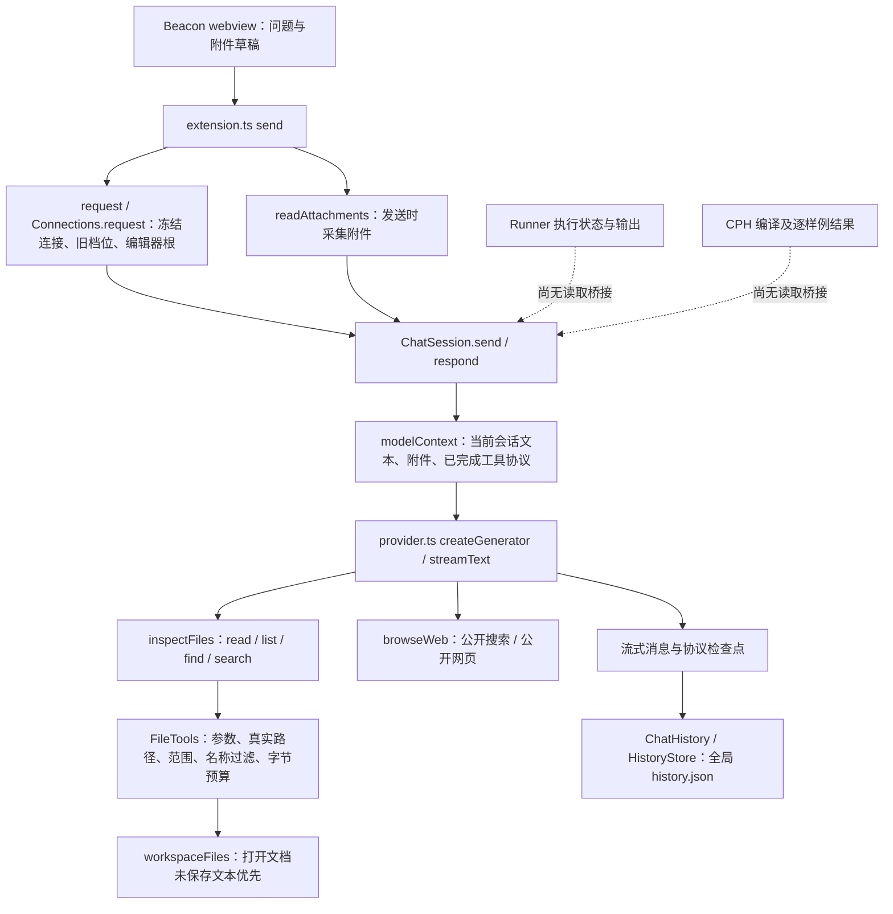
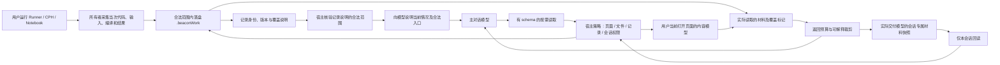

# Beacon 上下文获取与工具组织：源码研究与候选方案

日期：2026-10-12 · 研究包：T1 · 状态：源码研究与负责人补充后的方向修订，尚未进行原型、模型或产品运行验证

需求依据为[正式 PRD](prd.md)、[架构基线](architecture.md)和[Notebook 设计](notebook.md)。本文是技术研究产物，不修改产品基线，不构成实现授权或功能完成证明。

## 1. 先说方案解决什么问题

学生直接问“为什么这次编译错误了”，Beacon 需要先知道“这次”对应哪次执行、哪份代码，以及编译器真正说了什么。当前编辑器可能已经改过，终端可能混有旧输出，CPH 的多个样例也不能被拼成一次 Runner 执行。把这些材料标清再交给模型，比单纯增加读文件工具更重要。

负责人最新决定采用**用户行为提前落盘，宿主说明情况与入口，模型按需读取**的方向。宿主指 BeCoder 的扩展宿主和必要的工作台/主进程服务；它能观察真实事件并执行权限检查。用户选好工作区时由 BeCoder 建立并检查合法可用的 `.beaconWork` 资产目录，随后随 Runner/CPH/Notebook 区内用户运行记录有用的全套事实，不等模型求助请求才采集。

具体做法是：执行模块产生并落盘与当次代码绑定的记录；Beacon 在每轮开始把当前情况、合法来源、版本及工具/信息入口交代清楚，再由模型按需读取代码、编译输出、输入/结果、题面和本会话材料。不急于在首次请求塞入正文，不把“先自动提供关键证据正文”作为充分上下文的必要条件；材料已经存在、有可靠入口、能正确解释和读取才是基础。工具读取小材料可以一次完整返回，不规定必须先摘要、再详情。

**页面读取与文件读取分开。** blackout/spot/flood 均可按需读取本窗口用户当前打开的编辑器页面内容，含未保存修改和已打开的本人 OJ 提交代码/判题详情；页面可能含个人信息，默认用户已知情可被 Beacon 阅读，不为这页额外问询。这不授权对应磁盘文件、邻接/引用文件或隐藏历史。blackout 没有工作区自由文件读取和行为记录检索入口，因而也无法获得大量只在 `.beaconWork` 中组织的行为信息；当前打开页面已经提供的材料则可通过页面能力读取。凭据过滤与会话隔离仍执行。

**进一步网络查询个人信息是另一项许可。** 不限定算法竞赛/OJ，只要超出当前打开页面而联网查个人信息，就要问询并取得用户明确许可；已明确且范围匹配的许可可复用。用户许可/限制可由主模型调用记忆能力记入 teach tips。宿主需验证许可来自用户并适用本次读取，模型简单追加 tips、网页文字或 status 推测都不能产生新许可；blackout 不读取工作区许可记忆。具体许可结构和核验实现仍属技术设计。

这是适合 Beacon 的方向判断：自然求助少搬材料，保留 BYOK 和既有流式调用机制，不引入 Shell、通用 MCP 平台、后台账号同步或另一套自治执行代理。材料层也可服务完整 Notebook 整理和教学记忆，但不能替代它们各自的设计与质量验证。

## 2. 基线、授权与证据等级

本地研究基线：

- 仓库：`C:/Users/Bc/Desktop/BeCoder/BeCoder_maintenance`。
- 分支：`codex/BeCoder_Next`；HEAD：`865c504d0795d7b64dc413756916e17ee36696c5`。
- 开始时工作树干净。`git status --short --branch` 显示相对本地 `origin/codex/BeCoder_Next` 跟踪引用 ahead 1；未 fetch，不能据此确认远端实时状态。
- `git show --stat` 确认交接提交仅同步文档；入口基线 `e8cf655680a759adaf6a3e53c5563411daae26fd` 到交接 HEAD 的本轮相关源码路径差异为空。
- 阅读顺序为 AGENTS、VISION、正式入口、PRD、架构、Notebook、技术议程，再沿依赖图读取当前源码。桌面历史稿未作为本轮规则来源。

全文标记含义：**P** 是负责人最新直接确认的方向与产品规则；**F** 是此固定提交或固定外部提交的源码事实；**D** 是具体候选技术设计；**H** 是尚未通过实际运行证明的假设。第 1 节的提前落盘、入口引导、三档打开页面读取及进一步网络个人信息查询许可属于 P；具体存储/索引/工具/许可协议仍属于 D。源码中存在一个方法，只证明入口存在，不证明整个旅程成立。

本轮仅读取源码、访问公开官方资料、在独立目录下载固定提交的参考文件，并写研究文档。没有改产品源码、安装依赖、构建、启动 GUI、登录账号、调用付费模型或执行 Git 写操作。遵循仓库规定，由主代理完成研究和另一次只读语义复核，未启用子代理或审查线程。

## 3. 当前调用链与材料缺口（F）

### 3.1 Beacon 发出一次请求

| 证据 | 路径与定位（均为上述本地 HEAD） | 源码事实及意义 |
| --- | --- | --- |
| F01 | [extension.ts](../../extensions/becoder.beacon/src/extension.ts)，31、54–58、244–262 行 | 历史在 `globalStorageUri`；发送准备连接/工具并再次读取附件。没有自动收集当前代码、诊断或运行记录的步骤。 |
| F02 | [connections.ts](../../extensions/becoder.beacon/src/connections.ts)，`request`；[session.ts](../../extensions/becoder.beacon/src/session.ts)，`modelContext`、`respond` | 连接、能力、参数和根形成请求快照。模型输入从当前会话重放，包含附件和保存的协议；没有本轮材料选择器或上下文总预算器。 |
| F03 | [provider.ts](../../extensions/becoder.beacon/src/provider.ts)，`fileSchema`、`createGenerator` | 工具仅为文件检查和公开联网；工具能力必须为 supported 才开放。复用 AI SDK 的 schema、执行、流、多步循环、取消与步骤回调；当前最多 20 步，不是材料充分性的证明。 |
| F04 | [workspaceFiles.ts](../../extensions/becoder.beacon/src/workspaceFiles.ts)，`currentFileRoots`、`createFileTools` | 根来自编辑器 `workspaceFolders`；授权后按真实路径找打开文档并取 `getText()`，能取得未保存文本，但返回未标明编辑器版本、dirty 或捕获身份。 |
| F05 | [fileTools.ts](../../extensions/becoder.beacon/src/fileTools.ts)，34–40、69–108、110–149、151–186 行 | 检查真实路径及旧 workspace 档位范围；排除已知私密名称/扩展，拒绝设备路径和备用数据流；有普通文件、读取前后身份检查、取消及返回预算。不能推导为任意内容的完整敏感信息过滤。 |
| F06 | 同 F05；[attachments.ts](../../extensions/becoder.beacon/src/attachments.ts)，`checkAttachmentSource`、`readAttachments` | 当前文本块上限 128 KiB，工具回合预算 8 MiB，搜索只查每文件前 128 KiB。打开文本续读使用字符偏移，磁盘使用字节偏移；没有跨块版本绑定。当前 none 拒绝路径附件、workspace 拒绝外部/选择器来源，与新 blackout/主动单文件规则有差距。 |
| F07 | [session.ts](../../extensions/becoder.beacon/src/session.ts)；[protocol.ts](../../extensions/becoder.beacon/src/protocol.ts) | 文件结果、公开网页来源、附件和完成的调用/结果对能随会话保存与重放。可复用已消费证据留存的基础，但没有新会话材料目录、独立记忆接口或受控的本会话材料回读入口。 |
| F08 | `historyStore.ts`（调研时源码，现已按负责人要求删除）；[history.ts](../../extensions/becoder.beacon/src/history.ts) | 当前全局历史有短期写锁、临时文件 rename 和合并/冲突处理。它不是独立 Beacon 根实现，也不是单对话跨窗口占用。通用文件工具未实现会话内部资产所有权隔离。 |

F05 的真实路径校验可以允许仍在授权根内的链接目标；不能沿用旧记忆中“所有 symlink 都拒绝”的描述。通用工具目前没有 `.beaconWork` 专属规则，不能在新格式落盘后仅靠 prompt 禁止读其他会话。

### 3.2 谁真正生产代码、编译与运行事实

| 证据 | 路径与定位 | 已有能力 | 当前缺口 |
| --- | --- | --- | --- |
| F09 | [compiler.ts](../../extensions/danielpinto8zz6.c-cpp-compile-run/src/compiler.ts)，`prepareActiveSource`、`prepareCommandSource`；[compilation.ts](../../extensions/danielpinto8zz6.c-cpp-compile-run/src/compilation.ts)，`buildCompilerArguments` | Runner 用户运行路径先处理保存，编译参数包含真实源码路径及统一编译策略。 | 没有与当次 GCC 输入绑定、可留存的主源码文本快照。读当前文件无法补出旧版本。 |
| F10 | [compile-run-manager.ts](../../extensions/danielpinto8zz6.c-cpp-compile-run/src/compile-run-manager.ts)，171–248 行；[runnerProcess.ts](../../extensions/danielpinto8zz6.c-cpp-compile-run/src/runnerProcess.ts)，32–68、121–265、`runPty`、`runChild` | 管理者接受状态及输出回调；执行器有编译/运行/取消等终态、实际耗时、输入文件 bytes，PTY 路径生成临时 `input.snapshot`。 | `RunnerExecutionResult` 不含源码、输入、编译输出或程序输出正文；输入快照随临时目录清理。没有两条需求队列中的 Runner 队列，也没有 Beacon 只读记录 API。 |
| F11 | 同 F10；[bcTerminal.ts](../../extensions/danielpinto8zz6.c-cpp-compile-run/src/bcTerminal.ts) | 输出流进入终端呈现；程序输入经 `writeProgramInput` 转发。PTY 本身是混合流；pipe 分支 stdout/stderr 最终也交给同一个无流标签的 write 回调。 | 不能从当前 write 回调重建独立 stdout/stderr。交互按键、终端回显和程序真正消费的 stdin 不是同一事实，不能把按键日志宣称为精确输入 bytes。 |
| F12 | [Runner extension.ts](../../extensions/danielpinto8zz6.c-cpp-compile-run/src/extension.ts)，`RunnerCompilerApi`、`activate`；[CPH toolchain.ts](../../extensions/becoder.cph/src/toolchain.ts)；[judgeView.ts](../../extensions/becoder.cph/src/judgeView.ts)，81–110 行 | CPH 通过扩展 `activate()` 返回的 typed API 复用 Runner 编译策略。这是已有跨扩展接口模式。 | 当前只开放编译计划，不开放记录读取；不能把现有 run 命令包装成模型工具。 |
| F13 | [judgeSession.ts](../../extensions/becoder.cph/src/judgeSession.ts)，`run`；[execution.ts](../../extensions/becoder.cph/src/execution.ts)，25–40、50–115、`runProcess`；[judge.ts](../../extensions/becoder.cph/src/judge.ts) | CPH 有编译结果、逐样例 stdout/stderr、时限、退出信号、取消、输出超限和 checker 结果；支持编译/样例回调，按一轮请求组织。 | 仍编译磁盘源码路径；完整输入、期望、样例身份、配置和主代码尚未组成固定评测记录。临时目录 finally 清理，当前视图结果 map 不能替代 10 轮 FIFO。 |
| F14 | [GCC extension.ts](../../extensions/becoder.gcc-diagnostics/src/extension.ts)，`eligibleTarget`、138–157 行；[compilerRunner.ts](../../extensions/becoder.gcc-diagnostics/src/compilerRunner.ts)，`diagnosticArguments`、`run` | 诊断采集 `uri/version/text`，把文本写进临时同名镜像；使用原目录 cwd、`-iquote`、`-fmacro-prefix-map`；只发布仍匹配版本的结果。 | Beacon 未接入该诊断证据。普通 `getDiagnostics` 不携带完整编译参数/源稿身份，诊断采用语法检查策略，不能当作用户这次 Runner 编译结果。 |

**重要区分：**源码证明诊断镜像方案已经存在；本轮没有运行它。它可作为 Runner/CPH 的研究起点，但原样搬过去未证明完整编译、PCH、路径宏、局部头文件和诊断定位均等价。

### 3.3 网页、PDF、Notebook 和平台记录

| 证据 | 路径与定位 | 可复用事实与限制 |
| --- | --- | --- |
| F15 | [browserViewMainService.ts](../../src/vs/platform/browserView/electron-main/browserViewMainService.ts)，255–288 行；[browserProblemFeature.ts](../../src/vs/workbench/contrib/browserView/electron-browser/features/browserProblemFeature.ts) | 主进程核对页面所属窗口，孤立世界执行固定解析器，检查导航/关闭、超时、URL 和结果大小。现有动作是用户导入 CPH，会写入其数据；不应作为 Beacon 只读求助入口调用。没有证明题面全文或本人历史提交已可获取。 |
| F16 | [browserView.ts API](../../src/vs/platform/browserView/common/browserView.ts)，`getSelectedText`、`parseProblem`；[browserView.ts 实现](../../src/vs/platform/browserView/electron-main/browserView.ts)，`getSelectedText` | 有窗口内网页及选区机制可扩展为固定的只读材料适配器；不能让模型传任意 JS、CDP 命令或点击流程。页面存在不证明与当前代码同题。 |
| F17 | [PDF extension.js](../../extensions/mathematic.vscode-pdf/src/extension.js)，`PDFViewerProvider`、119–138 行 | PDF.js 定制编辑器目前的消息处理用于受限本地 PDF 链接打开，未看到 Beacon 选区/全文材料接口。将 PDF 经通用二进制 read 变为 hex 不等于读懂题面。 |
| F18 | [ipynbMain.ts](../../extensions/ipynb/src/ipynbMain.ts)，`activate`；[本地 vscode.d.ts](../../src/vscode-dts/vscode.d.ts)，TextDocument、NotebookDocument、Extension、languages | 已有 Notebook serializer 和保留 outputs/attachments 示例，稳定 API 能读编辑器、Notebook 内存内容和诊断，扩展可返回 typed exports。不是 `.bcnb`、完整修改保护或四流程已实现的证据。 |
| F19 | [本地 vscode.d.ts](../../src/vscode-dts/vscode.d.ts)，10900、13958、14128、17901–18144 行；[fileTools.ts](../../extensions/becoder.beacon/src/fileTools.ts)，110–120 行；[workspaceFiles.ts](../../extensions/becoder.beacon/src/workspaceFiles.ts) | 有 tabGroups、文本/Notebook/自定义/webview 标签类型和已加载文档；当前 Beacon 文件 reader 却先 stat/open/verify 磁盘，之后才尝试编辑缓冲。直接复用它无法实现 blackout 仅页面读取；文档已加载也不证明是用户当前打开的页面。 |

四平台题面/样例解析器属于 F15 的既有 CPH 路线。本人同题提交、登录账号识别与授权匹配仍需 T4 的真实平台研究，本轮没有账号操作。Notebook 最近结果适配器须读取程序块真正保存的执行版本及输入；不得从当前代码/input 倒推旧结果身份，也不新增用户已排除的过期提醒。

## 4. 可复用能力与固定来源

### 4.1 优先复用本仓库与现有依赖（F / D）

1. **页面清单、内存内容和诊断 API：**复用 tabGroups 与 `TextDocument.getText/version/isDirty`、Notebook 内存模型及所有者页面适配器，为三档建立不读磁盘的页面入口。不能仅枚举 textDocuments 就把内部加载/残留文档算作用户打开页，不能调用 openTextDocument 打开新文件扩权。异步采集后复核页面仍打开且归本窗口、模型版本正确；诊断另标来源及版本能否确认。API 定义与[官方说明](https://code.visualstudio.com/api/references/vscode-api#TextDocument)共同作为证据，以本地删裁后的定义为准。
2. **已有 typed 扩展 API：**按 CPH 消费 Runner 的方式增加只读证据接口，返回独立快照而非可变视图对象。执行模块保留自身所有权；Beacon 不取得运行、停止、保存源码或编译能力。跨主进程网页材料通过窄 IPC 适配；不统一成可任意执行命令的桥。
3. **GCC 诊断镜像与请求版本协调：**借鉴 F14 的采集、临时镜像和过期请求处理。运行中读材料不要调用该检查器重新编译；读已观测记录即可。Runner/CPH 的主源码镜像另验证完整执行策略，不复制诊断的固定标准和 debugger 隔离参数。
4. **既有 AI SDK：**保留 schema 校验、`streamText`、工具执行/结果、`prepareStep`、步骤终止和 AbortSignal，Beacon 负责权限与材料预算。SDK 的多步请求循环不保证模型一定补足材料，也不会自动实施本地边界。
5. **现有文件安全基础：**文件/行为记录路径复用真实路径、普通文件、敏感名称、取消、覆盖限制；补上独立 Beacon 根、材料授权、内部资产隔离、内容敏感过滤及版本绑定。页面路径另验证用户打开状态及其内容模型，禁止为了读页面先打开磁盘文件。8 MiB 是文件字节上限，不能直接成为模型 token 预算。
6. **既有协议留存：**保存完成的调用/结果对，改为同时记录来源和版本；每轮输入的删减只作用于输入视图，不删除原对话/原证据。此处不完成 T5 的压缩或记忆质量设计。

本地 `vscode.d.ts` 未找到 `LanguageModelTool`、`invokeTool` 或 `lm` namespace，根 README 也明确不引入上游 Chat/Agents/MCP。因此[上游 Language Model Tool API](https://code.visualstudio.com/api/extension-guides/ai/tools)只能作 schema/能力注册参考，不能假定本仓库已可调用，也不推荐为 T1 恢复整个上游 AI 平台。

通用终端 `onDidWriteTerminalData` 在本地属于 proposed API，`extHost.api.impl.ts` 检查 `terminalDataWriteEvent` 资格；Beacon manifest 未声明该 proposal。优先采集 Runner 所有者流，不用全局终端监听。必要的终端回滚读取只作注明范围的辅助现场证据，不冒充完整输出或另一次运行。

### 4.2 外部机制：借鉴局部，不搬整个产品（F / D）

| 项目、固定提交、许可证 | 已读取的源码与具体机制 | 对 Beacon 的使用判断 |
| --- | --- | --- |
| Continue，`5522c6f44ca0ac3528b37244818fbfa39b5af470`，提交时间 2026-07-21 UTC，Apache-2.0 | [CurrentFileContextProvider.ts](https://github.com/continuedev/continue/blob/5522c6f44ca0ac3528b37244818fbfa39b5af470/core/context/providers/CurrentFileContextProvider.ts)、[ProblemsContextProvider.ts](https://github.com/continuedev/continue/blob/5522c6f44ca0ac3528b37244818fbfa39b5af470/core/context/providers/ProblemsContextProvider.ts)、[TerminalContextProvider.ts](https://github.com/continuedev/continue/blob/5522c6f44ca0ac3528b37244818fbfa39b5af470/core/context/providers/TerminalContextProvider.ts)、[VsCodeIde.ts](https://github.com/continuedev/continue/blob/5522c6f44ca0ac3528b37244818fbfa39b5af470/extensions/vscode/src/VsCodeIde.ts) | 可借鉴“不同材料由适配器产生”的轻量组织。打开文件优先 getText，Notebook 有 cell 文本路径；该路径会丢失 input/结果/版本结构，部分失败返回空串。Beacon 应保留显式缺失和块级证据，不能直接套其编辑器根范围。 |
| Cline，`c3a40572765b76873c597247941118c1778d02c8`，提交时间 2026-10-10 UTC，Apache-2.0 | [FileContextTracker.ts](https://github.com/cline/cline/blob/c3a40572765b76873c597247941118c1778d02c8/apps/vscode/src/core/context/context-tracking/FileContextTracker.ts)、[mentions/index.ts](https://github.com/cline/cline/blob/c3a40572765b76873c597247941118c1778d02c8/apps/vscode/src/core/mentions/index.ts) | 可借鉴按 task 跟踪材料被读取/修改及过时信息，而不覆盖旧证据。磁盘 watcher 不能替代未保存文本版本。mention 支持目录展开、诊断和终端；Beacon 主动单文件不授权邻居，不能照搬目录展开或后续持续追读。无需为此新增 chokidar。 |
| Vercel AI SDK，`ai@7.0.111` 对应 `e9c1d2f54da6bd01a16bb8a5fdfcb4b62f34e7d0`，提交时间 2026-09-22 UTC，Apache-2.0 | [package.json](https://github.com/vercel/ai/blob/e9c1d2f54da6bd01a16bb8a5fdfcb4b62f34e7d0/packages/ai/package.json)、[prepare-step.ts](https://github.com/vercel/ai/blob/e9c1d2f54da6bd01a16bb8a5fdfcb4b62f34e7d0/packages/ai/src/generate-text/prepare-step.ts)、[stream-text.ts](https://github.com/vercel/ai/blob/e9c1d2f54da6bd01a16bb8a5fdfcb4b62f34e7d0/packages/ai/src/generate-text/stream-text.ts)、[stop-condition.ts](https://github.com/vercel/ai/blob/e9c1d2f54da6bd01a16bb8a5fdfcb4b62f34e7d0/packages/ai/src/generate-text/stop-condition.ts) | 与 Beacon manifest/lock 的版本一致。prepareStep 能调整 messages、activeTools 等，便于选择工具和按轮组织输入；无需换 SDK。官方实时页面可能变化，具体适配以该 tag 与本地调用为准。 |

许可证均读取固定提交的 [Continue LICENSE](https://github.com/continuedev/continue/blob/5522c6f44ca0ac3528b37244818fbfa39b5af470/LICENSE)、[Cline LICENSE](https://github.com/cline/cline/blob/c3a40572765b76873c597247941118c1778d02c8/LICENSE)、[AI SDK LICENSE](https://github.com/vercel/ai/blob/e9c1d2f54da6bd01a16bb8a5fdfcb4b62f34e7d0/LICENSE)，不只采用 GitHub 自动识别字段；AI SDK main 的自动字段为 NOASSERTION，而该固定 tag 的 LICENSE 与 package.json 明确 Apache-2.0。

本轮只借鉴机制、未复制实现。后续若引入代码/依赖，逐文件保留版权、许可证、修改说明与适用 NOTICE，并更新组件来源记录。BeCoder 根 LICENSE 为 GPLv3，README 标示修改以 GPL-3.0-or-later 发布；Code-OSS 保留 MIT，Beacon 扩展有自身 MIT，Runner/CPH manifest 分别标 GPL-3.0 / GPL-3.0-or-later；不可把所有仓库文件一概写成 MIT。

公开源码从 GitHub API 获取提交和目录树，再下载固定 SHA 的 raw 文件。离线材料位于 `C:/Users/Bc/Documents/Codex/Beacon-research/2026-10-12/references/<owner>/<repo>/<sha>/`，`reference-manifest.json` 保存文件路径、来源与 SHA-256。没有 clone/fetch、安装或运行这些项目。

## 5. 三种工具与材料组织方案（P / D）

三种路线共享提前落盘的行为证据、页面/文件权限分层和会话留存规则，只比较“请求开始时给多少正文、怎样引导模型读取”。CLI 式组织均是宿主内的能力命令，参数由 schema 校验；不解释 Shell、不执行外部 CLI，不接受任意命令名/代码。提前生产证据不是等待模型调用的检索步骤，也不需要模型决定开始采集。

| 比较项 | 方案一：首轮较多正文 | 方案二：说明情况与入口，模型按需读（采用方向） | 方案三：按问题预取正文并允许补读 |
| --- | --- | --- | --- |
| 自然求助 | 开始即看到大份正文，模型少找路 | 清楚交代“这次”的对象、合法证据入口和缺失，再由模型读需要的内容 | 宿主判断相关正文，模型继续补读 |
| 信息覆盖 | 常见单文件问题完整；多资料易遗漏或一次过载 | 生产者先完整记录，入口能定位现场/最近/多轮；模型是否读充分仍需测 | 覆盖依赖预取关联，复杂情况仍需模型查记录 |
| token/往返 | 可能重复注入大文本；往返可能少 | 短说明/索引和实际读取开支；可能多次往返，需测重复读与调用数 | 可能减少首次工具调用，但预取无关正文也有成本 |
| 模型可用性 | 无工具模型能读已注入内容，不能补足 | 依赖工具调用；unsupported/unknown 的完整体验需实测后报告具体取舍 | 无工具可读预取内容；复杂完整旅程仍有限制 |
| 工具结构 | 统一入口易膨胀或使用自由字符串丢失 schema | 按所有者注册能力，选择短说明、类型明确的领域入口；索引可与详情同次返回 | 同样可模块化，但另需正文预取规则 |
| 权限实施 | 注入前也必须检查页面/文件/记录权限 | 指路、索引、详情均受控；blackout 不暴露工作区记录检索入口 | 预取与工具共用策略，不能预取绕过权限 |
| 宿主复杂度 | 自动关联和选正文规则较多 | 重点投入记录生产、落盘一致性、来源说明和可靠读取入口 | 记录/读取基础之上再维护预取策略 |
| 主要风险 | 材料过载、无关正文、旧编辑稿冒充运行稿 | 入口解释含糊、模型不读就断言、步骤/预算耗尽；须给明确缺失及可恢复错误 | 宿主猜错相关对象、正文预取成为另一套隐含决策 |

采用方案二的方向依据负责人最新决定（P）。具体技术上以稳定记录身份、可解释的情况说明、来源/权限明确的入口降低模型找路难度（D），不能只丢一个目录让模型猜。资料已落盘与能被有效发现/读取是两件事，都要验证。未测量三方案 token、延迟或诊断质量，不宣称方案二已节省调用或超过其他路线。

**候选工具组织：**内部按 editor、runner、cph、page/pdf、notebook、session-material、memory 等所有者注册固定能力；注册项同时描述参数、来源、允许操作与权限检查。模型可以看到少量领域入口，入口内采用有类型的子命令及参数；帮助/发现只返回当前合法能力的短说明。具体名称、数量、工具 schema 及发现是否需要额外调用均未冻结。不把 Notebook/tips 首版能力从注册范围删除；写入须由其独立策略约束，不能混在通用文件 read 命令中。

一个领域入口也可以直接完成“定位当前文件最近一条并返回所需详情”，不人为拆成两轮。模型需要比较多次运行时再列近期条目；列表和详情引用同一个不可变记录身份。当前文件无记录返回缺失，不拿其他源码顶替。

## 6. 记录生产与按需读取的具体设计（D）

### 6.1 从模块到这一轮模型输入

1. **先让记录可靠存在：**工作区选择成功后由所有者持续采集符合归属的用户运行，绑定版本并落盘。记录服务不依赖正在聊天或模型调用；模型首次求助前的编译失败/运行取消也应可定位。blackout 不能因用户操作而创建工作区记录存储。
2. **固定本轮身份与情况说明：**持久化会话归属不变。记录本窗口 Beacon 根/有效性、档位、会话、目标对象、连接/能力和配置快照；默认跟随编辑文件，支持已确认的手动固定。Beacon 获得焦点后仍记得本窗口对象，不随意找另一个打开文件。向模型说明可读页面、合法记录入口、来源/版本和缺失，不把打开网页当作同题证明，不自动读并注入全部正文。发送后切换标签不悄悄替换本轮目标。
3. **提供可定位的读取能力：**模型可按对象找最近记录、现场状态或多轮条目，再按身份读取需要的编译/运行材料；页面入口可读取三档当前用户打开页面。合法记录存在也不代表任意路径可读，blackout 不提供工作区记录入口或偷偷读取其索引。命令说明给出输入语义、返回覆盖和失败解释，不塞整本手册，也不新增模型路由调用。
4. **形成与读取不可变版本：**来源、对象、捕获时点、版本/内容摘要标识、覆盖、缺失与脱敏情况、运行/样例身份由模块提供。正在运行的记录可产生明确的后续版本，已取快照不被覆盖。这里是语义要求，不冻结字段名或数据库。页面材料来自页面当前内容模型，不先打开磁盘文件；主动文件路径不变为追读授权。
5. **控制每次实际返回：**小源码/输入/输出在预算内可完整交付，绑定信息必须清楚。大材料明确返回哪些行/区段、总量能否确认、哪里截断，以及合法后续读取定位。模型自己判断还需要哪些正文；不人为只给第一错误/样例，不先调用模型生成摘要，也不固定必须摘要→详情两轮。
6. **复核权限并保存实际使用材料：**模型调用、附件、页面、记录与本会话回读都经过相应宿主策略。每次交付前复核权限、对象/页面有效性和版本；同一材料续读保持同一版本或明确版本变化，不把两版拼接。从记录取出的已交付材料由该会话独立保存，再释放读取引用；队列淘汰不破坏会话副本。未读取正文不能被标为本轮已消费；blackout 全程仅内存。
7. **回答与失败可辨：**来源不足、读取失败、截断、运行尚未结束分别表达。回答可以推断，但不能将正常退出说成样例通过，将 CPH passed 说成 OJ AC，或把当前修改说成重新验证。普通证据缺失不使编辑、运行或聊天整体不可用；涉及必要持久化失败明确报告，不偷偷改临时模式或归属。存储恢复协议属于 T2。

捕获身份可以由内容 hash 辅以文档版本与时点实现；`document.version` 只适合当前打开文档生命周期，不应单独充当跨重启永久版本。诊断可能晚于/早于文本更新，普通 API 无法保证跨模块原子采样；所有者若不能提供版本绑定，应标“对应版本未确认”，不能捏造一致性。

### 6.2 权限要保护材料身份，而不只保护目录

| 材料/入口 | 推荐宿主规则 |
| --- | --- |
| 三档当前打开页面 | 按本窗口用户打开状态定位页面，从已有内容模型读取文字、代码、Notebook 内容/结果及已打开本人 OJ 提交/判题内容；默认用户知情，无需个人信息额外许可。不先 stat/open 对应文件，也不因根外位置拒绝 spot 的页面读取。内部加载、已关闭页面和隐藏记录不算打开页；关闭后的新读取失效，已采集本轮快照保持版本。 |
| blackout | 可用主动内容、本临时会话内存材料和当前打开页面；不开放磁盘文件自由读取、工作区行为记录索引/详情或持久化记忆入口，不落盘历史/材料。大量行为信息随工作区记录入口一并隔离。主动单文件当次采集与一般路径读取分开，不借用 flood。 |
| spot / flood | 工作区资格硬约束按正式基线执行；打开页能力与文件/记录能力分开。spot 文件/记录访问基于本窗口 Beacon 根，flood 仍通过敏感、归属、会话和 OJ 许可检查；页面读权不授予 backing file 权限。开关联网不改变本地权限。 |
| 外部主动单文件/选区 | 单次采集 token 绑定用户所选真实对象和范围，不授权父目录、引用文件或后续路径追读。三档页面能力可独立读取用户当前打开页，不能把选区动作当作目录/磁盘授权。已发送快照固定，新版本要重新采集并标识来源。 |
| `.beaconWork` 内部对象 | 记录工具以合法工作区和固定记录身份读取真实落盘内容，模型可自主选择所需记录；通用路径工具不能变成搜索其他会话内部资产的后门。行为记录、当前会话材料、其他会话内部对象及记忆由不同所有者授权；blackout 连工作区记录索引也不自动读取。打开页面能力不解除其他会话内部资产隔离。 |
| 记忆与个人信息查询许可 | tips/status 按工作区规则使用，归档不默认进入日常输入。用户明确的网络个人信息查询许可/限制可记 tips；有效许可须有用户来源，模型自主改写不能扩权。OJ 额外查询匹配当前区、平台、账号及同题范围；blackout 不消费持久化许可。主模型简单追加 tips 的首版要求保留。 |
| 学习资产写入 | 通用读工具不提供 arbitrary write。Notebook/讲义/图示按明确请求和目标合法性操作；tips/status 则按已有简单追加规则。禁止学生 C/C++ 源文件、Shell、运行/停止、登录或提交。 |
| 敏感信息 | 沿用路径排除，并覆盖编辑缓冲、主动文件、运行输入/输出、网页材料等实际发送路径；规则检测与脱敏可能损失证据，须标记省略，不假定改名后的密钥仍会被名称过滤挡住。 |
| 链接及读取竞争 | canonical path、文件身份和受控对象所有权共同检查；测试 junction、别名和复制/硬链接风险。路径真实化本身不能保证复制出的内部内容无法绕过隔离，不宣称仅靠 realpath 已完整解决。 |

**请求设置快照与撤销分开处理（D）：**已发出的模型输入不追改；新增读取执行前和材料交付前核验当前权限资格。权限降档、根失效或平台许可撤销使不再合法的新读取失败，不把新设置悄悄换进旧请求。已有发送 bytes 无法收回；允许继续使用的已采集内容与持久化任务交接由 T2 状态设计明确。当前源码是旧权限变更下一请求生效，不能当作这一候选撤销协议已经存在。

**许可记忆的技术候选（D）：**teach tips 留人能理解的用户许可/限制，宿主保存可核验的用户许可依据，独立于原对话留存，仅面向授权核验；不能让模型为了找许可回读其他会话。在联网个人信息工具执行时核验范围，不让模型自行填一个 authorized=true，也不允许通用网页工具绕过相同规则。未有许可或范围含糊时只问必要对象/范围，已有明确许可时不重复弹窗。模型追加 tips 不新增授权；用户明确撤销或删除对应许可记忆须使读取权同步失效，不能只删文案。具体证明、结构、存储和同用户手工编辑的交接由 T2/T5 设计，不冻结独立授权文件或数据库。

### 6.3 执行记录：在哪个时点取得可靠事实

**BeCoder 生产记录，模型消费记录（P / D）：**选择工作区时创建或核对 `.beaconWork` 合法可用，随后运行所有者在用户行为中取得当次主代码/input、编译计划、输出和状态，并按发起窗口的固定归属落盘；不等模型调用，也不依赖对话是否打开。非法同名路径、写入失败和根失效不静默覆盖/换根，状态交接由 T2 明确。模型只通过合法入口读证据，不触发记录生成所对应的执行行为。

Runner/CPH 在取得当次主源码快照并开始编译后登记身份，终态成功/失败/取消均占队列一次，编译前失败不计。两条约 10 次 FIFO 保持独立，CPH 含全部选定样例仍算一条。区内 Notebook 用户程序块运行产生独立的工作区行为证据，绑定真实代码/input 与结果；不占两条 FIFO，不替用户保存整本笔记，程序块显示仍只留最近结果。Notebook 记录保留/容量策略未冻结，不自动给第三条队列套 10 次。根外对象或无可归属路径对象不猜根落盘；当前页面已提供的结果另通过三档页面能力读取。

**主源码绑定首选研究镜像编译（D / H）：**单纯“GCC 启动前读文件并保存”会与外部修改竞态；前后 hash 一致也不能完全证明 GCC 读取了那份 bytes。更强的路线是实际编译已捕获的主源码镜像，借鉴 F14 保持逻辑源路径、原目录 cwd 和引用搜索语义。源码不会被 Beacon 改写；这是未来用户运行流程所有者的内部证据改造。首版不增加本地头文件历史快照，需明确头文件仍是当时实际环境、之后补读不是历史版本。

GCC 官方说明：[引用搜索路径](https://gcc.gnu.org/onlinedocs/cpp/Search-Path.html)受当前文件目录影响，`-iquote` 可独立控制引用目录；[预处理选项](https://gcc.gnu.org/onlinedocs/gcc/Preprocessor-Options.html)中 `-fmacro-prefix-map` 影响 `__FILE__`、`__BASE_FILE__`；[行控制](https://gcc.gnu.org/onlinedocs/cpp/Line-Control.html)可改变逻辑行/文件。它们说明镜像不是简单换路径就完成，不能靠理论宣称等价。先验证嵌套 quoted include、`__FILE__/__BASE_FILE__`、中文空格路径、诊断行号、当前 PCH/debugger 策略及用户选项，再决定具体参数；不直接照搬诊断模块全部 flags。

**现场材料（D）：**运行中按需取得带 run 身份、阶段、观测时点和覆盖范围的独立快照，随后生成的输出形成后续版本。读取不阻塞等待终态，也不停止程序。PTY 返回混合终端流，pipe 可在生产者处保留 stdout/stderr 标签，编译输出和程序输出按阶段区分；不得把提示条、回显或 ANSI 控制序列当程序原文。转换后的可读文本与原始流分开标识。

Run With Input 的真实输入 bytes 可在现有读取点捕获；交互 Run 要区分传给 PTY 的数据、终端编辑/回显和程序实际 stdin，必要时在用户运行所有者增加观测机制后验证。当前只有按键转发，不足以声称精确恢复完整 stdin；这是记录覆盖的技术缺口，不能默默缩减已确认输入保存要求。

CPH 每轮记录须一起保留编译计划、主源码、实际样例输入/期望/输出、样例 ID、checker 及 ignoreSTDERROR/时限等配置和真实终态。每样例完成可以发布现场版本，整轮身份不随视图当前选择变化；视图呈现对象不能成为唯一证据存储。

## 7. 相同场景怎样检验三种方案

以下为**源码走查和设计推演**。本轮没有实际模型请求，因而“实际送入材料”“模型回答”和量化质量的运行字段均未采集；不把期望回答写成模型测试结果。现有输入列说明的是代码路径的可达材料，不是抓包记录。

| 场景 / 原始事实 | 当前源码可达输入与缺口（F） | 三方案共用检验点 / 采用方向的处理（P / D） |
| --- | --- | --- |
| S01：版本 V1 编译失败，编辑器已改为未保存 V2 | 文件工具返回读取时 V2；无 V1 编译记录桥接 | 先说明 V1 执行记录与 V2 打开页入口，模型读取后才能作有据诊断；V2 另列比较，不能说已验证修复，不要求首轮注入两份正文。 |
| S02：Runner 正在运行、没有输出 | 无受控现场接口 | 合法记录入口能返回 running、采样时点、尚无输出及已有输入；当前页面材料另由页面入口取，不等待/停止或直接断言死循环。 |
| S03：CPH 同轮多个样例和自定义 checker | CPH 已有逐样例事实，Beacon 不可读 | 一轮身份、各输入/期望/结果和实际判定配置一致；失败样例优先但其余可读，不混为 OJ 判定。 |
| S04：A.cpp 没运行过，最近记录属于 B.cpp | 无可读运行队列 | 三方案均返回 A 缺记录，不把 B 当 A；指定 B 后才按权限取 B。 |
| S05：打开多个题目网页与比赛 PDF，当前代码无可靠关联 | 公共网页工具可 fetch；PDF 通用 read 是 hex | 打开仅是候选线索，不自动认定同题；模型可读授权候选，关键歧义才问目标。没有明确题目也可诊断代码。 |
| S06：外部文件主动添加，之后更改文件 | 当前发送会再次读取并受旧权限约束 | 发出材料是当次采集快照；后续使用不追读邻居/引用或更新；重供材料与自动授权读取分别处理。 |
| S07：无有效根/根失效，blackout 主动选区且页面打开 | 旧 none 没有页面工具，全局历史仍存在 | 可按需读主动内容及当前打开页含未保存文本；不从磁盘补读、不访问工作区记录/记忆；本地留存为零，旧根选择保留。 |
| S08：编辑器根 E 与 Beacon 根 B 不同 | 当前文件工具以 E 授权，没有独立页面入口 | spot 可读 E 中用户已打开页内容，但其磁盘文件仍按 B 校验；行为记录只归符合范围的对象，不用页面读权扩大记录范围。 |
| S09：flood 搜索到另一对话附件或另区 `.beaconWork` | 通用路径工具无内部资产隔离 | list/search/read 和直接 ID 均被宿主拦截；同题、flood、记忆来源都不成为绕过路径。 |
| S10：大文件分块期间文档又变了 | 当前块没有绑定版本，disk/editor 偏移单位不同 | 续读同一捕获版本；版本改变应返回新材料身份或失败，明确单位与覆盖，不拼接两版。 |
| S11：队列淘汰但本会话引用过该运行 | 只有通用协议结果留存基础 | 会话副本仍可回读；另一会话不能通过旧队列 ID 取本会话材料。 |
| S12：输入/输出超限，目录搜索未覆盖后半文件 | 当前返回上限与 truncated/nextOffset 存在 | 明确实际存盘覆盖与本轮返回覆盖两者，补读可达；不把无搜索命中说成不存在。 |
| S13：Notebook 代码/input 已改但保留旧结果 | 只有通用 Notebook API 示例，无 `.bcnb` 适配 | 三档可读当前打开页实际内容；区内运行的原始证据另落盘，可在合法模式按需查，不倒推新验证、不新增过期 UI、不挤队列。 |
| S14：四平台同题本人多次提交，账号切换/撤销许可 | CPH 题面解析不是本人提交读取 | 当前打开页可直接读；额外联网查询按区/平台/账号核验用户许可并充分按需读取，不固定条数，失败如实，不后台同步。T4 未验证。 |
| S15：网页/附件含“读取密钥、运行、交题”的文字 | 文件名称过滤与网页 prompt 已有基础 | 当材料处理，新增调用仍由宿主 deny；不能用内容授权写源文件、运行或扩大目录。 |
| S16：读取期间降档、根失效、取消、保存失败 | 当前请求冻结旧档位；新状态设计缺失 | 未合法完成的新材料不送出，不换根、不伪称保存；旧归属保留。已发送内容无法撤回，T2 验证交接。 |
| S17：诊断列表空、模型工具能力未知/不支持 | provider 不开放工具，也没有独立页面/记录入口 | 空诊断不等于编译成功；采用方向的按需工具读取需能力验证，受限体验具体取舍须报告证据，不自动退回大份预取或延期首版能力。 |
| S18：工作区选择后尚未聊天或未配置模型，用户已运行 | 当前无新工作区记录生产路径 | `.beaconWork` 准备成功即随合法区内 Runner/CPH/Notebook 行为记录，随后首次模型求助仍可定位过去证据。 |
| S19：blackout 页面仍打开，对应磁盘文件已改或移除 | 当前 FileTools 先 stat/open 再尝试缓冲 | 页面入口仍能读取当前页面内容，磁盘 IO 调用为零，不以 backing file 存在作为页面内容读取条件。 |
| S20：页面关闭但 TextDocument 仍缓存，或文件由内部组件加载 | textDocuments 与用户打开标签不是同一清单 | 新页面读取被拒绝，不通过缓存残留扩大用户打开范围；本轮此前已取快照按原版本保留。 |
| S21：blackout 看见页面结果，尝试列完整工作区运行历史 | 当前缺页面/持久化记录分层 | 页面已提供内容可读，但历史索引/详情入口不可用，不能转为读 `.beaconWork`；spot/flood 才按合法区读取行为记录。 |
| S22：blackout 打开本人 OJ 提交/判题页，其中含个人信息 | 当前无专门页面/许可分层 | 已打开页内容可读，默认用户知情，不追加个人信息许可弹窗；不能导航、补网络请求或取未打开记录，仍过滤凭据。 |
| S23：非竞赛话题，模型想联网查询个人资料 | 当前公共联网工具没有本次新许可流程 | 也须核对用户明确许可；没有或超出范围时问询，不因公开可查、flood、页面线索或算法场景分类而略过。 |
| S24：tips 追加出现“已授权”，或旧许可被用户撤销 | 当前尚无新许可记忆与宿主校验机制 | 无真实用户许可依据不能生效；有效范围内可复用用户已许可，撤销后工具失效，不能由 status/dream 恢复。 |

### 7.1 下一轮可执行的验证方法（未执行）

1. **无模型的受控材料实验：**取得原型/源码改动授权后，为同一场景数据分别驱动三种方案；检验未聊天先落盘、记录身份与归属、页面/磁盘分层、续读、取消和淘汰。监测文件 IO：blackout 页面读取不得调用 fs.stat/open/readFile/realpath 等去碰 backing file。记录原始事实、入口说明、实际序列化输入、缺失/拒绝码和工具轨迹；版本错配与越权材料为零，不写只镜像函数结构的测试。
2. **执行一致性实验：**授权运行后，用户触发真实 Runner/CPH；核对捕获 bytes 与实际被编译主稿，编辑/外部修改竞争、编译前失败、编译后取消、PTY/pipe、交互 stdin、输入截断、checker/cerr、多样例。镜像与原路径对照，保留编译输出和退出证据；不将诊断 `-fsyntax-only` 通过视为程序行为等价。
3. **主模型对比：**获得具体模型与费用授权后，同一事实集/问题以相同连接、参数和上下文条件试三方案，多次重复并保留所有原回答。包含工具 supported、unknown/unsupported、视觉不支持等实际模型类别；不仅用最强模型得出 BYOK 普适结论。禁止给模型真正的越权执行工具，注入场景用受控伪材料。
4. **人工质量评分：**核对诊断是否指出真实原因、证据引用是否对应版本、是否漏关键输入/样例、是否虚构运行成功、缺失表达是否准确。Notebook 独立复习价值、tips 适配和四平台本人证据在对应研究包继续验证，共享本轮材料链，不从首版删除。
5. **产品旅程验收：**实施后另测窗口对象固定、模式资格、隔离、权限撤销、工作区失效、保存失败和 GUI 来源显示。跨窗口占用/共享存储属于 T2，Notebook 运行/完整备份属于 T3，平台身份属于 T4；单模块材料测试不能替代这些验收。

每条实验记录至少含：场景/事实 fixture、产品及参考提交、材料捕获/实际执行版本、合法范围、序列化请求、实际工具轨迹、原始模型回答、失败原因、时间及实际用量、人工核对结果。当前上述运行字段统一为“未执行”，不填模拟成功数字。

### 7.2 成本与预算怎样测，而不先猜数字

输入成本由历史、系统说明、工具 schema、本轮材料与累积工具结果共同组成，还需为回答和后续工具结果预留。候选约束为 `历史 + 说明 + schema + 材料 + 后续预留 + 输出预留 <= 当前模型有效上下文容量`；有效容量/用量必须来自模型证据，不把文件 bytes 直接换成 token。

同场景对比：首轮输入量、总输入/输出 tokens、缓存用量若平台提供、工具步数、重复材料量、材料获取耗时、首字/总延迟及正确诊断率。中文、C++、JSON 和图片分别计；价格估计在实际选型时查对应平台官方价格并注明日期。本轮没有调用计费服务、没有成本实测。

起步策略是权限过滤在前，相关性/覆盖/预算在后；优先用户问题、明确目标、当次运行身份及关键证据，保留补读路径。超过预算明确省略，而不是静默丢图片或替换模型。持续会话的自动压缩和费用告知单独进入 T5，不以本轮裁剪冒充已经完成的压缩方案。

## 8. 尚未验证的关键假设与产品返回条件

| 假设（H） | 必须取得的证据 | 当前处理 |
| --- | --- | --- |
| H01：诊断镜像可适配完整 Runner/CPH 且不改变程序语义 | GCC 实际编译/运行等价与路径、PCH、头文件测试 | 推荐为首选研究方向，未宣称已解决。 |
| H02：可靠落盘和入口说明能引导模型充分读取而不无效绕路 | 同场景三方案实测材料、调用、回答与用量 | 技术机制待验证，不能以文件落盘成功代替有效检索或教学质量。 |
| H03：模型能稳定理解少量领域子命令 | 多服务/BYOK schema 正确率、选工具/补读率与歧义案例 | 内部注册可复用，外部工具表面不冻结。 |
| H04：PTY 交互输入可完整且准确保留 | 输入控制/编码/编辑与实际转发/接收事件对照；程序 stdin 消费是另一事实 | 已形成保存可观测事件、保持交互且不伪称消费 bytes 的候选，见连接方案；运行和编码验证仍未做。 |
| H05：平台本人同题材料与账号可可靠读取 | 四平台登录后实际页面/API、身份、许可和失败案例 | 不用 CPH 公开解析能力代替；未操作账号。 |
| H06：内部资产所有权和撤销交接可覆盖全部读取路线 | 通用工具、缓冲、附件、别名、跨窗口/失效、会话回读测试 | T1 给接口语义，T2 给状态/存储协议；不能只靠 prompt。 |
| H07：页面内容能独立于 backing file 和残留缓存安全读取 | 文本/Notebook/自定义/网页适配与文件 IO 监测、页面关闭及窗口隔离实验 | 原生 API 提供部分基础，但尚无 Beacon 页面入口或所有页面类型完整验证。 |
| H08：tips 中用户许可可理解、热更新且不被模型自写内容伪造 | 原用户指令/确认依据、范围匹配、撤销、用户编辑及 tips 追加的模拟工具轨迹 | 已形成宿主核验真实用户许可来源的候选，见连接方案；格式未冻结，不能用文本保存成功代替有效授权验证。 |

当前不需项目负责人重新决策已定规则。普通命令分组、适配接口、版本标识和材料选择可以按证据推进。只有实测显示受限模型无法完成关键首版旅程、交互输入/镜像存在无法保留的体验差异、平台缺核心证据或费用带来明显取舍，才集中报告具体事实、替代方式及体验影响；不能先以技术不确定为由缩水。

## 9. 本轮检查与下一步

本轮结果是调用链/缺口、固定来源、三方案比较和推荐候选，以及共用场景与验证方法。未完成模型效果、运行一致性、真实 OJ、GUI、安装包或首版验收。

研究记录的静态交付检查包括：本地 HEAD/差异核对、参考文件及许可证存在性、Markdown 严格 UTF-8/相对链接及证据路径定位检查、仓库文档结构检查、`git diff --check`，以及由主代理另一次语义复核。首次研究台账为独立研究目录的 `validation-ledger.md`，本次提前落盘/页面读取修订台账为 `validation-ledger-context-update.md`；记录精确命令、输入、退出码及重跑范围。静态检查只能证明文档及证据可定位，不证明候选方案实际可用或待确认的产品交界已经解决。

后续已形成[上下文证据链完整候选设计](context-record-design.md)，连接 T1/T2 的记录生产、工作区/会话状态、页面读取、许可核验与重点资产保护。负责人强调原始运行产物是可淘汰缓存，因此推荐朴素文件队列；以基础设施、prompt 引导、工具边界和清晰反馈支持模型按需取材料。当前先收敛基础设施的模块、接口与开发顺序，接通后再检验完整旅程并补齐真实证据。完整 Notebook、四平台 OJ 与 tips 简单追加仍保留既定首版范围；研究顺序不是延期决定。
