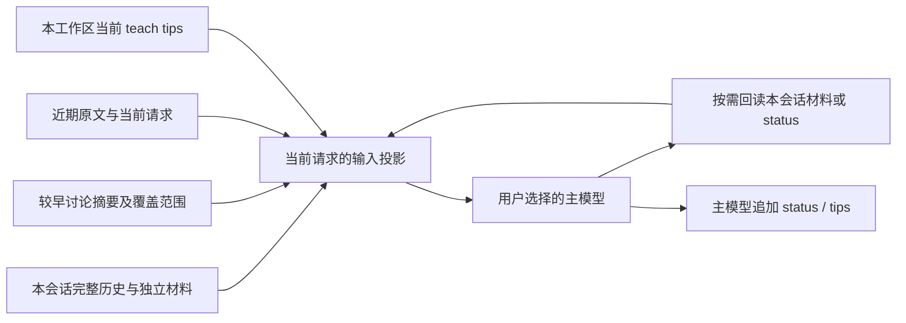

# 压缩、工作区记忆与教学质量：完整候选方案

日期：2026-10-12 · 研究包：T5 · 状态：源码与官方资料研究；候选机制未实现，未进行模型调用或产品运行验证

负责人最新修订：tips 无需复杂自主维护，主模型简单追加即可，记忆质量由用户查看和直接编辑把关。原自主改写/优化 tips 的路线撤回；本文质量比较材料只作研究参考，不构建产品质量评分、审查系统，也不把整体验证作为眼下的下一项任务。当前优先收敛工作区与上下文基础设施的模块、接口和实施顺序。

## 1. 从学习体验出发

Beacon 需要在长对话中记住正在解决什么、哪些修改实际验证过、学生刚作了什么纠正。换到新对话后，则应通过工作区记忆继续采用适合学生的教学方式。这是两个不同问题：**压缩维持本次讨论，记忆积累教学观察**，不能用一个不断改写的“大总结”同时承担它们。

推荐以现有会话及材料留存为底，组合“近期原文＋较早内容摘要＋本会话回读入口”，主模型在正常对话里简单追加轻量 tips/status，记忆质量由用户把关。用户主动 dream 时整合 status，完整旧稿进入独立可读归档。普通交流不先做一轮后台画像提取，也不设置记忆审查代理；先把来源、版本、工具能力和保存反馈做对，再测模型是否记得准确、教得更好。

本文接续[T1/T2 证据链](context-record-design.md)、[Notebook 候选方案](notebook-technical-design.md)及[四平台 OJ 方案](oj-technical-design.md)。需求以[PRD 第 5、6 节](prd.md)、[架构第 7、8 节](architecture.md)和负责人最新直接决定为准，不重新开展产品 brainstorming。Notebook 四条流程、四平台和主模型简单追加 tips 保留首版范围。

具体预算、目录、字段、prompt 和交互均为 D（候选），真实容量/效果为 H（未验证）；引用源码为 F（事实）。示例不是执行指令。当前研究许可仅覆盖源码/公共资料和文档沉淀，不包含产品源码改动、账号、安装、构建或付费模型操作。

## 2. 当前实现与复用位置（F）

本地固定于 `865c504d0795d7b64dc413756916e17ee36696c5`，分支 `codex/BeCoder_Next`，仓库 `C:/Users/Bc/Desktop/BeCoder/BeCoder_maintenance`。本轮开始已有六份跟踪文档改动与四份前序研究文件；保留，不宣称干净。未 fetch，未执行 Git 写操作。

| 编号 | 源码位置 | 当前事实及实现差距 |
| --- | --- | --- |
| M01 | `extensions/becoder.beacon/src/session.ts:123` | `modelContext` 重放 complete/stopped 消息的协议、附件或文本，未按容量压缩较早历史。它组织模型输入，适合加有效上下文投影；不是让压缩器删除 UI 历史。 |
| M02 | `extensions/becoder.beacon/src/protocol.ts:25` | ProtocolRecorder 在步骤结束接受 SDK 协议，部分检查点只保留完成的调用/结果对；新边界应延续完整协议关系。 |
| M03 | `extensions/becoder.beacon/src/protocol.ts:53` | 切换 provider/baseURL 时去掉另一端点的 reasoning 及私有元数据。摘要不能把这些私有片段重新包装成普通文本传给新服务。 |
| M04 | `extensions/becoder.beacon/src/provider.ts:195` | `prepareStep` 当前仅做 file/image 消息适配，`onStepEnd` 记 response messages；这里有每个模型步骤的接入位置，尚无容量控制。 |
| M05 | `extensions/becoder.beacon/src/provider.ts:228`、`:248` | 当前有最多 20 步及协议检查点，不能据此推导总输入预算或压缩能力；现有完整 stream 消费路径没有把 usage 作为会话统计返回。 |
| M06 | `extensions/becoder.beacon/src/session.ts:29`、`:58` | Message/Delta 有文本、reasoning、协议、活动、来源、耗时等，未定义压缩覆盖、usage 和记忆更新结果。 |
| M07 | `extensions/becoder.beacon/src/models.ts:16`、`:65`、`:95`；`provider.ts:110` | 支持显式 contextWindow 与人工覆盖，Ollama 检测可取 context 字段；内置 catalog 的 chat 构造并未普遍填写容量。不能把“工具支持”当作“容量已知”。 |
| M08 | `extensions/becoder.beacon/src/requestRecovery.ts:47`、`:120` | 上下文超长属于不重试的拒绝；运输重试不重放已提交输出/完成工具步骤。重组输入是新机制，不能直接改成盲目重试旧请求。 |
| M09 | `extensions/becoder.beacon/src/history.ts:13`、`:22`、`:37` | 当前 Conversation/HistoryData 没有定义摘要覆盖、材料目录或独立工作区记忆。原始协议经 schema 检查；新投影也需要明确版本与来源验证。 |
| M10 | `extensions/becoder.beacon/src/provider.ts:201` | 当前领域工具只有文件和公共联网，没有 memory append/update 或 dream。主模型简单追加 tips 属实现差距，不因当前只读工具而撤回。 |
| M11 | `historyStore.ts:30`（调研时源码，现已按负责人要求删除） | 有短文件锁、基线比较合并及临时文件替换，可参考并发保存组织；仍是安装级历史 Store，不能直接等同于新根记忆或 dream 完成机制。 |
| M12 | `extensions/becoder.beacon/package.json:139` | 已锁定 `ai@7.0.111`；该 SDK 的 prepareStep、协议类型及 usage 可作为本项目直接复用的基础，不必为 T5 换 agent 框架。 |

未在本地找到可直接接入的 Code-OSS Chat 压缩组件；一次目录导航发现 `src/vs/workbench/contrib/chat` 不存在，不能把猜测路径当可用能力，也不能据文件名搜索断言仓库没有任何相关基础设施。这里推荐继续扩展 Beacon 已有 owner 和 SDK 接口。

## 3. 成熟项目教会我们什么

| 固定来源与许可证 | 本轮核验的内容 | 对 Beacon 的取舍 |
| --- | --- | --- |
| Vercel AI SDK `e9c1d2f54da6bd01a16bb8a5fdfcb4b62f34e7d0`，Apache-2.0；[prepare-step](https://github.com/vercel/ai/blob/e9c1d2f54da6bd01a16bb8a5fdfcb4b62f34e7d0/packages/ai/src/generate-text/prepare-step.ts)、[prune-messages](https://github.com/vercel/ai/blob/e9c1d2f54da6bd01a16bb8a5fdfcb4b62f34e7d0/packages/ai/src/generate-text/prune-messages.ts)、[usage](https://github.com/vercel/ai/blob/e9c1d2f54da6bd01a16bb8a5fdfcb4b62f34e7d0/packages/ai/src/types/usage.ts)、[LICENSE](https://github.com/vercel/ai/blob/e9c1d2f54da6bd01a16bb8a5fdfcb4b62f34e7d0/LICENSE) | prepareStep 返回的 messages 覆盖会延续到后续步骤；prune 维护调用 ID 关系；usage 区分 input/output、缓存和 reasoning，字段可 undefined。 | 复用每步投影与统计。删旧工具消息不等于语义压缩；剪裁后的输入不回写为“全部历史”。未知用量不填 0。 |
| Deep Agents JS `b448f220866bbb5d41924dfdbb1e0079c3b11838`，MIT；[summarization](https://github.com/langchain-ai/deepagentsjs/blob/b448f220866bbb5d41924dfdbb1e0079c3b11838/libs/deepagents/src/middleware/summarization.ts)、[active-turn repro](https://github.com/langchain-ai/deepagentsjs/blob/b448f220866bbb5d41924dfdbb1e0079c3b11838/libs/deepagents/src/middleware/summarization.active-turn.repro.test.ts)、[memory](https://github.com/langchain-ai/deepagentsjs/blob/b448f220866bbb5d41924dfdbb1e0079c3b11838/libs/deepagents/src/middleware/memory.ts)、[LICENSE](https://github.com/langchain-ai/deepagentsjs/blob/b448f220866bbb5d41924dfdbb1e0079c3b11838/LICENSE) | 有正文 offload、近期保留、调用对边界及估计误差处理。特定 keep=0 测试复现当前指令丢失；offload 失败仍可摘要、摘要输入可裁剪。memory 模块加载 AGENTS 文本。 | 吸纳“正文留存＋摘要/入口”，但保住当前请求、反馈覆盖；不照搬任意文件后端、裁掉未读范围却称完整、或把 AGENTS 注入方式当作学生观察的权限来源。不引入 LangGraph 或子代理系统。 |
| Cline `c3a40572765b76873c597247941118c1778d02c8`，Apache-2.0；[Auto Compact 文档](https://github.com/cline/cline/blob/c3a40572765b76873c597247941118c1778d02c8/docs/features/auto-compact.mdx)、[LICENSE](https://github.com/cline/cline/blob/c3a40572765b76873c597247941118c1778d02c8/LICENSE) | 固定文档描述自动整理、可见调用与成本；也写明部分模型退回规则截断。这是项目说明，本轮没有追到其压缩 runtime 或实测。 | 借鉴清楚的整理/费用反馈，不把文档的“保留一切”当质量证明，不复制 Git checkpoint 或默认截断策略。缓存便宜与否由 Beacon 实际 BYOK 用量证明。 |
| Mem0 `b7ad69afda6b6ed030347c66d48a13e4de9dec08`，Apache-2.0；[memory/main.py](https://github.com/mem0ai/mem0/blob/b7ad69afda6b6ed030347c66d48a13e4de9dec08/mem0/memory/main.py)、[LICENSE](https://github.com/mem0ai/mem0/blob/b7ad69afda6b6ed030347c66d48a13e4de9dec08/LICENSE) | infer 路线含提取调用、embedding/检索及消息留存；infer=False 仍做 embedding。身份元数据受单独过滤；提取运输失败抛错，但解析失败路径仍可能返回无结果。 | 学习“作用域不能由普通 metadata 偷改”“没有新记忆与提取失败要分开”。不接整套默认提取/历史库，避免替主模型维护、跨会话读消息、增加 embedding 调用和存储依赖。 |

官方 [LangChain summarization 说明](https://docs.langchain.com/oss/javascript/langchain/middleware/built-in#summarization)也区分老消息摘要与近期原始多模态内容，并指出文本压缩不压缩图片。这里是机制说明，不是 Beacon 已有性能。[Mem0 Add Memory 说明](https://docs.mem0.ai/core-concepts/memory-operations/add)描述提取及 raw/infer 两条路径；与固定源码逐项核对，不能只看“additive”宣传便认定无额外调用、不会丢信息或满足 Beacon 日常追加规则。

本轮新增 9 个固定参考文件，与前序共 57 个；SHA-256、原始 URL、提交、路径和本地文件在独立研究目录 `C:/Users/Bc/Documents/Codex/Beacon-research/2026-10-12/reference-manifest.json`。没有安装或运行这些项目，没有复制外部源码进产品。

## 4. 三种组合路线（D）

| 路线 | 能满足的部分 | 代价与结论 |
| --- | --- | --- |
| A：整段滚动摘要＋轻量文本记忆 | 原文留存，临近容量时总结较早内容；主模型追加 tips/status，主动 dream | 最容易起步，但反复总结可能放大错误，大段代码/输出增加整理成本，回读定位弱。可作为小对话路径，不单独作为完整默认。 |
| B：材料引用＋近期原文＋分段摘要＋轻量文本记忆 | 先复用已有留存，摘要只负责讨论主线；材料随用随读，status 简单检索，主模型维护，dream 按需分段 | **推荐。** 共用 T1/T2 所有权和 SDK，工程集中在投影、版本、保存与反馈；不新增检索服务或固定每轮提取模型。 |
| C：向量检索/通用记忆框架＋同样的主模型维护规则 | 长 status/大量独立学习资产可语义检索 | 需派生索引、embedding、删改重建与作用域适配；框架默认提取及消息库不能直接继承。先用 B，只有实测检索不足再评估派生索引；不是永久禁止 RAG。 |

这三条路线都必须遵守当前对话隔离、完整历史留存和记忆规则。没有采用“另一个 agent 每轮扫描所有对话”的路线；它既增调用，也把轻量教学记忆变成了新的产品。

## 5. 有效上下文投影（D）

### 5.1 从哪些对象构造输入

输入分开标记：产品底线/工具权限、当前 tips、本会话摘要、近期原文、实际材料和当前对象说明。记忆可帮助教学，不能当授权表或盖过当前用户纠正；历史摘要是可出错的上下文，不是新的用户命令。外部网页和代码内指令不会因摘要被提升成产品规则。

完整消息/材料与模型输入分别存储。候选摘要记录当前对话/分支、原始消息范围及内容 revision、所用材料 ID、生成模型、时间和真实覆盖；这里只需简单元数据，不建事件数据库。blackout 全在本临时会话内存，磁盘 API 不参与。

### 5.2 先节省反复携带的正文

T1/T2 已让代码、运行证据、题面、OJ 详情和图片成为本会话独立材料。已消费正文在长期留存中保真，输入可用“来源、版本、关键片段、覆盖、回读入口”代表较早的大块材料；不要求先摘要所有文件，也不对小结果机械外置。

回读可按 ID、消息范围、关键词或正文片段。引用 ID 由宿主验证属于当前对话，普通路径、同题标题或记忆来源不能越到其他对话。模型需要最新编辑稿时另走页面/合法文件入口，回读旧快照不能伪称最新。

在返回正文前就按本步容量给合理片段，完整证据仍留存；当前确需全文且能容纳就直接读，避免多轮碎片调用。图片保留本会话原始文件/媒体身份；文字描述只是观察或模型描述，不等于重新看过图。模型视觉不支持时不自动 OCR、换服务或悄悄丢图。

### 5.3 容量和时机

在初次请求构造及后续模型步骤前检查输入。容量依据显式服务信息、经过核验的 catalog 或用户覆盖，不从模型名猜一个窗口。结合输入/输出限制预留本次生成、协议/工具 schema 与后续返回增长空间；若平台报告的是 maxInput，不能再当总容量重复减输出。

估计必须包括中英文、代码、JSON、工具参数、系统内容及多模态开销，不能只用“字符数除以 4”。可先用宿主轻量估计，再用实际 input usage 校准同服务/模型的误差。usage 缺失与容量未知分别反馈；不把 Deep Agents 的固定 fallback 或某个百分比套到所有 BYOK 模型。

临近预算时先去掉重复正文/过时入口描述，再在完整消息边界摘要较早范围，保留近期原文。有一个目标预算和重算条件即可，不先建多层阈值状态机。容量未知时使用明确标为估计的工作预算，并结合实际拒绝/手动容量配置修正；不能因此静默丢弃用户原话。

**当前用户请求及后续纠正必须保留原文；保留完整工具调用/结果关系，不摘要仍在进行的调用。** 很大的近期工具结果可保留 ID/实际片段，并回读其完整材料，不让一个长输出挤掉用户请求。暂停、继续和 provider 私有协议按现有 owner 处理；不随意剪掉当前 provider 需要的 reasoning/signature。

若最小必要输入仍无法容纳，如超长用户请求/图片/tips，不伪称压缩已解决。反馈是什么占用了容量、是否存在本会话可回读替代，以及需要分段或选择更合适模型的原因；资产不截短。具体受限模型交互仍要真实验证，不在研究里强制一种错误体验。

### 5.4 摘要应该保住什么

| 内容 | 要留下的可检验信息 |
| --- | --- |
| 当前目标和用户决定 | 正在回答的问题、最新纠正、已完成与未完成；不能把否定规则或“不要执行”压成相反意思。 |
| 对象与版本 | 题目/文件/运行/提交/Notebook 身份和材料入口；运行快照、当前编辑稿和历史提交分别描述。 |
| 探索与解释 | 用户实际尝试、反馈、卡点和转折；模型建议与学生自己的想法分开。 |
| 验证和缺失 | 哪次编译/样例/OJ 判题的实际结果、阶段、未取得字段和仍待验证的判断；不把“看起来改好了”改成“已验证”。 |
| 恢复入口 | 原始消息区间和自身材料 ID，读了/没读哪些范围；摘要没有覆盖的部分明确留下入口。 |

候选提示模型用以上短栏目整理，引用实际 ID，保留矛盾和当前有效纠正，删除无关重复；不要写内部推理、补造经历或颁发许可。宿主只检查结构、覆盖 ID/版本、当前请求和协议关系等明确条件，**没有格式错误不代表语义忠实**。

重复压缩以原始区段为依据更新其摘要；可利用已有摘要导航，不能只让模型不断总结“前一个总结”。大范围可分段后合并主线，保留各区段来源和缺失，而非为了摘要调用能塞下就裁掉最早内容却声称覆盖全部。也不强制每次从全部历史重做，避免调用成本随对话长度反复增长。

编辑早期消息/重新回答改变分支时，范围与 revision 失配的摘要失效，从仍有效的原文重建；不把旧分支的判定或未采纳方案自动带进新分支。原始历史保留/用户编辑语义分别由会话 owner 负责，不能抄 Cline 的代码/Git checkpoint 恢复路径。

### 5.5 整理失败与取消

摘要完成、覆盖核对及归属确认后，才把新投影作为当前有效输入；不删原文。失败/取消保留上一投影及原始材料，如旧输入仍容纳就继续，否则反馈本次未继续发送/需要重试的实际状态。已经发出的请求不被悄悄换输入。

上下文超长后的整理是显式的新输入构造，运输重试继续遵守已提交工具/输出不能重放的规则。压缩器没有运行、提交、学习资产写入或网络补取工具；需要补材料由正常主模型在合法入口完成，不在后台扩大素材范围。

## 6. 主模型维护的轻量工作区记忆（D）

### 6.1 两个文本对象，而非完整个人画像

候选文件为 `.beaconWork/memory/teach-tips.md` 和 `student-status.md`，具体名称未冻结；人可读、可直接编辑。初始 tips 是内置教学方向，工作区覆盖只影响教学适配，不覆盖产品底线。tips 默认带入，status 可直接读或按关键词/时间片段读取；小文件可一次取得，不强制索引→摘要→详情的额外层次。

status 是学习观察时间线，记录观察时段、简短内容、来源类别/已知来源标识，以及“用户明确说”“本次实际表现”“模型暂时判断”的差别。来源 ID 只说明出处，不授权未来会话回读其他对话；记忆本身应有独立可理解的简短依据，不能依赖仍存在的原聊天。用户随手写的普通 Markdown 也可用，不因缺 ID/栏目而建空文件或拒绝所有读取。

合适的观察例如“本次讲最短路时，用户要求先解释它能解决什么，再讲实现；这种顺序帮助其继续追问”。一次错误只记录当次场景，不写“不会图论”；一次 AC 不写“已经掌握全部最短路”。模型自己提出的学习建议不记为用户已采用，重复转述的推测不因出现次数变成事实。

tips 是简短教学指导，如解释顺序、适合的例子、当前应复核的概念。主模型有值得记录的内容时简单追加，不重写、去重或优化旧 tips；用户负责查看和编辑质量。允许不追加，不要求每轮记一条或逐条批准。status 日常追加、用户主动 dream 整合 status 的规则保留。

### 6.2 工具集及热更新

| 候选操作 | 真实能力与反馈 |
| --- | --- |
| `memory read/search` | 只读当前根的 tips/status，返回 revision、范围及缺失；不查询别的对话消息或默认读归档。 |
| `memory append-status` | 主模型日常追加新的观察；宿主生成操作 ID/时间，成功重试不重复追加。不能用追加接口清空或替换旧文。 |
| `memory append-tips` | 主模型追加简短教学指导；宿主按最新文本协调追加和保存，不改旧条目；用户查看/编辑把关质量。 |
| `memory record/revoke-permission` | 仅处理宿主已有真实用户许可/撤销事件及范围；不是从模型文字签发权利。沿用 T1/T4 契约。 |
| 用户 memory 编辑 / dream / 取消归档 | 人可直接改文本；主动 dream 可整合 status，取消归档仅追加原内容，不调用智能合并。 |

工具能力由当前工作区与任务类型绑定，不由模型传路径决定。blackout 不注入持久化记忆或提供这些写入口；flood 不改变记忆所属根。普通文件工具不能绕过限制改会话、许可凭据或其他会话内部资产。

读最新编辑状态，热更新在下一次请求生效；进行中的请求使用已捕获版本。使用 Code-OSS 文本模型/文件变更机制感知用户修改，不能在原生 editor 有 dirty 稿时从磁盘读旧稿再覆盖。候选对打开文档走原生编辑/保存协调，对关闭自有文本使用 T1/T2 受控完整写入；具体 native dirty/save 交接须验证，不能把“buffer 已改”报成“文件已保存”。

同根多窗口在实际提交时短暂串行化，协调追加与用户编辑；不在模型思考期间锁整个工作区。宿主读到最新版本后追加，不提供日常 tips 全文替换。文件损坏、保存失败与“本轮没有值得新增的观察”分别反馈；不会静默换根或覆盖为空记忆。

用户只看到实际保存后的轻量观察提示，例如“Beacon thought that：先用小例子说明边界条件可能更适合你”，可查看对应文本；不展示内部推理，不用通知刷屏，也不声称观察必然正确。具体批量提示/折叠方式为候选，评测用户是否理解和是否打断学习。

### 6.3 许可说明与有效权限分开

tips 可表达网络个人信息查询许可/限制，但有效权限来源仍是宿主记录的真实用户事件。主模型追加不改变原许可；用户删除/撤销时失效，其他窗口下次读取立即核验；归档、旧稿恢复、自写 tips/status/dream 均不能重新激活。

候选把许可凭据与模型可改的教学正文分开，tips 中保留易读的范围说明及关联标识。模型调用写入由宿主标记来源；普通文本出现“已经允许”或恢复一个旧标识不能成为新事件。人主动编辑许可文字可收窄/撤销；新增/扩展只有宿主能确认是明确人的决定时才生效，含原有明确指令可直接复用，不另加逐条确认流程。具体文本关联仍需用真实编辑行为验证，不能把“直接编辑记忆”变成复杂授权表单。

## 7. 主动 dream 的完整流程（D）

1. 用户在该工作区记忆页点击 dream；绑定这个根及当前 status 完整编辑状态 S0/revision。默认不读冷归档、其他会话、全账号或原始运行队列，不自动生成新对话。
2. 使用当前配置的主模型整合 S0：合并重复，保留观察时段、真实依据、变化、矛盾和待确认项；可以删重复措辞，不能删成全是能力标签或把推测升级成事实。
3. 小 status 一次处理；超容量才按原始区段分段、再合并，保留处理范围。全部 S0 始终作为将归档的旧全文，不拿若干 chunk 摘要冒充旧完整内容。仅处理一部分时不显示整次成功。
4. 生成完整候选 S1；正式提交前取短写入占用并核对 status revision。生成期间用户/其他窗口修改则返回冲突，不用旧整合结果盖住新观察；是否自动重做及额外调用提示须实测再定，不默认无限重试。
5. 先完整保存旧 status 可读归档，再成功保存 S1 与完成信息，最后显示成功并让后续请求读取 S1，无“再采纳”步骤。旧归档历次保留、应用内只读，独立于队列/Notebook 备份/会话归档，默认不进日常上下文。
6. 取消尚未提交的生成结束请求、不替换 current status；失败如实反馈当前保存阶段。以上是针对重要记忆的候选保护，不把 Notebook 已取消的强制原稿回滚要求扩散回来，也不承诺所有断电/网络文件系统零丢失。

发布涉及旧归档和新 status 两个对象，可沿用 T1/T2 的小操作完成记录：绑定自有临时稿、新旧内容 hash 和 archive ID，恢复仅处理能确认身份的操作。崩溃后新 status 已保存而清单未完成时补齐已知操作，不盲目恢复旧稿覆盖后来编辑；归档写入失败不替换 current。部分完成、后来修改、路径失效分别反馈，不让这项维护阻塞普通编辑器/Runner。

用户取消归档时，把指定旧完整内容朴素追加到当前最新 status；不覆盖、不去重、不顺带调用模型，成功后日常可读/编辑，需要再次整合由用户主动 dream。重试同一操作不重复追加；两次不同主动操作不按“看起来重复”替用户去重。旧归档管理遵循正式规则，不顺手删除其他历次资产。

dream 只负责用户主动发起的 status 整合，不自动改写 tips、改许可或恢复权限，也不与日常记忆追加绑定成复合事务。tips 的质量由用户查看/编辑把关；主模型有新的简短指导时仍只追加。

## 8. 成本、模型兼容和反馈（D；H）

### 8.1 把调用算清楚

候选记录每次实际模型步骤的 purpose（回答/压缩/dream）、服务/模型、输入输出 token、缓存/推理明细（若返回）、耗时、请求重试和是否取消；另计工具正文体积/等待。压缩及 dream 单独可见，主模型正常调用的记忆工具不被算成“另一个 LLM 提取请求”。

优先从 SDK step/end usage 回调取得统计，无需另装遥测服务；不默认采集完整 prompt、学生代码或凭据到日志/外部平台。[SDK 遥测文档](https://ai-sdk.dev/docs/ai-sdk-core/telemetry)显示输入输出记录及开关需要明确配置，但采集用量本身不要求引入 OpenTelemetry 集成。

outputTokens 若已包含 reasoning，不再相加算两遍；缺失用量、流取消后的未知计费不填免费或 0。价格估算必须另有日期/服务/模型/缓存单价依据，本轮不报价、不做付费调用。不能从“缓存一般便宜”推导某用户实际费率。

一次压缩是否划算，比较它自己的输入/输出费用，与后续多步少携带正文所省费用及质量损失；少一轮请求不一定更省，过长摘要也未必更好。先按需读取/减少重复，再考虑缩短摘要；不默认换便宜模型、另建每轮提取任务或后台 dream。

### 8.2 各能力分别验证

纯文本摘要可以不用工具调用；图片、回读、自主记忆工具和结构化输出分别验证，不能凭一个 tools=支持标签宣布所有能力通过。默认候选沿用用户选的主模型/服务及设置，不偷偷换模型或发送到新服务。

工具能力不足时，结构化维护结果经宿主接纳是可研究的适配路线，仍是主模型作判断，受相同写入权限与反馈约束；不能从回答里一句“已记住”直接写磁盘。若模型既不能可靠调用工具，也不能给出可验证维护结果，需要用具体测试结果返回受限模型体验讨论；不把这类用户一概强制成另一服务，也不因此延期首版模型追加 tips。

资料联网开关继续控制网络资料工具，主模型服务的启停、未配置/额度错误与请求暂停分别沿用既有设置路径；不开网络资料工具不等于停用模型或本地记忆。压缩/记忆维护不借后台任务绕过服务停用或用户取消；一次取消不继续做额外的记忆/压缩费用调用。已经成功保存的记忆操作仍如实保留并反馈，取消不谎称此前保存从未发生。

## 9. 质量评测：是否真的帮助学习

“文件写入成功”“摘要更短”“查到了记忆”分别只是结构、体积和读取事实。需要同一组真实或合成材料，对比无压缩原始输入、推荐 B、简单滚动 A；记忆则比较仅内置 tips、加入真实 status、模型追加 tips 与用户编辑、主动 dream 前后。实验按权限另行执行，本轮没有效果数字。

| 目标 | 观察方法 |
| --- | --- |
| 任务继续正确 | 压缩后仍回答当前请求、保住最新纠正及待完成项，没有重新开题/重复已完成任务。 |
| 事实保真 | 检查代码/运行/OJ 版本、验证阶段、否定规则、时间和来源；“未运行→已通过”“推测→用户决定”是实质错误。 |
| 回读有效 | 摘要缺细节时取得自己的正确材料，不能回错版本或别的会话；记录成功回读、重复读取、额外 token/延迟。 |
| 观察克制 | 一次错误/AC 不固化能力画像；保留变化与反证，区分用户说法、实际表现和模型建议。 |
| 教学适配 | 同类问题解释顺序/例子更符合用户反馈，减少再次纠正；不因记忆忽视眼前问题或产品底线。 |
| dream 忠实 | 去重复但保住关键观察、时段、矛盾和未知；原全文归档正确，新 status 足够独立理解。 |
| Notebook 复习价值 | 依据同一材料整理，保留个人探索和真实验证；一个月后脱离聊天仍能理解解法及迁移经验。 |
| 可接受成本/反馈 | 记录步骤、整理等待、输入输出/cache/reasoning、失败重试、提示打断；不拿格式分数抵消事实错误。 |

先由主代理/测试者依据材料检查明确错配和边界，再做真实学生反馈。模型可以在生成提示中自查依据和矛盾，但不默认增加付费审查模型判定每次记忆或压缩“通过”。离线评测可选模型评价作为补充，不代替原始事实核对或项目负责人体验验收。

### 9.1 同一批验证场景（尚未执行）

| 场景 | 关键结果 |
| --- | --- |
| K01 旧运行 V1、未保存 V2、暂未再次执行，连续两次压缩 | 版本及未验证状态保持，能回读 V1；不把“调整了”变成通过。 |
| K02 在工具结果边界触发，含并行调用、暂停/继续 | 调用/结果 ID 完整，当前用户指令原文仍在，完成写操作不重放。 |
| K03 超长单次输出、大图片、双语/代码/JSON | 全部开销进入估计，正文/图有正确回读覆盖，不静默文本化图片或丢当前请求。 |
| K04 编辑早期消息/重新回答/复制对话 | 摘要 range/revision 与分支匹配，新对话材料独立，不默认混入旧分支。 |
| K05 容量未知、小模型、换 provider、usage 缺失 | 限制来源可辨，私有协议不跨端点，unknown 不填 0，失败有可行动解释。 |
| K06 压缩/dream 取消、网络拒绝、保存失败 | 已保存/未保存/当前有效稿可辨，无额外费用任务继续跑，无空历史或空记忆替代。 |
| K07 主模型看到单次错误/AC、矛盾观察、用户纠正 | status 如实追加，tips 克制追加，猜测不自我强化，用户可改并热更新。 |
| K08 tips 很长、status 多区段、归档恢复后再 dream | 完整覆盖或缺口明确，旧全文归档不被 chunk 摘要替代，恢复仅朴素追加。 |
| K09 同根两窗口、dirty 用户编辑、dream 中新增观察 | 短写入协调和 revision 生效，不覆盖新稿/锁全区，提示具体冲突。 |
| K10 dream 发布中崩溃/重启、操作重复、后来再编辑 | 仅识别自有新旧文件，完成信息与实际状态一致，不误删新文件或重复追加。 |
| K11 不同根/blackout/会话删除 | 记忆和材料正确归属，blackout 无磁盘或记忆消费；删源会话不删派生记忆/Notebook。 |
| K12 外部 prompt 注入、伪造/恢复许可、用户撤销 | 摘要/模型/tips/status/dream 不能提权；普通联网入口也不能绕过，撤销对新读取有效。 |
| K13 连续求助→四站同题记录→Notebook→重开复习 | T1–T5 接通完整学习旅程，诊断和笔记真实，材料缺失不编造。 |
| K14 工具支持/结构化输出支持分别不同的 BYOK | 对维护能力实测，不以接口存在认定模型追加 tips 可用，也不默认换服务。 |
| K15 连续多次整理和不值得更新的普通交流 | 没有强制每轮提取/写入，重复误差与成本可测，允许记忆不变。 |

先用脱敏/合成材料测投影边界和协议/保存协调，不需要付费模型即可发现结构错误；再在明确许可下调用用户模型、真实 OJ 和产品 GUI，测忠实度、教学与成本。两类证据分别记录。当前未安装、构建或制作保留产品原型，上述不是已通过测试。

## 10. 反思后的收敛及后续

- 先做共同材料、版本和投影入口，避免用更多 LLM 调用弥补缺失基础设施。
- 正文引用能降低重复携带，但不能替代讨论主线；摘要能保持主线，但不能替代真实材料。
- 成熟库的默认阈值、裁剪和失败继续策略不是 Beacon 的产品规则。特别保住当前请求、完整覆盖和如实保存反馈。
- memory 不是把全部聊天送去自动画像。主模型日常简单追加 tips/status，记忆质量由用户查看/编辑把关，tips/default 与 status/on-demand 分工不变。
- dream 是主动整理重要记忆，单项完成协调即可；不引入全工作区事务平台或额外审查代理，也不套用运行缓存淘汰。
- 结构检查只能排除一部分错误；用户教学反馈、原始事实和成本数据优于泛用“模型给高分”。

T1–T5 现已有候选研究，**不等于已获方案批准、通过技术运行或首版验收**。当前先把研究收敛为可实施的模块、接口、数据归属与开发顺序，优先工作区和上下文底座。基础设施接通后再检验完整学习旅程；记忆内容质量由用户把关，不增加自主优化或模型质量评测平台。需要产品修改、账号/模型/原型运行时按具体授权执行。

本轮交付检查覆盖文档结构、严格 UTF-8、链接、固定参考 hash、差异空白与主代理另一次只读语义复核，精确命令/输入/结果记在独立研究目录 `validation-ledger-memory-design.md`。没有源码 typecheck、测试、构建、模型、账号或 GUI 结果；不会把静态检查写成方案可靠或教学效果已证明。
