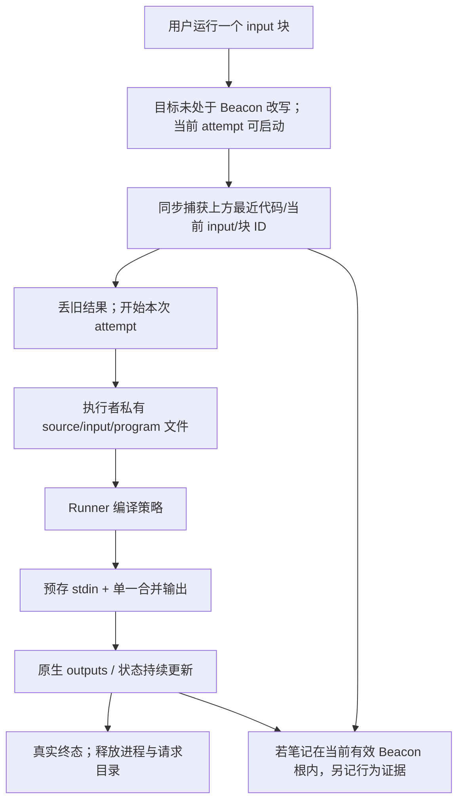

# BeCoder NoteBook：原生能力复用与完整候选技术方案

日期：2026-10-12 · 研究包：T3 · 状态：只读源码研究与候选设计，尚未实现或运行验证

2026-10-14 更新：现行方案采用独立 `becoder-input` 原生单元格；运行上方最近 C/C++，结果与分阶段时间归 input，程序输出为单一 ANSI 流。图片仅保留原生附件粘贴与渲染。已替换正文中被撤回的内嵌 inputs/自建输入区路线，固定源码证据仍保留其研究时点。实际实施与验收状态见[当前实现状态](implementation-status.md)。

需求依据为[Notebook 正式设计](notebook.md)、[PRD](prd.md)及负责人最新直接决定；上下文衔接见[证据链候选](context-record-design.md)。**P** 是已确认产品规则，**N** 是固定源码事实，**D** 是工程候选，**H** 是未验证假设。本文不重新启动产品 brainstorming，也不将技术选型写成已完成的功能。

## 1. 先说推荐方案为什么适合产品

Notebook 要让学生在一份文档中自由记录思路、图片、公式、代码、多组 input 和真实结果，离开 Beacon 仍可编辑、保存、主动运行。Beacon 整理把当前会话及合法材料沉淀成可复习的笔记，不把文档变成聊天报告或源码同步副本。

推荐 **Code-OSS 原生 Notebook 编辑器 + 轻量 `.bcnb` JSON 格式 + BeCoder GCC controller + 原生独立 input 单元格**。原生编辑器负责块、编辑、调序、代码折叠、输出、工作副本与普通保存；BeCoder 补自身数据字段、单块编译运行、源码路径关联和 Beacon 整理入口。controller 是接口名称，负责接收用户运行请求并产生结果，不意味着引入 Python kernel、Jupyter 服务或共享变量状态。

这能把工程投入放在产品差距上：多组 input 与代码/结果绑定、单文件图片、完整备份和按需材料。普通文件保存、键盘、主题、撤销等优先沿用原生机制，不自己再造一个编辑平台。

**本轮最新 P：改写失败无需强制保住或恢复原稿，借鉴原生能力即可。** 所以保留“改写前最新完整备份、运行交接、成功直接生效”的规则，撤回额外事务提交/失败回滚方案。原生处理有局限就如实反馈，不把资产重要性等同于必须自建零丢失保存系统。

Agent 侧采用既定工程方向：先把文档、运行事实和受控读取基础设施做对；prompt 告诉模型如何形成忠实、可复习的内容；工具只执行已确认权限与字段所有权；返回可修正的错误和实际保存反馈，不再安排一个审查模型或逐步批准。

## 2. 固定基线与当前调用链（N）

仓库 `C:/Users/Bc/Desktop/BeCoder/BeCoder_maintenance`，分支 `codex/BeCoder_Next`，HEAD `865c504d0795d7b64dc413756916e17ee36696c5`。本轮开始已有六份正式/议程文档修改和两份前期研究文档，均保留。针对 `src`、`extensions`、`build` 中的 TypeScript 与扩展 manifests 检索，未找到现有 `.bcnb`/`becoderNotebook` 实现；这只说明该检索范围没有入口，不用需求文档证明源码已存在。

```mermaid
flowchart LR
    FILE[现有 ipynb 文件] --> SER[ipynb serializer]
    SER --> MODEL[NotebookData / NotebookTextModel]
    MODEL --> EDIT[原生块编辑器与工作副本]
    EDIT --> SAVE[原生 save / Save As]
    MD[Markdown / 内嵌附件 / KaTeX 扩展] --> EDIT
    CTRL[NotebookController API] --> OUT[执行状态 / outputs]
    OUT --> MODEL
    GCC[Runner 编译策略 / 输入 helper] -. 尚无 Notebook adapter .-> CTRL
    BEACON[现有 Beacon] -. 尚无 .bcnb 读写与整理桥 .-> MODEL
```

| 证据 | 固定本仓库路径与定位 | 已有能力及实际缺口 |
| --- | --- | --- |
| N01 | [API 定义](../../src/vscode-dts/vscode.d.ts)，14154、14192、15741–15794 行 | 自定义 Notebook 类型、serializer、NotebookData/metadata/outputs 均存在；没有 BeCoder 格式注册。 |
| N02 | [ipynbMain.ts](../../extensions/ipynb/src/ipynbMain.ts)，`activate`；[package.json](../../extensions/ipynb/package.json)，`contributes.notebooks` | `transientOutputs:false`，附件/id 等 metadata 留存，支持新建未命名笔记。注册与粘贴逻辑绑定 `jupyter-notebook`，不能直接期待它服务 `.bcnb`。 |
| N03 | [ipynb serializer](../../extensions/ipynb/src/notebookSerializer.ts)，`deserializeNotebook`、`serializeNotebook`；[serializers](../../extensions/ipynb/src/serializers.ts) | bytes 与内存 cell/outputs 相互转换，有稳定字段排序等经验；带 Jupyter 历史字段、语言及格式约定，不宜原样改后缀即称 BeCoder 设计。 |
| N04 | [工作副本模型](../../src/vs/workbench/contrib/notebook/common/notebookEditorModel.ts)，184–264 行；[模型快照](../../src/vs/workbench/contrib/notebook/common/model/notebookTextModel.ts)，475–513 行 | 未保存文字、metadata、outputs 能组成快照，非 transient 修改影响 dirty；Backup context 遇输出大小限制会抛错。自动恢复备份不是产品同目录完整 `.bcnb-backup`。 |
| N05 | [扩展宿主保存](../../src/vs/workbench/api/common/extHostNotebook.ts)，316–392 行；[工作副本保存](../../src/vs/workbench/services/workingCopy/common/storedFileWorkingCopy.ts)，1034–1130 行 | 核对版本、写入条件，成功仅在版本匹配时清 dirty，失败保留 dirty/错误状态；代码明确考虑磁盘部分写入，不提供本产品先前设想的强制恢复 R0 保证。 |
| N06 | [编辑器 input](../../src/vs/workbench/contrib/notebook/common/notebookEditorInput.ts)，130–169、330 行；[编辑器](../../src/vs/workbench/contrib/notebook/browser/notebookEditor.ts)，133、270、378 行 | readOnly capability 变化会传到 widget；稳定公开 API 中未见临时设整个 Notebook 只读的方法。需要窄的 BeCoder 工作台接点，不能只写 cell metadata `editable:false` 当完整保护。 |
| N07 | [代码 cell renderer](../../src/vs/workbench/contrib/notebook/browser/view/renderers/cellRenderer.ts)，282–304 行；[cell options](../../src/vs/workbench/contrib/notebook/browser/viewModel/cellEditorOptions.ts)，14–35 行；[widget](../../src/vs/workbench/contrib/notebook/browser/notebookEditorWidget.ts)，`getDefaultNotebookCreationOptions` | 原生 CodeEditorWidget、编辑贡献和 `folding:true` 可复用；运行应读取整个 cell 模型，不取显示/展开部分。不是已验证 C/C++ Notebook 语言服务完整可用的证明。 |
| N08 | [图片粘贴](../../extensions/ipynb/src/notebookImagePaste.ts)，`createInsertImageAttachmentEdit`；[attachment renderer](../../extensions/ipynb/notebook-src/cellAttachmentRenderer.ts) | 图片 bytes 以 cell metadata 附件保存，Markdown 用 `attachment:`，renderer 转 data URL。selector 为 Jupyter 类型，需扩展/抽取适配；不应沿链接自动读邻接图片。 |
| N09 | [serializer options 转换](../../src/vs/workbench/api/common/extHostTypeConverters.ts)，1743–1751 行；[附件清理](../../extensions/ipynb/src/notebookAttachmentCleaner.ts) | 现有 `cellContentMetadata` 可声明附件变化，ipynb 使用本地 `diffContentOptions` proposal；附件 cleaner 是另一个异步行为，不能顺手搬来主动删学生图片。 |
| N10 | [Markdown renderer](../../extensions/markdown-language-features/notebook/index.ts)，`renderOutputItem`、`extendMarkdownIt`；[KaTeX](../../extensions/markdown-math/notebook/katex.ts) | Markdown、渲染扩展、公式/CSS/字体路径已有。是否正确应用于新类型、图片 metadata 更新及发行资源需实际验证。 |
| N11 | [执行 API](../../src/vscode-dts/vscode.d.ts)，15822–16039 行；[执行服务](../../src/vs/workbench/contrib/notebook/browser/services/notebookExecutionServiceImpl.ts)，35–102 行 | 用户执行入口、controller 选择、workspace trust、取消和输出接口已存在；不是 Jupyter 服务依赖。默认通用交互仍需要适配成 BeCoder 的单块 GCC 体验。 |
| N12 | [执行状态更新](../../src/vs/workbench/contrib/notebook/browser/services/notebookExecutionStateServiceImpl.ts)，`_applyExecutionEdits`、546 行 | 执行输出/状态通过不计算 undo 的编辑写入。可借鉴保持单次最近结果，而不是借运行建立结果回退队列。 |
| N13 | [Runner exports](../../extensions/danielpinto8zz6.c-cpp-compile-run/src/extension.ts)，18–45 行；[compilation.ts](../../extensions/danielpinto8zz6.c-cpp-compile-run/src/compilation.ts) | CPH 已复用编译计划：GCC、flags、标准、PCH/debugger 与私有环境。API 尚不接收 Notebook cell 文本，Runner executor 有自己的终端/程序发布行为，不能整条直接调用。 |
| N14 | [CPH executor](../../extensions/becoder.cph/src/execution.ts)，50–175、181–233 行；[Runner input helper](../../extensions/danielpinto8zz6.c-cpp-compile-run/native/runnerInput.cpp)，60–125 行 | 私有 binary、预存 stdin、分离 stdout/stderr、Windows Job 及取消可复用；CPH 的样例循环/checker/时限/输出超限停止属于评测策略，不是 Notebook 普通单块运行默认。 |
| N15 | [model 同步](../../extensions/ipynb/src/notebookModelStoreSync.ts)，`pendingNotebookCellModelUpdates`、`waitForPendingModelUpdates` | 有等待异步 metadata 同步的成熟例子；说明“屏幕上已改”不自动证明 serializer 已获得最新字段，input/图片必须纳入捕获与保存路径。 |
| N16 | [构建入口](../../build/gulpfile.extensions.ts)，66–75 行；[发行筛选](../../build/lib/extensions.ts)，33–45、455、640–648 行；[包校验器](../../build/azure-pipelines/win32/verify-becoder-package.ps1) | Notebook/Markdown/公式相关构建路线存在，当前 OI exclusion 未排除这些扩展。只是源码/构建配置证据，没有运行本次 build 或确认发布包实际内容。 |

## 3. 成熟项目经验与版本/许可证

| 来源 | 已读取的固定文件与机制 | 取舍 |
| --- | --- | --- |
| 本仓库 Code-OSS、ipynb、Markdown 与 Notebook 模块；上述固定 HEAD，相关源文件保留 MIT 头 | 原生模型/serializer、工作副本、cell 事务、附件与 renderer、execution controller | 是首选复用主体，不重新造保存和编辑器。BeCoder 新模块/复制源码仍遵循仓库及来源许可证。 |
| Microsoft vscode-extension-samples，`65c1c44800eeac6fb065a54823ee5ae62c79540a`，MIT；[controller.ts](https://github.com/microsoft/vscode-extension-samples/blob/65c1c44800eeac6fb065a54823ee5ae62c79540a/notebook-serializer-sample/src/controller.ts)、[serializer.ts](https://github.com/microsoft/vscode-extension-samples/blob/65c1c44800eeac6fb065a54823ee5ae62c79540a/notebook-serializer-sample/src/serializer.ts)、[extension.ts](https://github.com/microsoft/vscode-extension-samples/blob/65c1c44800eeac6fb065a54823ee5ae62c79540a/notebook-serializer-sample/src/extension.ts)、[LICENSE](https://github.com/microsoft/vscode-extension-samples/blob/65c1c44800eeac6fb065a54823ee5ae62c79540a/LICENSE) | controller 在本进程处理 JSON 并产生输出，说明接口不要求语言服务器/kernel 服务；样例刻意 `transientOutputs:true`、不保存输出，解析错误还退空文档 | 借 API 骨架，不把教学 sample 当完整可靠格式；Beacon 不能照搬其丢 outputs/空文档行为。 |
| Jupyter nbformat，`4346f97c9d435f41ddfe76d28758b23796fdcf5a`，BSD-3-Clause；[format description](https://github.com/jupyter/nbformat/blob/4346f97c9d435f41ddfe76d28758b23796fdcf5a/docs/format_description.rst)、[v4.5 schema](https://github.com/jupyter/nbformat/blob/4346f97c9d435f41ddfe76d28758b23796fdcf5a/nbformat/v4/nbformat.v4.5.schema.json)、[convert.py](https://github.com/jupyter/nbformat/blob/4346f97c9d435f41ddfe76d28758b23796fdcf5a/nbformat/v4/convert.py)、[LICENSE](https://github.com/jupyter/nbformat/blob/4346f97c9d435f41ddfe76d28758b23796fdcf5a/LICENSE) | 版本化 JSON、cell ID、Markdown 附件及区分 source/outputs；转换会处理/丢弃部分字段，不能当无损兜底 | 借“单文档包含内容、附件与结果”的机制，不安装 Python 包或继承 kernel/execution_count 语义。 |

[官方 Notebook 指南](https://code.visualstudio.com/api/extension-guides/notebook)说明 serializer/controller/renderer 三者分工；实际接口以本地 d.ts 和源码为准。[nbformat 官方格式说明](https://nbformat.readthedocs.io/en/latest/format_description.html)作为格式导航，具体研究引用固定源码。固定外部文件、许可证与 SHA-256 位于独立研究目录 `C:/Users/Bc/Documents/Codex/Beacon-research/2026-10-12/reference-manifest.json`。未复制外部代码到产品、未安装依赖。

## 4. 三条可行路线（D）

| 路线 | 满足产品的方式 | 代价/主要风险 | 推荐判断 |
| --- | --- | --- | --- |
| A：原生 Notebook + 轻量自有 JSON `.bcnb` | 用现有模型/编辑/输出，明确独立 input、各自最近结果和附件图片，GCC controller 独立执行 | 补 serializer、input 语言/执行适配、临时只读及领域工具；必须验证 metadata/图片/输出往返不丢 | **推荐。** 复用最多，业务语义直接，不引入服务器或通用 kernel 配置。 |
| B：原生 Notebook + nbformat 内容，后缀 `.bcnb` | 复用更多 ipynb serializer/附件转换，用扩展 metadata 放 BeCoder input/结果 | Jupyter 字段、扩展元数据保留、其他程序读写兼容都要管理；换后缀不自然获得互操作，也不省 input/保护接点 | 可以做，当前没有 `.ipynb` 互通需求，额外语义收益有限。 |
| C：CustomEditor/Webview + 自有文档模型 | UI 完全自定义，input/输出可直接安排 | 重新解决文档 dirty、save/backup、撤销、Monaco 嵌入、焦点/键盘、主题和大文档性能；通常仍需不少宿主桥 | 若实测原生无法承载关键体验才考虑；不能因为两处扩展差距就重建编辑器。 |

普通技术选择不需要逐字段批准。选 A 不代表首版减掉图片、公式、代码折叠、多组 input 或任何一条完整流程；本轮只是以源码证据说明 A 值得先验证。

## 5. 单文件格式与原生模型映射（D）

### 5.1 格式只表达当前产品需要

候选根对象为 `format:'becoder-notebook'、version:1、cells、metadata`。格式字段是技术候选，不是正式产品冻结。文件是普通 UTF-8 JSON，无外部图片目录、数据库、zip 解压流程或共享内容池；`.bcnb-backup` 使用相同内容格式和编辑器。

| 文件对象 | 主要内容 | 原生映射 |
| --- | --- | --- |
| 文本块 | 稳定 cell ID、Markdown 源文、该块内嵌图片附件 | Markup cell；图片放可持久化 metadata，`attachment:` 引用 |
| 程序块 | cell ID、语言 c/cpp、完整代码 | 原生 Code cell，只编辑和展示 |
| input 块 | cell ID、`becoder-input`、输入正文、名称、最近 attempt 与输出 | 原生 Code cell；正文是 stdin，运行上方最近程序块，结果归该 input |
| 最新 attempt | 本次代码与 input 快照/身份、名称、开始/结束/状态、编译及实际输出、覆盖情况 | 与 outputs 一同保存；不是每组 input 的历史列表，不建立 block 旧结果池 |
| 普通元信息 | 用户标题/参考 URL、可选来源线索等 | NotebookData.metadata；关联入口仍按路径，不凭元信息追随源码身份 |

ID 在块移动时保留；复制成新块取得新 ID；input 各自有 ID，名称可变。序列化保留字符串、换行、图片 bytes 及真实输出，不经过 Markdown flatten，也不靠 cell index 长期标识。文件不依赖 `.beaconWork` 的 record 路径才能阅读；最新结果本身含必要当次信息。

serializer 纯粹转换 bytes/data，不在打开时跑程序、调用模型、读关联源码、生成缺失结果或联网补材料。`transientOutputs:false`；input 正文、附件、最新 attempt 不能标成 transient。运行中 UI busy 等临时字段可 transient，避免保存成永久任务锁。

坏 JSON/未知不兼容版本要给原生打开错误，不能 catch 后造空笔记并随后覆盖。未来兼容策略按实际新增字段设计，本轮不建立开发期旧格式迁移系统。序列化可借鉴稳定字段顺序，避免无意义重写；不改变用户块顺序和文本文字。

### 5.2 图片、公式与分享

图片采集借鉴 N08：用户通过原生粘贴提供的图片 bytes，保存为 cell 内附件，渲染 `attachment:`。复制单个 `.bcnb` 到另一目录仍能显示；普通 URL 仍是链接，不自动下载，不把本地相对图片路径当可移动资产。

现有 Jupyter paste provider 需要适配 Notebook type 与 cell 所有者，不能仅依赖 ipynb 自动生效。原生跨块复制须携带附件并为新块分配 ID；粘贴异步完成的 metadata 更新必须在保存/备份捕获前纳入。候选不自动搬用 AttachmentCleaner，避免临时删除引用/模型重组时顺手清理图片；保持朴素的随块保存。

复用现有 Markdown 和 KaTeX renderer；需要 `cellContentMetadata` 时按本仓库已有 proposal 注册/声明，或在所属内置服务中明确适配，不假定稳定 d.ts 已包含它。公式 CSS/字体与附件渲染要验证新类型和发行包。界面只负责显示学生内容，不开放模型任意 renderer JS/HTML 执行入口。

### 5.3 多组 input 的位置与模型

程序块只负责 C/C++ 编辑与展示。每份 input 是独立注册的 `becoder-input` 原生 Code cell，正文作为 stdin；运行它时捕获上方最近 C/C++ 程序块与该 input 的最新未保存文本，可跨过 Markdown 或其他 input。输出及最近 attempt 归该 input，调序后按实际顺序重新定位。

不自建输入 webview、选项列表或 metadata 文本模型。编辑、调序、删除、撤销、dirty 与保存均复用原生单元格；左上及块间工具栏提供添加 input，名称由既有命令修改。输入编辑区不重复显示执行状态或总耗时，英文状态、compile/run 时间交给下方输出。

原生 code editor 支持折叠基础。运行读取完整 source，不根据折叠范围拼代码；程序块不能共享变量或自动拼接/包装。C/C++ cell 的完整 clangd/GCC 即时诊断支持尚未验证，不能从语法色彩和 folding 存在直接推导。

## 6. 用户单块执行与真实结果（D）



### 6.1 复用编译与进程机制，分开 UI/评测策略

通过 Runner typed 编译接口复用内置 GCC、标准、flags、PCH/debugger 与私有环境；Notebook 执行者将最新 cell 文本写请求私有 `.c/.cpp`，生成 private executable，输入 bytes 来自所选 input。Notebook 不先保存，不发布源码邻接 `.exe`，不触发 Runner BC 面板或向两条 Runner/CPH FIFO 注入记录。

Runner 编译 API 现为路径型，需新增 Notebook 文本/资源配置适配。进程层复用 `runner-input.exe`/Windows Job，通过 Notebook 专用合并输出模式及取消收尾，补逐步输出回调；不把 CphExecutor 的样例循环、expected output/checker、stderr 判错或时限判题一起引入。也不直接调用 RunnerExecutor 的程序发布/PTY 全流程。

候选 cwd 为已保存 Notebook 所在目录；未保存笔记使用用户已打开的编辑器根作为明确执行基目录，不推导为 Beacon 根。多根可从文档创建来源根/用户当前选择定位；没有可靠所属根就给必要定位反馈。源码关联仅定位笔记，不默认给模型读取原源码/头文件的能力。普通 local include、相对文件读写和路径宏应按这组执行基目录测试；不存在的 include 给真实 GCC 错误，不静默切 cwd 或自动包装代码。

共享 compiler/helper 只是复用模块，所有用户主动进程仍由 Notebook 执行者持有。Notebook controller 绑定本类型，只有 `becoder-input` 可执行，UI 呈现 BeCoder 编译运行；优先配置唯一控制器的关联以减少 kernel picker。保留当前产品实际 workspace trust 行为，不额外建 Notebook 许可流程。原生 Run All/上方/下方执行入口只执行选定范围内的 input，依序处理，停止后不自动继续；不执行纯程序块、不引入共享变量。

### 6.2 最新 attempt 与并发

新 attempt 开始即丢旧结果；compile failed、无法启动、用户停止等保留本次实际状态/已有输出，不恢复旧结果。code/input 后续改变仍保留旧结果，不新增过期提醒。输出区域注明实际所用 input，模型读取包含当次 source/input 身份，不能用后来选择的 input 冒充。

捕获后更新代码/input 不改变正在执行的私有快照。request/attempt ID 与稳定 cell ID 绑定，异步输出更新前确认同一 attempt；块移动不串结果。用户删除运行块时执行者取消并收尾该块进程，不能向后来占据同 index 的块写输出。清除结果不恢复旧 attempt；若运行中清除输出，已经清掉的前缀不能被迟到批次重新填回，随后新输出仍可按原生运行过程更新。具体 native 删除/clear/cancel 的交接以实例验证，其他块正常编辑/运行。

同一 input 不并行启动两次；不同 input 各自使用独立请求目录和执行状态。批量运行只响应用户原生运行命令。运行中触发 Beacon 改写目标笔记按 P 轻量拒绝，不停止/等待排队，用户结束后重试。用户关闭/重启后的进程回收借现有 owner lifecycle/Job，不把已保存的 running 字段误认成仍活着的任务，也不打开即重跑。

### 6.3 输出与存储策略

程序 cout/cerr 合并成朴素输出，保留换行与 ANSI；debug() 的库代码负责着色，不划分 stdout/stderr 区块，也不强制染色普通 cerr。编译/运行阶段与实际状态仍在结构化证据中可辨。compiler 成功但 child 未启动不能显示程序运行成功；退出 0 只能表示正常退出，不是样例通过/OJ AC。取消仅来自用户/当前执行生命周期，不把 Beacon 读材料变成停止程序操作。

更新可以按约 100–200 ms 合并，复用原生 append/replace output，避免逐字符 metadata 改写。持续大输出的内存/界面限制沿用或适配原生策略，截断明确报告；不要仅为保存空间追加 CPH 式“超限即杀进程”或题目时限。正文保存容量与原始缓存容量分开，不用 `.beaconWork` 缓存预算清理 Notebook 图片/input/实际结果。

只有用户运行路径可以产生最新 attempt 和 outputs。生成 Notebook 的新程序块保持无结果；模型更新既有代码/input 后，宿主保留原实际 outputs。运行状态更新借 N12 的执行编辑路径，不建立隐藏旧结果回退队列；普通文档撤销仍沿用原生编辑能力，不另造版本历史。

### 6.4 和工作区行为缓存的关系

笔记自身位于发起窗口当前合法 Beacon 根内才产生 `.beaconWork` 行为证据；关联源码在区内不替根外笔记取得归属。未保存无合法路径不猜根，不为记录替用户保存。采集与 Beacon 是否显示/模型是否配置无关。

证据包含 notebook/cell/attempt 身份、代码/input 快照、编译/输出/真实状态，进入独立简单队列，计数/容量可沿 T1/T2 候选调整；不占 Runner/CPH 两队列。清除文档结果不直接删工作区旧缓存，缓存淘汰不改文档；实际用于会话的材料仍复制到会话自己的目录。

## 7. 新建、源码关联与备份文件（D）

新建独立笔记先核对编辑器是否打开文件夹；满足时使用 `openNotebookDocument(viewType, data)` 的 untitled 模型，普通保存/另存选择文件名和位置。不提前创建 `.notebook` 或默认塞 `.beaconWork`。无打开根直接提示；已有 `.bcnb`/备份可以无打开根阅读、编辑、保存和用户运行。

关联 resolver 按源码所属已打开根与完整相对路径计算 `.notebook/.../A.cpp.bcnb`。重叠根候选选最近的已打开祖先，规则确定后跨窗口一致；不按同名/内容猜笔记。打开源码只更新入口命中，不创建目录/笔记。首次用户新建才一次复制当前含未保存代码，新块无 outputs；已有笔记直接打开，不追加/覆盖。

多根各自定位；源码根外给打开/添加相应文件夹的反馈。父级 `.notebook` 的已定特殊情境按产品说明建议打开父级，不擅自复用父根、创建重复子目录或合并笔记。源码 rename/move/delete 不注册笔记级联操作，旧文件仍独立；新路径朴素匹配。

serializer 同时声明 `*.bcnb`、`*.bcnb-backup`。备份不参与关联，编辑后仍是备份，用户另存 `.bcnb` 才成为新的正式文件；不提供专用恢复 UI。正式笔记的最近备份路径仍是将 `.bcnb` 换为 `.bcnb-backup`，用户另存副本不被自动清理，不建立复杂备份链。

## 8. Beacon 整理：先引导，再工具约束，最后反馈（D）

### 8.1 材料获取与教学组织

用户选区求助仍是“加入可查看、可移除的草稿，由用户补问题并发送”，不是自动请求解释/改写。三档 `page.read` 取本窗口当前打开 Notebook 的结构化内存内容，包含 input/图片/最近结果与当次身份；blackout 不从该 handle 补读磁盘笔记、关联源码、缓存或工作区记忆，也无写入。

整理以明确请求和合法目标为前提：模型通过上下文入口取当前会话及授权题面、代码、运行、OJ 材料，不搜其他会话。题目身份不明只有将写错关键事实时才简短问；未 AC、未完成或部分记录缺失仍可形成有用笔记。四平台均保留首版完整流程，当前打开的本人页面直接读；额外联网本人同题记录遵循用户许可及实际账号/平台范围，不固定仅最近几次。平台实际适配由 T4 提供证据，不把本方案合同当接入已完成。

prompt 提供五部分初次骨架：题目要点、我的探索过程、关键解法、实现与验证、复习收获。它引导记录关键约束、卡点/转折、理由/复杂度、真实错误与验证、可迁移经验；不是 schema 强制五个空表单。普通手写笔记及用户后续重组不受此骨架限制。

### 8.2 工具只表达合法编辑和真实反馈

当前源码在领域工具中提供 `create、begin、read、apply、finish、cancel` 操作，不要求学生逐步批准。begin 验证明确目标/权限/空闲状态，先取得修改占用并进入目标临时只读，再同步所有者已发起的 input/附件更新，捕获最新完整模型与 revision、保存最近备份；模型通过可定位材料读取需要内容，不把所有图片 base64 自动注入 prompt。源码实现不代表模型端到端验收已完成。

编辑参数表达完整有序块列表中的 id、kind、source、language、name；input 是独立块，其正文通过 content 读取。已有图片附件由宿主保留在原 cell ID 的 metadata 中，不往返图片 handles。最新 attempt、executionSummary、真实 outputs 由宿主/用户运行维护，不接受模型新增“AC/运行成功”或输出 bytes 字段。保留的既有块按 ID 携带原真实结果；新块为空结果。模型可在正文引用有来源的旧验证，但不能把它写成当前块刚执行的结果。

返回 `documentRevision、已应用编辑、保存 true/false、当前 dirty/error 状态、备份路径/结果、缺失/未验证材料`。schema/版本/资源错误给具体可修正反馈；保存失败后文档可能已有新编辑，不谎称没改，也不自动恢复原稿。用户可以使用原生编辑/保存及普通备份自行处理，无额外采纳按钮或审查代理。

### 8.3 原生编辑与保存交付

1. 模型先取得合法材料与当前笔记，确定准备改写。运行中的目标直接反馈忙，不先备份/只读、不代停止。
2. 空闲时取得目标修改占用并限制该笔记新的用户编辑/运行；完成所有者已经发起的 input/附件同步，再捕获最新完整内存 R0，含未保存内容、独立 input 正文、原生图片附件和真实 outputs。只作用目标，不改学生源码或锁其他文档。
3. 用本类型 serializer 导出完整 R0，写同目录最近 `.bcnb-backup`；不调用 document.save 替用户先保存原笔记，也不使用可能受输出限额影响的自动恢复 Backup context 冒充完整副本。备份失败给具体原因，不开始改写，释放占用。
4. 模型生成内存中的完整合法候选编辑；完成后复用 NotebookEdit/WorkspaceEdit 及原生编辑事务应用，再调用目标 Notebook 的原生 save，复用 dirty、版本/etag 冲突和保存错误反馈。只保存目标，不执行 Save All。
5. 成功直接生效；失败如实返回已应用/未保存状态，不额外回滚 R0。取消未应用生成时停生成、笔记未因此改变；原生文件写入一旦进入不可取消阶段，以实际保存结果反馈，不倒报为“取消且原稿恢复”。finally 释放临时占用，恢复编辑/运行。

完整备份是预先保存的普通笔记，不是自动恢复事务日志。不要另建“磁盘先提交 R1 再同步模型”的保存路线；那需要补工作副本干净状态、文件事件、自定义回滚与多窗口事务，超出最新决定所需。

### 8.4 临时只读的最小宿主接点

N06 的原生能力已能传 readOnly，但公开稳定 API 缺设置方法。建议给 BeCoder Notebook 所有者一个按文档 URI 的短期 busy/readOnly 状态，通过原生 EditorInput capability 与 widget/options/context keys 同步到同文档视图。执行/编辑领域入口核对该状态；授权编辑由所有者应用，不把临时 UI readOnly 等同于 OS 文件属性。

不写全局 `files.readonlyInclude`、不 chmod、不改学生目录权限。避免重复窗口改写同一文档可借 T2 的按资源短占用机制，正常退出/扩展断连释放。各窗口若有不同未保存稿，反馈具体冲突，不静默用另一窗口或磁盘替当前目标；保存冲突优先借原生行为处理，不自建协同编辑/合并系统。

## 9. 整理质量如何得到反馈（D）

评价一份题目笔记，核心是一个月后能否独立读懂，而不是字数或漂亮标题。建议使用以下小型评测维度：

| 维度 | 有用的判断 | 失败反馈 |
| --- | --- | --- |
| 独立理解 | 约束、核心思路、为何成立、复杂度和实现关键点足够 | 指出具体缺少的理由/条件，补相应材料或解释，不强制整篇重写。 |
| 个人探索忠实 | 只记录实际会话/记录有依据的尝试、错误和转折 | “未记录当时想法”胜过编造心路；OJ 提交序列不自动证明探索理由。 |
| 验证来源准确 | 清楚区分编译、正常退出、CPH、OJ、旧版本与未验证 | 标实际版本与判定来源；新生成代码不配模拟 outputs。 |
| 可迁移学习 | 能提炼边界、错因、方法适用条件及未解决问题 | 不从单次失败/AC 固化能力标签，不抹掉未完成内容。 |
| 用户可继续编辑 | 结构自由、代码/input/图片可用、无需原聊天 | 不把五部分骨架做固定表单，不因改标题/调序破坏结果和图片。 |

开发评测可以用固定材料让负责人读笔记、对照真实过程，收集“哪里看不懂、哪里失真”的具体反馈；不在每次用户整理中自动加一个付费审查模型。prompt 根据失败样例改进，工具字段所有权阻止伪造执行结果。教学质量仍需真实评测，文件保存成功不等于笔记有用。

## 10. 研究中的反思与修正

| 初始直觉/容易误用的机制 | 发现的问题 | 当前修正 |
| --- | --- | --- |
| 重要笔记应自建完整回滚/提交保护 | 负责人明确无需改写失败后强保原稿，额外提交体系偏离成熟机制复用 | 撤回自建提交；完整备份后复用原生 NotebookEdit/save，反馈实际状态。 |
| 有 serializer 就有完整格式 | 官方 sample 丢 outputs/metadata，解析失败退空文档 | 只借骨架；自有格式完整映射图片、input 和结果，坏文档给打开错误。 |
| Native Notebook 就能原样承载所有 UI | 多组 input、临时整本文档只读并无现成稳定扩展接口 | 补两个窄接点，不因此重建 Webview 编辑器。 |
| input 做另一个 cell 或假 output 最省事 | 会误成可执行块或让清结果影响输入，调序/版本也难对应 | input 随程序块 metadata，独立小型编辑区纳入同一模型。 |
| Jupyter controller 就要装 kernel | 接口可执行本地 JSON；本仓库已有编译/预存 stdin 机制 | controller 只接用户单块 GCC 执行，无共享状态/服务器。 |
| 全搬 CPH executor 可以减少代码 | 会带入评测、checker、时限和输出停止策略 | 复用编译/进程/helper 基础，Notebook 保持普通主动运行语义。 |
| 自动恢复备份可直接当产品备份 | native Backup context 有大小上限，并非同目录普通文件 | 用完整模型/serializer 导出 `.bcnb-backup`；失败反馈，不偷删输出。 |
| 直接继承图片 cleaner 更成熟 | 其异步清理会成为额外资产删除行为 | 先采用简单内嵌附件，不自动剪掉暂未引用图片。 |
| LLM 返回整份 JSON 可顺手写 outputs | 会制造“验证”或丢弃既有真实结果 | 领域编辑只开放内容字段，保留块结果由宿主带入，新块无输出。 |
| 路线选定便能宣布首版可用 | API/配置存在不证明 input/图片往返、任务交接或质量 | 保留以下验证项，不缩四流程、不用 T3 顺序延期四平台/模型追加 tips。 |

## 11. 同一批场景与验证方法（H，未执行）

| 场景 | 必须观察的结果 | 主要验证方法 |
| --- | --- | --- |
| B01：无 Beacon/BYOK，独立笔记 | 文本/公式/图片/input/代码/结果可编辑保存，用户运行正常 | 实际 Notebook UI 旅程，关闭模型配置后往返。 |
| B02：没有编辑器打开根 | 新建/关联只提示，不先建空文档；已有笔记及备份能用 | 不同创建/打开/用户运行入口逐项比对。 |
| B03：同文件保存/复制/分享 | 全部内容、内嵌图片、inputs、最新结果不丢；未保存快照正确 | serializer 往返与复制到新目录，断网读内嵌内容。 |
| B04：粘贴图片后立即保存/备份 | 图片和引用同版本，文件仍自包含 | 在异步 metadata 更新处设屏障，检查完整导出。 |
| B05：代码范围折叠、片段/无 main | 折叠代码参与运行；不完整代码能保存，运行给真实 GCC 错误 | 代码模型与 compiler 实际输入对照。 |
| B06：多个块、多组 input、末尾换行 | 用户运行所选组与最新未保存代码，块间无共享状态/自动包装 | 比对捕获 bytes、私有源稿、cwd 和输出，切 input 后旧结果仍标当次身份。 |
| B07：compile/runtime 失败、停止、无输出 | 新 attempt 丢旧结果，保留本次真实状态/前缀，不误判死循环/AC | 可控执行 callbacks，再实际进程旅程；取消等待进程回收。 |
| B08：调序/删除运行块、清除结果 | 输出不串 index、不复活旧结果，清除不删正文/input | 稳定 ID/attempt 屏障，晚到 callback 与 native 删除/清除。 |
| B09：多根/父子根/源码改名移动删除 | 关联按当前路径，旧笔记/备份不动，不自动合并/复制 | 路径 resolver +真实文件操作；打开源码本身不创建。 |
| B10：Notebook 运行与行为缓存 | 合法区内独立记录，区外/无路径不猜根；不占两条 FIFO | 首次无聊天执行、root 与 Notebook 路径不同、缓存淘汰对文档无影响。 |
| B11：blackout 页面与选区 | 可读打开页/未保存内容，不读 backing file/隐藏记录，不落盘/写资产 | 页面所有者 IO 监测和窗口/关闭状态；不调用 openNotebookDocument 补页。 |
| B12：明确整理与材料不全 | 不重新圈素材；缺重要事实才问，未 AC/未完成仍可整理 | 固定会话/题面/运行材料的模型质量评测，分别测工具入口和 prompt。 |
| B13：运行中请求改写 | 无备份/只读/自动停止/排队，其他提问笔记不受影响 | 目标运行占用与 beginEdit 竞争屏障。 |
| B14：最新完整原稿与备份 | 备份含未保存内容/图片/input/真实结果，最近一份、可普通编辑运行 | 与 R0 完整快照对照；Backup context 超限不被当完整成功。 |
| B15：保存失败/取消 | 原生 dirty/error/已应用状态反馈真实，不额外恢复/伪称保存成功 | 原生 save 的 before-write、write-error、commit 后取消时点；验证最终 release。 |
| B16：改写代码/input 保留旧 outputs | 旧结果不伪装新验证，新块无模拟结果，无过期提醒 | 领域工具 attempts/outputs 字段拒绝及 native 数据应用对照。 |
| B17：四平台 OJ | 当前页三档可读，额外本人同题读取匹配实际许可/账号/来源 | T4 四平台真实旅程；不能用公开题面 parser 代替个人记录验证。 |
| B18：临时只读与多视图 | 目标不能用户编辑/run，其他文档自由，退出后释放 | 菜单、键盘、拖放、输入 part、共享模型/跨窗口及 owner 断连。 |
| B19：格式与发行闭包 | `.bcnb` 和备份类型、controller、附件/公式/字体/语言资源及 helper 都存在 | 实施后拥有者源码检查、包 verifier/GUI 各自独立，不据源码配置宣称已打包。 |
| B20：一个月后复习与证据忠实 | 不看原聊天能理解，探索/判定有依据，用户可继续丰富 | 人工阅读反馈 +固定模型材料评测，记录真实成本/延迟与失败原因。 |

主要 H 是 input part 与原生 dirty/undo 的同步、附件/公式新类型适配、GCC/helper/private cwd 和诊断定位、临时只读/任务交接、完整备份以及生成质量。local include 的目录语义、复杂 output/图片性能、不同模型工具可靠性与真实 OJ 需实例证据；不能以目前未知为由先收缩范围。

这些是后续验证方法，不是本轮已经执行的测试。本轮没有产品改动、安装、构建、GUI、账号或模型调用。普通字段/参数/接口依据证据自主选择；若实际验证出现核心体验无法保留或平台材料缺失，再说明具体替代与影响，而不是让负责人替工程师决定所有细节。

## 12. 交付边界与下一步

本轮产出 A/B/C 路线比较、原生适配矩阵、单文件格式、用户执行/真实结果、独立与关联笔记、完整备份与原生改写交付、页面读取/领域编辑及整理质量方法，并按负责人最新决定去掉自建失败回滚。四条流程、四平台 OJ 和主模型追加 tips 仍是首版范围。

下一步实施前验证最小贯通旅程应包含完整文本/图片/公式/input/结果往返、未保存块执行、关联创建/再打开、Beacon 明确整理与最近备份、失败实际反馈；不能只做一个格式壳就宣布 Notebook 完成。T4 平台具体证据和 T5 质量/成本研究与之衔接，不把未知实现写成当前功能。

本轮静态检查与主代理另一次语义复核记录在独立研究目录 `validation-ledger-notebook-design.md`，只证明文档与参考资料可定位。固定基线、源码事实、技术候选和真实运行证据始终分别记录。
