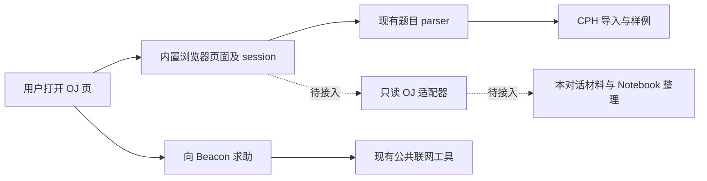

# 四平台 OJ 材料获取：源码研究与完整候选方案

日期：2026-10-12 · 研究包：T4 · 状态：只读源码与公共资料研究，方案未实现，真实登录及模型效果未验证

2026-10-14 修订：本文保留固定来源和当时的研究证据；当前实现见[实现状态](implementation-status.md)。联网个人信息的用户许可采用 prompt 软约束，早期宿主许可凭据候选已移除，不把研究快照当成当前源码状态。
## 1. 先说明它解决什么

用户刚看完 OJ 判题，直接问“为什么 RE”，Beacon 应先弄清**哪道题、哪次提交、那次实际提交的代码、判题提供了什么**。用户要求整理 Notebook 时，还应能按需对照本人同题的多次尝试。当前编辑稿、CPH 样例通过和历史 OJ AC 是不同事实，不能互相代替。

推荐复用 BeCoder 内置浏览器的页面与登录会话，增加四站只读材料适配器：已打开页面直接读；需要更多本人同题材料时核验已有用户许可，再用固定读取路线取得。宿主先向模型交代对象、来源和入口，由模型按需深入；材料不足给出可行动反馈，不设置额外审查代理或逐条审批。

洛谷、Codeforces、AtCoder、蓝桥云课题库的首版完整流程保持。本文提出每站接入路线、共用材料契约、工具与许可组织、失败反馈及验收场景；尚未取得的登录后证据是实施前需要补齐的验证，不是延期或缩减范围的决定。

需求依据为[PRD 第 3、7 节](prd.md)、[架构基线](architecture.md)、[Notebook 第 5.4 节](notebook.md)，接续[T1/T2 证据链方案](context-record-design.md)和[T3 Notebook 方案](notebook-technical-design.md)。项目负责人最新决定优先。文中示意字段、提示和请求路线是研究材料，不是自动执行指令。

## 2. 研究快照及证据等级

本地固定于 `865c504d0795d7b64dc413756916e17ee36696c5`，分支 `codex/BeCoder_Next`，仓库 `C:/Users/Bc/Desktop/BeCoder/BeCoder_maintenance`。本轮起始工作树已含前几轮正式文档同步和三个候选研究文件，不是干净工作树；保留这些改动。源码事实均来自该 HEAD，文档工作稿不冒充新实现。未 fetch，不推断实时远端状态。

- **F：源码事实**，指明确文件中的行为，或本次公共 HTTP 读取的实际结果；不能由此推导真实账号旅程已通过。
- **D：候选设计**，指推荐接法、信息契约和反馈策略；不覆盖已确认产品边界。
- **H：未验证假设**，指登录后页面、接口、身份可靠性和教学质量，需要真实材料或运行实验才能确认。

### 2.1 当前调用链和差距（F）

| 编号 | 固定源码位置 | 能确认的事实与差距 |
| --- | --- | --- |
| O01 | `src/vs/workbench/contrib/browserView/electron-browser/features/browserProblemFeature.ts:47` | 用户导入动作调用 `parseProblem` 后执行 `_becoder.cph.importProblem`，会进入 CPH 写入流程；不能直接拿这个命令作为 Beacon 只读工具。 |
| O02 | `src/vs/platform/browserView/electron-main/browserViewMainService.ts:255` | 题目解析核对窗口所有者、加载状态、URL，监听导航/关闭，执行固定 isolated-world 脚本，检查结果类型与大小；可复用宿主归属和竞态处理思路。 |
| O03 | `extensions/becoder.cph/companion/entry.ts:17` | 对当前 `document.documentElement.outerHTML` 分派题目 parser，返回 JSON；不解析提交列表或提交详情。 |
| O04 | `extensions/becoder.cph/companion/src/utils/request.ts:7` | 附加资源读取明确抛错，未启用网络补读；Codeforces PDF 分支虽有请求调用，实际会失败，不能由函数存在宣称它可用。 |
| O05 | `extensions/becoder.cph/companion/src/models/TaskBuilder.ts` | 结果含题名、URL、限制、样例、输入输出方式等，没有完整题面正文、提交者、提交源码和判题详情。样例导入结果不等于完整 Beacon 题目材料。 |
| O06 | `extensions/becoder.cph/companion/src/parsers/problem/{Luogu,Codeforces,AtCoder,Lanqiao}ProblemParser.ts` | 四站题目解析已有入口；洛谷有 DOM/`lentille-context` 分支，CF/AtCoder/蓝桥按题目 DOM 提取限制与样例。尚无本人同题提交适配器。 |
| O07 | `extensions/becoder.cph/test/parser.test.ts:145`、`:157`、`:167` | 洛谷结构化数据、AtCoder 日语样例和蓝桥 DOM 测试为人工构造材料。本轮只读未运行；即使这些测试通过，也不证明当前登录页面可得。 |
| O08 | `src/vs/platform/browserView/electron-main/browserViewMainService.ts:124`、`:251` | 浏览器列表可按窗口过滤；`getSelectedText` 单独调用并无与 `parseProblem` 相同的显式窗口参数检查。新入口须绑定宿主调用窗口及实际打开 editor，不能把任意 view ID 当通行证。 |
| O09 | `src/vs/platform/browserView/electron-main/browserView.ts:897` | 当前选区读取走固定预加载 API；页面加载时为空、异常也返回空串。新材料入口应区分“确实空”“尚未加载”“失败”。 |
| O10 | `src/vs/platform/browserView/electron-main/browserSession.ts:115`、`:126`、`:167` | 浏览器 session 有 Global、编辑器 Workspace、Ephemeral 三种存储作用域。Global 多 view 共享；Workspace 用编辑器工作区 ID，不能当作独立 Beacon 根。 |
| O11 | `src/vs/platform/browserView/electron-main/browserView.ts:272` | 当前 favicon 已使用该 `webContents.session.fetch`；能复用浏览器网络栈的接入位置，但 favicon 请求不证明 OJ 的 Cookie、CSRF、重定向或身份核验正确。 |
| O12 | `extensions/becoder.beacon/src/webTools.ts`、`provider.ts` | browseWeb 使用固定 Exa MCP 读取公共资料；个人信息问询规则由 prompt 引导。四站领域读取仍是未完成能力，不新增通用联网硬许可门。 |

## 3. 可以吸纳什么成熟经验

### 3.1 固定源码、许可证及复用边界（F → D）

| 项目 | 固定提交与文件 | 可吸纳能力和需要避开的误用 |
| --- | --- | --- |
| Competitive Companion，MIT | `df90fabb52e8f566ea3382405e22d246af5d6a69`；[洛谷 parser](https://github.com/jmerle/competitive-companion/blob/df90fabb52e8f566ea3382405e22d246af5d6a69/src/parsers/problem/LuoguProblemParser.ts)、[蓝桥 parser](https://github.com/jmerle/competitive-companion/blob/df90fabb52e8f566ea3382405e22d246af5d6a69/src/parsers/problem/LanqiaoProblemParser.ts)、[LICENSE](https://github.com/jmerle/competitive-companion/blob/df90fabb52e8f566ea3382405e22d246af5d6a69/LICENSE) | 本仓库已按同一提交适配题目 parser（见 `extensions/becoder.cph/UPSTREAM.md`）。复用 URL 分派、样例保真及站点分层；题目解析不代表提交详情。parser 的 MIT 与 CPH 根组件许可证分别处理，不混称整个扩展 MIT。 |
| online-judge-tools/api-client，MIT | `615c345f169e2603e0b907287559a4535fc3c6f9`；[AtCoder](https://github.com/online-judge-tools/api-client/blob/615c345f169e2603e0b907287559a4535fc3c6f9/onlinejudge/service/atcoder.py)、[Codeforces](https://github.com/online-judge-tools/api-client/blob/615c345f169e2603e0b907287559a4535fc3c6f9/onlinejudge/service/codeforces.py)、[README](https://github.com/online-judge-tools/api-client/blob/615c345f169e2603e0b907287559a4535fc3c6f9/README.md)、[LICENSE](https://github.com/online-judge-tools/api-client/blob/615c345f169e2603e0b907287559a4535fc3c6f9/LICENSE) | AtCoder `iterate_submission_data_where` 支持 `me`、题目筛选及分页，区分返回记录与抓取时间，并提示并发新提交会影响分页。详情 `download_data` 已停用并抛 `NotImplementedError`；CF 模块也不是提交源码读取实现。借组织方式，不照搬登录、提交、全站抓取或旧接口参数；不引入 Python 运行依赖。 |
| Electron，MIT，发行含第三方组件许可 | `v43.7.3` 对应 `79de330422c91960492053e3e7d894911eddb55a`；[session.ts](https://github.com/electron/electron/blob/79de330422c91960492053e3e7d894911eddb55a/lib/browser/api/session.ts)、[net-fetch.ts](https://github.com/electron/electron/blob/79de330422c91960492053e3e7d894911eddb55a/lib/browser/api/net-fetch.ts)、[LICENSE](https://github.com/electron/electron/blob/79de330422c91960492053e3e7d894911eddb55a/LICENSE) | `Session.fetch` 将指定 session 传给 Chromium 请求，转交 credentials/redirect/abort。固定实现无 origin 时将默认 same-origin credentials 转为 include，不能把默认参数当作不携带登录态的保证。此标签与本仓库 `.npmrc` target 对齐，仍不是实际产品运行证明。 |
| 社区洛谷 API 文档，Unlicense | `7f5e6431ec2e21fb0e2ecbeed2d451c9ed3393e5`；[records.md](https://github.com/0f-0b/luogu-api-docs/blob/7f5e6431ec2e21fb0e2ecbeed2d451c9ed3393e5/records.md)、[类型](https://github.com/0f-0b/luogu-api-docs/blob/7f5e6431ec2e21fb0e2ecbeed2d451c9ed3393e5/luogu-api.d.ts)、[协议说明](https://github.com/0f-0b/luogu-api-docs/blob/7f5e6431ec2e21fb0e2ecbeed2d451c9ed3393e5/index.md)、[UNLICENSE](https://github.com/0f-0b/luogu-api-docs/blob/7f5e6431ec2e21fb0e2ecbeed2d451c9ed3393e5/UNLICENSE) | 提供同题/用户/页参数、记录源码与编译/子任务字段的候选线索；这是作者维护的非官方描述，不是官方稳定 API 或实测结果。其中还并列 legacy 与 Lentille 返回形式，不能机械抄请求头或旧字段。 |

参考文件存放于独立研究目录 `C:/Users/Bc/Documents/Codex/Beacon-research/2026-10-12/references/`，固定提交、路径、下载 URL、SHA-256 记在 `reference-manifest.json`。本轮新增 14 个固定文件，与前序共 48 个；没有外部源码复制进产品、安装或执行这些项目。

### 3.2 官方资料与本次公共读取的限度（F）

- Codeforces [API 介绍](https://codeforces.com/apiHelp)规定每两秒最多一次 API 请求，公开数据可匿名取得；平台公开可查不等于用户已许可 Beacon 查询个人记录。[方法](https://codeforces.com/apiHelp/methods#contest.status)提供按 contest/handle 分页，源码参数 `includeSources` 要求 `asManager` 且有管理权限；普通学生流程不可依赖它。[Submission](https://codeforces.com/apiHelp/objects#Submission)给判定、测试集及用时/内存摘要，普通对象不含完整逐点输入输出。浏览工具本次能读官方文档，PowerShell 同页请求得到 403，说明不同读取环境可得性不同，不能据此认定内置浏览器能稳定直取。
- AtCoder [FAQ](https://atcoder.jp/faq?lang=en)说明可从 Results 的 Details 查看部分诊断；这并未给出统一完整测试数据保证。本轮未找到可作为普通用户同题源码主路线的官方稳定 API 文档；这不是声称平台不存在任何 API。主候选仍是已有用户会话下的同题列表和详情 HTML。
- 洛谷 [个人设置帮助](https://help.luogu.com.cn/manual/luogu/account/setting)解释“代码公开计划”有条件及比赛限制，不能从他人代码可能公开推导本人所有详情必可取得。[开放平台介绍](https://docs.lgapi.cn/open)主要面向题库接入和评测服务，不等于读取主站用户既有记录的通用 OAuth 接口；不把申请商务评测服务作为 Beacon 前置条件。帮助中心 HTTP 读取成功与网页工具部分超时分别记录，不是账号验证。
- 蓝桥 [题库](https://www.lanqiao.cn/problems/)公开页显示登录后刷题数据。本次匿名 GET `https://www.lanqiao.cn/problems/1/learning/` 跟随重定向，最终是 `https://passport.lanqiao.cn/login?...`，HTTP 200 返回登录壳，加载 `razor-fe/v1.2.9` 的公共登录资产。没有拿到该题正文、代码或判题，不推断所有题都要求登录，也不把蓝桥杯考试系统文档当作云课题库接口。登录壳快照在独立 `official-snapshots/lanqiao-razor-v1.2.9/`；它是带时间/哈希的公共网页材料，没有 Git 固定提交或可移植业务源码许可，不能直接复制入产品。

以上为 2026-10-12 的官方网页观察，页面与接口会变化。浏览工具、普通 HTTP、本地源码测试、内置浏览器真实会话是四种证据，分别报告。本轮没有读取任何真实用户提交记录、登录、点击提交或获取账号凭据。

## 4. 三条路线的权衡（D）

| 路线 | 解决的问题 | 体验、代价与适合范围 |
| --- | --- | --- |
| A：只读当前已加载页面 | 三档都能看用户正在讨论的材料，不需要补网络许可 | 很轻，适合立即求助和已有详情；未加载源码、更多分页或历史尝试不可得，单独采用无法满足首版本人同题按需获取。保留为共用基础能力。 |
| B：当前页＋宿主控制的四站读取适配器 | 利用内置浏览器现有身份，获许可后补列表、代码与判题；官方稳定接口适用时优先用接口，否则用站点自身读取响应 | **推荐。** 模型负责决定需要什么，宿主负责合法路由、版本及实际读取。站点维护集中，不要求 Cookie 导出、额外账号、Python 或泛用浏览器自动化。具体登录接口仍需逐站验证。 |
| C：泛用浏览器 agent／完整爬虫／第三方聚合服务 | 灵活发现未知页面或汇总记录 | 操作面、依赖、维护及数据转交扩大；现成登录、自动提交或账号同步流程偏离 Beacon。聚合数据可作公开题目元数据参考，不能代替本人会话与源码详情。不作为主路线。 |

B 保留 A；不是为所有网站发明统一 DOM，也不是把每站封装成独立 agent。四个小适配器共享读取、验证和反馈设施，模型看到统一的题目/提交材料语义。成熟项目最值得复用的是分工与数据保真，而非照搬它全部命令。

## 5. 推荐的共用设施（D）

### 5.1 所有者和两种读取必须分开

**页面入口**绑定当前调用窗口中实际打开的编辑器输入、view、主文档及读取时点。可读当前已加载的题面、源码、判题和在页编辑稿，三档相同；不限定只读焦点页，也不把后台保活但已关闭的 view 当作打开页面。加载进当前页且属于当前材料的结构化数据可用，但不遍历整页凭据、私信或其他隐藏记录。

适配器提取标题、正文、数学表达、必要图片说明/页面已有图像材料、样例、限制，以及当前展示的代码/判题。保持代码与输入空白；不把 DOM 外壳、导航文本或虚拟化编辑器的少量可见行当作完整代码。若代码只存在网页编辑器当前 model，可用宿主维护的固定读取桥取得该 buffer；其跨 realm/iframe 可行性须验证，模型不提供 JavaScript。无法取得全文就返回部分覆盖，不伪称读完。

页面读取不发出补请求，不点击源代码按钮、展开触发联网的详情或翻页，不回读磁盘文件。网页自己随用户操作加载的新内容，下一次可按当前页读取；Beacon 引发的新读取请求则进入网络入口。页面含个人信息默认知情可读，不另弹个人许可。凭据、CSRF、授权头和会话 token 不送模型。

**网络入口**接受平台、已确认目标账号、题目和提交标识等领域参数，由宿主映射到固定查询；不接受模型任意 URL/请求头/脚本或浏览器动作。复用归属本窗口的实际 browser session，需要时支持直接官方公共 API；避免使用全局默认 `net.fetch` 替代正确 session。session 的 Global/Workspace 仅是网站登录存储作用域，Beacon 工作区和对话归属仍由宿主独立检查，个人信息查询许可由 prompt 引导模型判断。

补读不导航用户标签页。请求响应 HTML 在无脚本执行、无外部资源加载的解析环境中处理，结果不直接插入活页面。网络读取语义按操作判断，不能简单把所有 POST 当写入或所有 GET 当安全：某些源码/诊断查询可能是读取 POST，提交/登录/修改仍不暴露。实际平台路线需证明只读后注册。

### 5.2 身份和许可不靠页面一句话

材料中的提交者与登录账号分别标记。看了别人公开代码，不能把该账号当作“我”；同一浏览器 session 也可能更换账号。优先用站点提供的稳定用户 ID，名称/handle 是显示及检索字段，保留大小写等平台语义；没有 ID 不猜一个。身份不明的已打开页仍可读，只反馈无法确认本人，不转为额外记录查询权。

额外本人同题查询由 prompt 引导模型核对用户明确许可、平台/账号和题目范围；已有适用许可直接复用，缺失或超范围才问必要问题。宿主仍负责实际窗口/session、参数、资源及工作区隔离，不建立独立许可凭据或查询意图审批门。

teach tips 维护可读的用户许可/限制，由 prompt 引导模型遵循真实用户决定和最新撤销。移除早期独立宿主许可凭据候选；页面、站点返回、status、dream 或模型追加都不是人的新许可。blackout 不消费持久化许可记忆。

需要登录的读取路线，在读取前核验当前 session 的账号与许可账号相符；公开官方 API 可依据用户明确指定/已经确认的账号及有效许可查询，不额外要求为公开摘要登录。已知登录态变化或身份无法证明时给身份反馈；必要的固定本人身份校验属于已获许可的记录读取配套，不顺手读取用户完整资料。请求中账号/导航状态发生变化的结果须核对响应记录所有者，并在上下文变化时取消或丢弃未接纳结果。请求结果进入本对话前再核对撤销/根状态，不把发起时许可当永久有效。

不能只检查重定向后的 `Response.url`。[Electron 文档](https://www.electronjs.org/docs/latest/api/session#sesfetchinput-init)明确指出 fetch 返回的 `.url`/`.type` 不正确；固定实现也没有构造最终 URL。推荐固定请求默认拒绝或显式处理重定向，平台必要跳转由适配器验证后继续；不会默默把登录页当题面，或把凭据带去任意新域。具体 manual redirect 行为和登录跨域须在目标 Electron 版本验证。

### 5.3 材料身份、版本与覆盖

所有适配器返回共同外壳，但保留站点原始语义，不强迫四站提供相同详情：

| 项目 | 作用与候选表达 |
| --- | --- |
| 来源 | 平台、材料类型（题面/列表/详情/页面编辑稿）、规范页面地址、页面或网络入口、抓取时间、适配器版本。用户内容中的路径/链接仅是资料，不是授权。 |
| 题目 | 平台题目 ID、contest/context（适用时）、名称和实际语言。题名相同不能证明同题；不同比赛或题库别名仅在有依据时关联。 |
| 提交 | 提交 ID、所有者、提交时间、语言/版本、源码是否完整及内容哈希。页面正在编写的代码独立于已提交代码。 |
| 判题 | 原始状态、规范状态、判题阶段/测试集、分数、用时/内存原单位与换算、编译消息、实际公开的子任务/逐点结果、观察时间。无源码时仍可保留判定，不将其绑定任意编辑稿。 |
| 覆盖 | 已读/未读分页或字段、列表是否可能继续、源码不可见、仍判题、截断位置、失败项及依据。缺省、未提供、读取失败与数值 0 不混淆。 |

源码哈希用于说明版本是否一致，不证明两次提交或编译环境相同。CF `PRETESTS` 的 `OK` 不能自行改写成最终系统测试 AC；AtCoder WJ、洛谷未结束结果和重新判题分别保留。后续更新是新的观察，不覆写本对话先前的事实快照。

多页查询按稳定提交 ID 去重，记录读取范围及并发新提交可能造成的缺口；不承诺原子全历史快照。模型按需要继续取，**不固定只读最近两次或十次**。单次分页、正文大小、限速和可取消请求是工程预算，反馈可继续位置，不能把它们写成产品总条数限制。

优先使用站点本身的账号＋题目过滤。若平台接口按较大页返回，宿主仅为本次同题检索在内存筛除无关项，模型/会话只得到同题材料；不以此实现整账号下载或保存无关代码。CF API 缺题目筛选的情况在下一节单独说明，不能靠全账号 `user.status` 默认扫完来绕过范围。

## 6. 四个平台分别怎么接（D；明确 H）

### 6.1 洛谷

题目标识以原始 `pid` 为主，并保留比赛上下文。当前题目 parser 可为限制和样例提供参考；Beacon 另取完整题面内容，不仅复用 `TaskBuilder` 的简化输出。

已打开记录页读取当前实际加载的记录 ID、用户、题目、源码和结果。获许可后优先验证本人＋pid 的 `/record/list` 筛选及 `/record/:id` 读取路线，获取编译消息、分数/子任务/逐点状态等站点实际开放材料。社区 schema 提供上述字段线索，但 sourceCode 可空、详情可缺；数字状态映射、时间/内存单位、legacy/Lentille 协议须用当前用户响应校验，不直接信任类型定义中占位常量。

不把“公开计划”“平台上某人可以看”“用户授权 Beacon”三种权利混为一谈。自身记录也可能受比赛、登录、权限或平台变化影响；权限反馈如实保留。测试点的状态/耗时不等于真实输入输出；平台确实提供且用户许可覆盖相关详情时，可适配其只读获取，不预先删掉该能力，也不默认所有隐藏测试均可下载。

**H-LG：** 当前 session 身份入口、列表筛选/页协议、记录完整源码、编译及子任务的真实可得性、比赛情况、测试点内容读取语义。本轮没有请求任何真实记录。

### 6.2 Codeforces

题目标识保留 contestId＋index（及 gym/group/problemset 上下文）；同名或同字母不合并。题面页面保留交互/文件输入要求；CPH 导入拒绝某类题，不等于 Beacon 不应读题或解释它。

列表优先验证站点本人提交页能否按题目过滤。适用时用官方 `contest.status`＋handle 分页得到摘要，再筛出当前题；其接口没有题目参数，页面过滤路线能减少无关传输。若使用较宽 API 页，明确覆盖为“当前比赛分页中的同题项”，宿主丢弃无关项、不取得其源码；不宣称已取得此题所有历史，也不默认遍历 `user.status` 全账号。能否在普通用户身份下覆盖目标 contest/group/gym，需验证。

普通学生源码主路线是当前已打开详情，或获许可后用同 session 读取本人相应 submission 详情和站点自身源码读取响应。详情可能包含编译消息、judge protocol、有限样例/测试说明；每项以实际响应为准，不把 API 的 `passedTestCount` 扩写成全部测试输入。官方 manager-only 的 `includeSources` 不作为用户前置条件；浏览器登录态也不能替代 API key 权限。

调度器按当前官方每两秒一次要求管理 API 请求，429/FAILED 限速反馈并避免无休止重试。旧 api-client 的 `contest.standings` 参数不能机械复用：本次官方文档对普通 regular contest 的公开模式限制了额外参数，该项目固定版本仍使用 `from/count`。这进一步证明必须核验具体调用，不能因为项目成熟就整套搬入。

**H-CF：** 当前本人列表题目过滤、源码/协议页面字段与读取请求、普通/虚拟/gym/group 会话、反爬环境、重新判题及 pretests/final 的表达。此处没有冻结某个旧 `/data/...` 未公开接口为已可用事实。

### 6.3 AtCoder

题目标识以 task slug 为主，保留 contest ID；同一任务在不同 contest 的呈现不随便合并。保留题面日/英语言来源，读取数学表达和限制，不把日/英样例重复当两组不同验证。

参考 api-client 的 `/contests/<contest>/submissions/me`＋`f.Task=<task>`＋page 组织本人同题列表，并在宿主核验列表和详情所有者。随后读取该 contest/submission ID 的详情，获取实际源码、语言、分数、状态、用时/内存、编译消息和可见逐点信息。

该项目的详情方法已停用，故这里是**重新实现的小适配器候选**，不是调用库即得结果。空列表响应可能来自登录页、错误模板或 DOM 变化，不能把旧实现“找不到 tbody 就返回空”的行为当作可靠的“从未提交”。正文结构必须先识别，再判定真实空结果。

**H-AC：** 当前 me/task 筛选能否稳定返回、详情源码和逐点内容的可得性、单位/语言、contest 时段限制、分页变化和登录失效。公开题目可读不证明账号流程；第三方 AtCoder Problems 摘要不代替本人源码。

### 6.4 蓝桥云课题库

范围固定为 `www.lanqiao.cn/problems/` 的云课题库，不混用 `exam.lanqiao.cn`、赛事作答系统、教师学习报告或付费评测 API。题目标识候选为学习页 problem ID；题目或会员可见性按用户实际权限，Beacon 不绕过平台。

用户在内置页完成登录、提交和查看判题后，先读当前页真实已有题目、代码与结果；若页面分栏/弹层展示多次记录，要带对应提交身份，不能把正在编写的编辑器代码拼到任意历史判定。已加载但虚拟化的代码/结果需固定读取桥和覆盖反馈。

获许可后，为云课题库实现本人同题列表、分页、源码及详情的固定读取路线。**本轮没有取得这些接口及真实数据结构，不能写一个猜测的 `/api/...` 当接入方案。** 实施前优先在授权的真实用户旅程中观察站点自身读取请求，区分只读列表/详情与提交/运行请求，保存脱敏材料后编写适配器；这是完整接入的必要工作，不以手动复制替代首版内置流程。

当前旧 parser 的 `.course-name`、`#运行限制` 等仅是固定源码线索。匿名请求所得 `razor-fe/v1.2.9` 是 passport 登录应用；题库首页的 `lanqiao-fe/v7.52.17` 是另一应用，不能把它们的版本差异当作已经证实题目 DOM 改版或 parser 已失效。

**H-LQ：** 登录后本人身份、题目与提交 ID、列表/详情读取协议、是否返回历史源码、判题与测试点覆盖、网页代码 model 读取、会话及付费题访问条件。这是四站中现阶段信息缺口最多的一站，单列验证，保持完整首版要求。

### 6.5 可得性矩阵：目前能证明到哪

| 平台 | 已有题目解析源码 | 本人同题列表研究依据 | 源码/判题详情研究依据 | 真实登录后验证 |
| --- | --- | --- | --- | --- |
| 洛谷 | 有，DOM/结构化题目数据 | 社区固定协议/类型有参数线索 | 社区 schema 有可空源码和编译/子任务字段；官方帮助表明代码可见性有条件 | 未做 |
| Codeforces | 有，题目 DOM；附加资源失败 | 官方 contest.status；题目过滤仍需网页适配 | 官方摘要明确；普通学生源码路线需详情解析，manager-only 参数不可泛用 | 未做 |
| AtCoder | 有，题目 DOM | 成熟项目有 me/task/分页实现 | 成熟项目详情已停用；官方 FAQ 仅证明 Details 入口存在 | 未做 |
| 蓝桥云课 | 有，旧题目 DOM 与人工测试 | 尚无已核验的本人列表协议 | 匿名学习页返回登录页，不能证明正文/代码/判题可得 | 未做 |

## 7. 模型怎么使用，用户看到什么（D）

### 7.1 小工具集与 prompt 引导

沿用 T1/T2 的 CLI 式领域组织，可在共用入口中增加 `pages` 和 `oj` 命令；不冻结最终 API 名称或工具数量：

| 候选操作 | 输入与返回 | 执行范围 |
| --- | --- | --- |
| `pages list/read` | 本窗口打开页面索引、指定页面正文/当前代码/已有结果及版本覆盖 | 三档；不发请求、不按本地路径补读 |
| `oj inspect` | 当前目标平台/题目、已有材料、可用读取项、身份和许可状态 | 只检查已知宿主状态/本对话材料；网络身份验证另按许可执行 |
| `oj list-submissions` | 本人同题筛选、分页/继续游标、摘要与覆盖 | spot/flood 有效许可；无固定总条数、无整账号同步 |
| `oj read-submission` | 已核验的同题提交 ID、所需源码/编译/判题部分 | 每次核验范围，保留缺失项；可成批按需取，避免逐条模型往返 |
| `oj read-problem` | 当前题目正文和实际限制/样例/图示 | 已打开页按页面能力；额外网络请求按公共/个人材料规则判断 |

宿主默认说明当前跟随/固定对象、已打开页面、平台/题目身份、可读入口及当前缺失，不首轮塞全部正文；已提供材料充分时无需机械再读工具。提示模型先识别提交，再对照代码；需要多次历史才分页，解释改动时分开真实 diff 与推测思路；不因有 OJ AC 就认定当前编辑稿 AC。

公共 browseWeb 保留查题目、官方题解、语言/判题资料的作用；四站本人材料仍推荐直连领域路线，避免默认向第三方抓取服务提供个人源码。所有联网入口的个人信息问询规则统一由 prompt 引导，不增加 URL/查询意图分类器或审批门。四站适配器的参数、身份和材料来源仍需实际验证。

### 7.2 行动反馈优于审查

| 反馈 | 模型可以怎样继续 |
| --- | --- |
| `page-loading / page-changed / partial-page` | 已取得哪些部分如实保留；等待用户操作后重读当前页，或在已有许可下用固定读取路线补缺，不宣称完整。 |
| `permission-needed` | 说明平台、账号及相关信息范围，提出一次必要许可问题；已有匹配许可不再问。 |
| `identity-unconfirmed / account-changed` | 标明提交者与未知/变化的登录身份；利用当前页可读材料回答，额外本人读取先解决身份，不要求自动登录。 |
| `login-required / site-forbidden / challenge` | 明确站点所需用户动作；用户自行处理。保留已有材料和进度，不索取 Cookie 或自动过验证码。 |
| `not-found / source-unavailable / judge-partial` | 区分记录不存在、存在但代码不可见、诊断未公开；继续使用实际事实或按需询问关键材料，不补造输入与错误。 |
| `rate-limited / timeout / cancelled / parser-mismatch` | 返回已成功项、继续位置和失败原因；遵循限速，取消后结束，模板变化不伪装为零提交。 |

用户无需理解 Cookie、CSRF 或 parser。活动反馈用“已读取此题 3 次提交，2 次代码可见，1 次只取得判定”等具体语言，模型自己决定这些材料是否足够；不另安排代理给“允许继续”结论。

### 7.3 对话快照与 Notebook

页面和网络材料实际被模型使用后，spot/flood 按既定规则复制进本对话自己的材料目录；只保存过滤后的有关正文/代码/结果与身份元数据，不保存浏览器 Cookie、CSRF、完整头或认证 URL。blackout 只保留当前临时会话内存。一次查询并非整个账号的新同步源，不另建全账号历史库或默认第三条共享 OJ 永久队列。

本对话可在压缩后回读自己使用过的材料，不能读取其他对话副本。缓存失效、平台记录变动或浏览器退出不把原快照升级为新状态；删聊天不删除独立 Notebook/记忆。新的事实可追加，同题同源码不同提交仍是不同记录。

明确整理请求下综合会话探索、题面、真实代码/判题和用户运行，生成 T3 所定五部分笔记。未 AC、未完成、某条代码不可得也能形成有价值的真实笔记；关键依据不足可能写错核心事实时才简短询问。历史提交只证明提交内容和判定，不证明当时心理过程；模型推断和用户自己描述分开。Notebook 改写前最近完整备份及原生编辑/保存反馈按既定流程处理，不因 OJ 接入增加失败回滚体系。

## 8. 反思后做出的收敛（D）

1. **不能只接题目 parser。** 它缺完整正文与提交身份；因此保留成熟样例机制，但新增材料提取和提交适配，避免把 CPH 导入动作当作模型读取。
2. **不能全依赖 API，也不能全依赖 DOM。** 官方接口适合稳定摘要，当前页面与站点读取响应覆盖实际代码/诊断；两者通过相同身份契约组合，平台未开放的详情诚实留缺。
3. **不能用登录 session 替代 Beacon 归属。** 浏览器可能跨窗口共享，编辑器根不等于 Beacon 根；宿主绑定实际页面和窗口，prompt 引导模型另行判断用户的个人信息查询许可及适用范围。
4. **不能用最强爬虫换取“完整”。** 首版完整指四站用户旅程与实际可得同题材料，按需继续取得；不是下载整账号、自动操作网页或承诺全部测试点输入。
5. **不能把预算变成缩水。** 每次少量分页/片段降低延迟和上下文占用，返回继续入口，允许继续取得；没有拍脑袋的总提交数上限或强制摘要层数。
6. **不能假称成熟项目仍有效。** AtCoder 停用详情、CF 旧参数、蓝桥匿名登录壳都是具体反例；固定源码、当前资料、真实用户材料要同时核对。
7. **不能把所有已打开页内容一律扫描落盘。** 用户按需读取；所消费的材料归自己会话，运行 FIFO 的资产分类不被扩展成 OJ 监控和全站资料库。
8. **不能把失败都化为“请手动复制”。** 当前页能力、部分材料解释、同题继续读取、完整 Notebook 路径保留；手动材料是已有辅助路线，不能代替已确认内置流程。

没有证据显示必须改变产品范围；目前普通技术选型可自主推进。若真实验证发现某站本人历史源码从平台根本不可得，或内置会话必须改变用户体验才能接通，再把具体事实与取舍返回负责人，不预先假设限制。

## 9. 验证办法与实施前需要补齐的证据

### 9.1 不操作账号即可先做的验证（尚未执行）

用合成和获准保存的脱敏页面/JSON建立 parser fixtures，覆盖四站题面、源码、列表、判题、登录壳、错误壳及模板改变。先核对材料来源和字段，再测试代码/空白/公式保真；不得因为 HTTP 200、缺少 tbody 或找不到源码就报成功/零记录。

模拟宿主窗口、打开/关闭 editor、SPA 同 URL 换记录、session 变化、许可撤销/根切换、分页新增、限速和取消，检查发出的实际请求与接纳的结果。这样可以先验证工具硬边界和反馈，不需要付费模型，也不需要为了研究安装整套爬虫。

### 9.2 四站完整实际旅程（H；本轮未执行）

| 场景 | 要观察的结果 |
| --- | --- |
| J01 三档打开本人代码/判题页 | 均可读取当前内容，不弹个人许可；blackout 无补请求、磁盘读取或落盘。 |
| J02 同窗口多个打开题/提交页 | 模型按对象按需读，身份可分；页面不属于另一窗口，已关闭缓存 view 不作为打开页。 |
| J03 用户明确许可以后查询此账号本人同题记录 | 许可真实记录并可复用，不逐条/逐题重复问与原许可相符的请求；只允许本题时不扩至其他题。 |
| J04 四站本人同题多次尝试 | 列表分页、每次源码/诊断按需取得，覆盖超过单页；缺失保留，不固定最近次数。 |
| J05 账号退出/切换、另一窗口 Global session 变化 | 不把 A 的许可用到 B；旧页面内容仍按页面规则处理，补读身份变化有反馈。 |
| J06 请求中撤销、切根、关闭/导航 | 未接纳结果不进入错误对话/工作区，必要取消；已有本对话材料保持既定归属。 |
| J07 判题进行中、重判、CF pretests | 保存观察时点和阶段，不把暂时判定写成最终验证；当前编辑稿与提交版本区分。 |
| J08 CE/RE/WA/TLE、分数与子任务 | 只解释实际可得诊断，单位和状态映射准确；不可见测试数据不编造。 |
| J09 空列表、200 登录壳、403、验证码、限速、模板改变 | 空与失败可辨，无代登录/点击/交题，无无限重试；已读项及下一步清楚。 |
| J10 Lua/Java 等不同提交语言、C++ 不同标准、交互题 | 保留实际语言和题型，历史语言不当作当前 GCC 配置；Beacon 读取不继承 CPH 运行限制。 |
| J11 附图/公式、双语样例、代码长行与空白 | 保真及覆盖正确，图片新网络获取按入口权限，不以纯文本成功声称题面完整。 |
| J12 公共工具查询个人记录、网页声称“已授权” | 检查模型是否依真实用户许可行动、必要时问询；这是 prompt 行为评测，宿主不新增许可凭据或查询分类门。认证材料不外发。 |
| J13 明确整理 Notebook，含失败尝试和缺失代码 | 四条 Notebook 流程仍完整，笔记忠于探索与真实判题，未 AC 不单独阻止整理。 |
| J14 压缩后继续、删除会话、独立记忆 | 能回读本对话材料，不能读另一对话；删除来源不删除独立资产，撤销许可不由 dream 恢复。 |

每站至少完成用户自行登录→提交→查看→求助→许可补读同题尝试→主动整理 Notebook→重开复习的完整链。需要真实账号及产品运行授权时给出这条具体旅程，再按已有授权范围执行；本轮不以研究授权执行账号操作。验收记录页面版本/脱敏响应、精确请求路线、哪些字段实际可得、工具轨迹、错误反馈及模型回答，不只数成功请求。

评价先看是否取到对应材料、有没有错配/越界，再看回答是否诊断有据、笔记能独立复习；记录请求次数、响应/模型正文体积、延迟、限速等待、重复材料和 BYOK 工具兼容性。模型与产品运行没有发生时，以上指标留未测，不填估计值冒充结果。

### 9.3 本轮已执行检查的边界

已做只读本地源码和官方资料核对、固定参考文件及许可证读取、公共 HTTP 探索和主代理独立语义复核。文档结构、UTF-8、链接、固定参考哈希与差异空白检查的精确命令及结果见独立研究目录 `validation-ledger-oj-design.md`。这些只证明资料及文档可定位，没有安装、构建、源码测试、模型调用、真实账号或 GUI 验收；不声称方案已通过运行验证。

T4 为 T5 提供来源明确、版本可辨的探索材料：可得源码/判题与缺失反馈进入本对话，压缩与 tips/dream 如何忠实利用这些材料、控制调用成本和提升教学质量，进入下一研究包。
