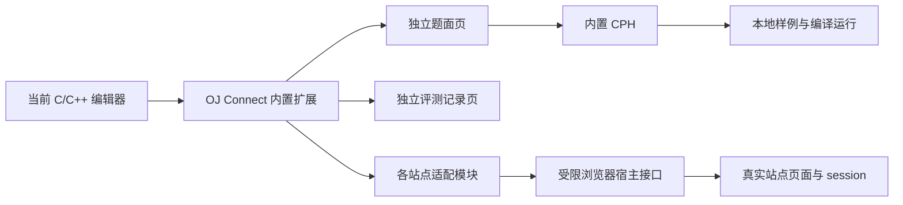

# OJ Connect 技术架构

Beacon材料接入的现行合同见[Beacon架构](../beacon/architecture.md)及[实现差距](../beacon/implementation-status.md)。下一阶段沿本扩展真实Get／Import／交题结果owner供证，并复用五站只读题面解析；模型取材不重放用户动作、不回写看题行为、不获得登录／提交权限。正常所选Beacon根的生产与模式消费分别校验，Blackout仍允许软件采集。本文既有站点用户流程与历史验收不因此变成Beacon新链路的通过证据。

[产品与开发入口](README.md) · [开发指南](../development.md)

更新日期：2026-11-20。负责人已确认“统一内置扩展负责刷题业务，浏览器宿主保留真实会话，CPH 负责本地测试”。AtCoder 第一阶段快捷键闭环已获负责人确认；当前源码另已实现洛谷／AtCoder 的共同导入、题面与评测页，并按最新要求直接裁剪复用 vscode-luogu4.20.0 的保留前端，并使用现有共享内容渲染能力。共同流程设计和实施计划均已批准。洛谷闭环与使用体验已获认可；2026-11-17 负责人已确认 AtCoder 代码提交能力闭环且达标，各轮其他界面与候选改动仍按各自记录验收。具体证据与限制见[当前状态](README.md#当前实现状态)，不能用旧 MVP、协议窗口或已认可的前版验证后续改动。

## 当前五站如何组织

2026-11-20 负责人确认第五站蓝桥核心闭环验收通过，四站既有协议保持各自所有者。蓝桥专属 `lanqiaoProtocol.ts` 静态读取当前官方语言目录、核对题型和投影记录，`lanqiaoTransport.ts` 只允许固定官方请求，`lanqiaoSessionClient.ts` 绑定窗口／Session／账号及一次发送权；`lanqiaoBridge.ts` 交付 opaque handle、活跃发送的本地阶段投影与经原生核对的正式记录。source → 有限执行 GET → 一次 report → 正式详情及本人列表核对，受理不明、取消和超时后只 GET。进度页从准备阶段展示，同一页面等待正式核验后升级；扩展按活跃句柄读取本地投影，受窗口、Session、生命周期与凭据版本约束，不增加官网请求或授予未确认记录权限。浏览器存储范围／工作区信任变化会先取消旧客户端，再使桥接及迟到响应失效。浏览器 Get 仍使用原网页 Session，包括临时会话；快捷键和提交沿用持久 Session。实现、核心验收与后续候选边界见[蓝桥实施记录](lanqiao-implementation-2026-11-20.md)。

2026-11-19 负责人已确认四站核心能力闭环。随后批准的第一阶段维护仅调整共同 Webview 导航和确定无消费者的旧翻译：标题、记录题目与正文链接由 OJ Webview 根节点统一处理，阻止进入通用外部 opener，再通过受校验的 openLink 消息汇入现有内置浏览器命令；前端和面板共用 HTTPS、长度、凭据与控制字符校验。页内片段保留原有 Webview 滚动，查看源码独立停止传播。没有改动全局 Webview 链接桥、共享清洗器、站点认证／提交／回执协议。实现检查与产品验收分别见[维护记录](review-2026-11-19-maintenance.md#第一阶段实施补记)。

第二阶段维护保持原看题请求顺序：ProblemPanel 的同绑定重开完整替换新文档，Panel.update 同步标签标题；提交、CPH 和题面语言校验读取当前面板文档。后台目录仍由原 entry／request／abort 守卫，保存偏好后的界面更新另核对当前文档与目录，防止旧选择恢复已被刷新掉的内容。RecordPanel 的读取失败提示指向查询原记录；无结果与正在读取分别展示，失败且缺失编译输出的说明由共同组件处理。原始判词、正式 ID、认证与单次发送保持各站所有者，详见[第二阶段记录](review-2026-11-19-maintenance.md#第二阶段实施补记)。

第三阶段随后以[分段诊断](statement-performance-2026-11-19.md)定位页面准备成本，并按[单文档设计修订](../superpowers/specs/2026-11-19-oj-connect-statement-acquisition-design.md)实现 AtCoder／CF 单次原生 Session GET。`ojStatementTransport.ts` 仅接受固定官方题目身份，手动重定向、限长、限时和取消；`ojStatementParser.ts` 每次创建短命离线 sandbox WebContentsView，独立非持久 Session 拒绝外部资源，原始 HTML 只进入 detached DOMParser。AtCoder 复用原始双语提取；CF 复用 CPH 原解析和样例规范，再整理共同题面。扩展只接结构化文档。快捷键绑定当前持久 scope，浏览器 Get 则保持网页原有 Session（含临时会话），不操作用户页；CPH 普通导入不变。原官网导航／二次 GET／DOM-ready 停资源的旧读题路径及临时诊断已删除，登录／提交／回执／评测所有者保持。真实对照、CF 同题重开代价及最终检查见[优化结果](statement-optimization-2026-11-19.md)。

2026-11-18 CF 候选已按[批准设计](../superpowers/specs/2026-11-18-codeforces-practice-design.md)与[实施计划](../superpowers/plans/2026-11-18-codeforces-practice.md)加入共同流程；[协议证据](codeforces-protocol-evidence.md)记录隔离采证。仅接入 `codeforces.com` 普通公开比赛的赛后练习，拒绝 Gym、进行中、虚拟参赛、group、私有／团队、镜像及 output-only，不丢弃原入口上下文。当前源码、协议探针、产品运行、最终构建与负责人验收分别成立，后几项仍待本轮记录，不由旧构建或探针补齐。

2026-11-17 去冗余审查已移除无生产入口的旧详情 JSON 实验链路，保留当前提交／评测使用的 HTML 与源码解析工具；该轮发现见[审查报告](review-2026-11-17-cleanup-settings.md)，后续修复及设置实施见[维护记录](maintenance-settings-2026-11-17.md)。

2026-11-17 当前候选已按批准的[AtCoder 提交耗时优化设计](../superpowers/specs/2026-11-17-atcoder-submission-latency-design.md)收敛为按需建立本次官方提交页、正常验证、单次页面内请求和独立会话记录读取。干净 stage 构建与负责人验收单列，不把有限真实采证写成长时可靠率或固定时延承诺。

源码当前由 `extensions/becoder.oj-connect/src/extension.ts` 装配洛谷、AtCoder、Codeforces、牛客、蓝桥五个适配器和同一个 `workflowController.ts`。`domain.ts` 统一题目、语言、正式记录、结果及发送状态；蓝桥的 `c/cpp` token 和24位小写hex记录校验只在本站生效。`problemResolver.ts` 按直接父目录优先和文件名解析，目录外通用数字文件不猜牛客或蓝桥。

| 所有者 | 当前职责与入口 |
| --- | --- |
| 共同工作流 | `workflowController.ts` 固定源码、语言、草稿确认、取消与并发；确认回执后释放发送资源，再等待结果面板；`recordController.ts` 读取明确 ID，四站每轮约120秒，到期保留记录并允许继续查询；AtCoder 优先官网 Interval、缺失回退2秒，洛谷等待推送，牛客与 CF 沿用2秒 |
| 站点适配 | `src/adapters/{luogu,atcoder,codeforces,nowcoder,lanqiao}/adapter.ts` 将原站业务封装在临时任务内；`site-scripts/` 包含 AtCoder 固定网页操作与 CF 题面读取 |
| 共同界面 | `src/views/` 与 `webview/`；题面绑定源码和题目，评测页绑定正式 ID，Webview 消息不决定源码路径／正文／任意命令 |
| 受限宿主 | `browserOjConnectFeature.ts` 固定命令和本窗口页面；`atcoderBridge.ts`／`luoguBridge.ts`／`codeforcesBridge.ts`／`nowcoderBridge.ts` 管理不可伪造句柄与正式回执；`browserViewMainService.ts` 执行固定 recipe、真实 session、取消和只读核对 |
| AtCoder 事务 | `atcoderTransaction.ts` 直接准备官方 submit 页，以完整表单内的明确源码／语言／题目进行一次页面内 fetch；无上传、Ace 同步和原生点击备用路线；复用返回列表及首次详情，保留基线排旧、账号、唯一候选和源码核对；正常全程不显现网页，验证超时在插件内提示 |
| CF 原生事务 | `codeforcesSessionClient.ts` 持有同窗口／存储范围／账号的官方表单、提交前记录边界及临时回执；`codeforcesProtocol.ts` 用静态 HTML 与 Acorn 字面量核对普通赛后 Practice、`outputOnlyIndices` 和动态语言，拒绝 output-only；`codeforcesTransport.ts` 用显式 Session、Cookie 与手动重定向的 `net.request` 只发送一次源码；确认唯一新记录并回读源码，未知受理仅只读核对 |
| 洛谷传输 | `luoguSessionClient.ts` 编排固定操作；`luoguSessionTransport.ts` 从持久 BrowserSession 读取凭据，以 Node HTTPS 发送固定请求，验证码与提交共用该路径；退出由内置浏览器中的官网处理。同次提交已输入的验证码被明确拒绝三次后停止，并提示转内置浏览器手动提交／认证，不增加新认证。`luoguCsrfTokenManager.ts` 迁入上游管理器，`luoguProtocol.ts` 转换语义数据，原生主进程建立带同会话凭据的推送连接 |
| Import／CPH | 浏览器固定主动作 Get Problem→`importController.ts`／`sourceStore.ts`→源码与题面；菜单 Import to CPH 始终使用 Companion，命中已接入站点时复用 adapter 的目录与文件名，其他题源保留 CPH 默认行为；题面另通过 `importSamplesForSource` 关联绑定源码 |
| 登录管理 | `views/loginView.ts` 以轻量 WebviewView 显示各站标识与真实摘要；仅名称可点击，未登录打开官网登录入口，已登录打开协议摘要提供的官方个人页，缺少可靠身份时沿官网登录入口重定向；退出仅在内置浏览器官网手动完成。宿主观察普通持久浏览器会话与导航／加载事件合并刷新，不轮询；AtCoder 摘要直接读取当前存储范围的 Session 首页，不创建或依赖网页标签；同一范围的并发检查合并，登录／退出使旧读取失效；普通 REVEL_SESSION 轮换不触发重查；CF 摘要读取同一持久 Session 的官方账号，读取失败保留未知；蓝桥使用当前主站 basic 核对身份，固定 Passport 入口，不猜个人主页 |

五站的 C／C++ 编译器标识分别保存在各自用户设置键中；蓝桥只保存本站 c/cpp token，并采用已批准的 C++17／唯一 C 例外，互不混用；AtCoder 题面语言同样使用用户设置。页面和快捷键通过一个偏好读写入口读取各自键，不再维护编译器内存 Map 或第二套 Memento 权威。旧 AtCoder Memento 首次激活迁移，不覆盖显式设置，成功后清理旧键；失败提示但不阻止激活。最近记录仍在当前窗口内。没有持久题目绑定库，没有独立账号存储。站点脚本、Webview bundle、样式和字体均来自本扩展静态构建。`webview/luogu/` 直接迁入固定版本的题面、提交区、记录、控件及 CSS，`main.tsx` 只装配共用状态；UUID 请求回复仅消费面板动作白名单。按钮与快捷键共用站点／语言族偏好。

2026-11-19 编译器选择及首开修正候选：四站共用默认选择函数，保持有效个人偏好；无偏好时从 C++20／C17 向上匹配 GNU/GCC、O2、msys2，未知标准的官网标签不推断版本。AtCoder／CF 题面与目录分离，目录通过受限 Session 原生 GET 后台读取，不依赖发送 token 或建立准备许可；未登录／读取失败使用已采证目录预选，tooltip 标明来源。CF 4 项来自官方表单；AtCoder 6017 由实交验证，C23 仅核实名称，有限内部预选标识必须按当前目录名称／语言族唯一映射真实数字 ID，不能进入源码发送。登录状态转为已登录时刷新对应面板，关闭／重开／prepare 更新取消并使旧响应失效。牛客只读题面所引语言资源，缺目录保留题面，prepare 仍拒绝缺失入口。

快捷键读题复用相同存储范围的精确题页。仅本次新创建、OJ 拥有且不可见的后台读题页在 DOM-ready 后停止未完外链资源，等 did-stop-loading 再进入原有隔离脚本；已有用户页与中途显示的页面均正常等待。原生夹具确认单改 DOM-ready 不足以绕过 Electron 隔离执行的全加载等待，因此没有削弱 parseProblem／_runOjRead 的加载和导航校验。阶段日志仅含站点、固定阶段及耗时。

牛客 Cookie 变化不直接等同身份变化；userId／明确退出是身份权威，首次补 Cookie 和同账号轮换不取消题面。发送、正式记录读取前仍确认当前账号；Cookie 在账号请求途中变化时，旧响应不能授权新凭据，最多补读一次最新身份，持续变化明确停止。合成／原生检查、stage 和真实网站验收分别记录。

主动登录只等待模型与持久会话校验，不等待整页加载再显现浏览器。AtCoder 提交事务临时关闭隐藏页面的后台定时器节流，结束时恢复；不预热、不跨提交复用页面。确认详情作为首次结构化结果交接，后续使用同窗口／会话范围的 status/json 及必要终态详情，不持有任务页。

2026-11-19 登录稳定性候选修复：四站登录入口只复用当前存储范围内地址匹配的登录页，普通官网页与草稿保持原样。AtCoder 已读摘要窗口和 CF 原生客户端按真实 Session ID 接收身份失效通知；不同工作区 Session 隔离，普通 Cookie 轮换不触发刷新循环。浏览器存储范围设置变化或授予工作区信任时，扩展立即清除旧摘要并取消旧读取，再查询当前范围。隔离回归与 stage 构建不能代替真实账号的负责人验收。

洛谷常规题面、准备、提交、账号摘要与记录查询不创建或依赖网页标签，按浏览器当前存储范围选择同一持久 Session；登录仍打开官网，验证码沿用上游的图片面板和输入框，留空刷新。HTTP 单次超时与人工等待分离；明确验证码错误继续原源码，未知回执不自动重交。记录绑定其原生会话，存储范围切换后不从新会话继续读取；关闭记录向原会话释放推送，重开按正式 ID 及所属会话重新查询。推送失败时按实例身份移除故障连接，停止跟踪并保留当前结果；只有显式继续查询才重新读取并按需建连。已排队结果先于后续 close 错误交付。隐藏／未知结果停止自动跟踪并释放已有推送，保持原状态并提供手动查询；不进入零延迟 HTTP 轮询。AtCoder 使用单次页面内请求，发送页生命周期与会话只读结果查询分开。当前源码实现不等于两站新构建的负责人验收，见 [当前状态](README.md#当前实现状态)。

洛谷响应转换由核心 `src/vs/platform/browserView/common/luoguProtocol.ts` 单一拥有，回归位于 `test/common/luoguProtocol.test.ts`；扩展中仅被测试使用的重复解析副本已移除。当前 OJ 静态构建入口为 `build-site-scripts.mts`、`build-webview.mts`，页面测试为 `test/render.mts`；仓库原生洛谷会话回归入口为 `scripts/test-luogu-session.cts`。运行时优先使用各自 package.json 的现行脚本，历史计划中的旧后缀不作为当前执行命令。

洛谷 HTTP 直连限定原有固定端点，每次读取浏览器当前 `_uid`／`__client_id`，不增加独立 Cookie 存储，不修改浏览器或系统代理设置。保持浏览器 User-Agent 不变；不跟随重定向、不做网络失败后的传输回退。登录和退出仍以浏览器会话为准。以下两段保留验证码 P0 排查与产品收尾的时序，不表示最新洛谷使用闭环仍整体未获认可；真实读取也不能替代正确验证码提交的证明。

2026-11-15 的后续实测仍收到 `InvalidCaptchaException`，该候选未通过验收。相同浏览器凭据下，上游 User-Agent、Axios 1.20.0、原始 `submitCode`／`getCaptcha` 源码以及扩展宿主 HTTP 代理补丁的独立对照均未取得正式回执；这些结果不能证明根因。原插件实际运行时还会受到扩展宿主 `@vscode/proxy-agent` 接管，因此源码中的 `proxy:false` 不能单独作为“实际上游必定直连”的依据。

2026-11-16 负责人判断该情况涉及洛谷交互式认证，明确不引入新认证形式，改为若干次失败后提示浏览器手动提交。源码据此将本次图片验证码答案失败上限设为三次；首次无答案的挑战、留空刷新与取消不计数。只对精确“验证码错误”且无正式 rid 的明确拒绝计数；未知受理仍不得重发。该产品收尾决策不等于独立证明网站内部认证机制，也不宣称已经修复该机制的自动认证能力。共享渲染已有后续实施与测量，历史基线和当前结果见[渲染记录](rendering-review-2026-11-16.md)，不再将整项描述为只读方案。

CF 的准备、发送、受理核对及结果读取不创建／导航网页，不预热；人工登录和正常官网验证由用户主动打开内置浏览器完成。题面读取复用当前官网页的 CPH 解析结果及 CF 固定 DOM reader，公式转换后进入共同安全内容管线。题目 `4/A` 规范为普通 contest URL，文件为 `codeforces/4_a.cpp`，真实后缀如 `A1` 保留；通用下划线文件名不在目录外自动认领。`codeforces.cCompiler`／`codeforces.cppCompiler` 分开保存当次官方表单可用的语言 ID，与其他站点互不混用。共同评测保留原始进度，只展示真实测试点和可核对的元数据；没有正式分数、代码长度、终态资源时省略，源码明确为官网回读并报告核对结论，不生成 CF 用户字段。

发送结果共用 `SubmissionOutcome`：`not-sent` 表示明确未发出源码，`rejected` 表示官网明确拒绝且无新记录，`unconfirmed` 保留受理不明尝试并只读核对，`record` 代表唯一确认的正式记录。CF 仅在 200 响应包含同账号、同题目的完整提交表单，以及源码字段精确的重复错误时返回 `rejected`；结束本次尝试并提示原因，不保存待查询回执。拒绝正文不写入日志，只记录状态码和固定分类。403、未知错误、残缺页面和身份不符均不能据此判定重复。其他站点保留已有行为。

## 目标所有者

牛客当前候选采用与手动 ACM 交题一致的固定 Session 请求路线，见[设计](../superpowers/specs/2026-11-17-nowcoder-acm-design.md)和[证据](nowcoder-protocol-evidence.md)。`nowcoderSessionClient.ts` 拥有固定 HTTP 操作、一次发送及会话失效；`electron-main/nowcoderProtocol.ts` 按需加载 Acorn 解析官网 pageInfo／env 静态字面量并映射题面、语言和结果。身份校验位于不依赖 Acorn 的 `nowcoderBridge.ts`，供 workbench 与主进程共用。无提交页、预热或备用通道，无第二套账号存储。只读跟踪与发送资源独立，未知受理不重交。四站均采用共同约120秒期限，原有站点查询节奏保留。当前实现与真实验收证据分列。



| 所有者 | 目标职责 |
| --- | --- |
| OJ Connect 扩展 | 快捷键与命令、插件设置、目录／文件名识别、导入编排、站点选择、登录摘要侧栏、独立题面与评测页 |
| 各站点适配模块 | 原生题目标识、页面／接口规则、语言目录解释、状态和详情解析；按站点能力使用已验证的路线 |
| 浏览器宿主 | 页面／窗口所有者、真实 session、导航和销毁观察、受限读写执行、单次发送防重及请求资源清理 |
| CPH | 将题目样例关联到已有源码，管理本地测试与结果比较；继续复用 Runner 的编译运行入口 |

扩展不持有 Electron `webContents` 或导出的登录 Cookie。站点适配的固定页面脚本可以作为内置扩展的受信任构建资源组织，由宿主从固定位置加载并在隔离世界执行；扩展通过结构化操作调用，不能提交任意脚本。代码的业务归属和实际执行进程需在模块中写清楚。

当前扩展组织如下，不为尚未接入站点建立空实现：

```text
extensions/becoder.oj-connect/
  package.json            命令、快捷键、设置、侧栏贡献
  README.md               当前已实现的用户说明
  src/
    extension.ts          激活、命令与生命周期
    problemResolver.ts    目录／文件名猜题和输入回退
    importController.ts   浏览器导入及既有源码保护
    workflowController.ts 提交任务与取消、防重边界
    browserHost.ts        类型明确的宿主调用
    views/                登录摘要、独立题面、独立评测页
    adapters/{luogu,atcoder,codeforces,nowcoder}/  四站适配
  site-scripts/           AtCoder 固定原站操作与 CF 题面读取
  webview/luogu/          裁剪复用的上游 React 组件／样式
  webview/main.tsx        共同状态装配
  test/                   路由、导入、状态与界面测试
```

各站点放在同一扩展的 `adapters/` 下，复用用户流程和界面。洛谷是视觉和使用基线，接入须按各站实际差异适配，不做外围功能的朴素叠加。题目标识、官网会话与语言 ID 按站点解释，不将不同站点的同名状态或题号强行等同。未知、部分结果、字段缺失均保留原始信息。统一体验不要求全部站点采用相同 HTTP 或推送协议；四站既有闭环已由负责人确认，蓝桥当前为实现候选，真实产品提交仍待验收。

下一站接入前，先核实当前题面、语言目录、登录与验证、正式回执和结果更新的真实路线，再据此确定适配范围。发现公开或所谓“官方接口”只构成调研线索，不能直接承诺提交能力；需要网页的站点可复用已验证的原生事务，需要请求的站点可使用固定受限操作，不预设所有站点共用一种传输。每站以同一条源码→看题／导入→快捷键提交→本次正式结果的用户流程验收，不因侧栏有站点名称或单个请求成功就声明支持。

共同层拥有题目、提交任务与评测记录的表达，以及共用题面和记录页面；站点提供内容和更新，不各自维护整套页面。页面句柄、表单检查属于需要浏览器的适配路径，不成为所有站点必须经历的通用步骤。任务发送与记录跟踪分开，无法确认是否受理时只查证，不自动重发。侧栏只显示登录摘要；题库、社交、题解与比赛管理／监控均从洛谷接入范围移除。

## 宿主接口边界

接口围绕已知业务操作设计，不开放通用 `executeJavaScript`、任意带登录态请求或 Cookie 导出。所需语义为：

| 操作 | 结果与约束 |
| --- | --- |
| 打开／取得站点页面 | 返回绑定当前窗口与真实 session 的页面句柄；宿主确定所有者，扩展不能指定其他窗口身份 |
| 读取题目 | 验证站点题目标识，执行固定适配，返回结构化题面与样例；AtCoder 观察网页生命周期，洛谷直接使用 Session |
| 检查提交表单 | 返回当前有效语言、是否已有网页草稿及就绪状态，不返回验证凭据 |
| 准备并发送本次解答 | 接收明确题目与源码快照，验证目标与有效语言，保留草稿保护；一次逻辑任务最多生成一条已受理记录；明确验证码拒绝按原插件续交，受理不明只查询 |
| 读取本次正式记录 | 返回明确 ID 的状态与可得详情；保留来源链接和与本次源码核对的结论 |
| 停止请求 | 释放等待、读取与页面观察；停止跟踪不等于撤回已发出的解答 |
| 读取站点登录摘要 | 返回当前会话可确认的登录状态及必要显示信息；失败／未检查不冒充已退出 |

这些操作当前已有五站固定接点与编译期 DTO；蓝桥的 source/report 和执行操作保留本站专属类型与校验。核心只保留宿主需要的权限与执行职责，不把完整用户流程重新塞回 `BrowserViewMainService`。

提交的不可逆发送边界由宿主持有。扩展重复调用、取消后验证晚到，都不能造成自动重发。扩展停用或宿主连接结束时终止该请求后续动作；AtCoder 另观察网页关闭／导航，洛谷任务不随普通网页关闭而结束。发生不确定状态时允许重新读取正式结果，不自动重新提交代码。洛谷登录使用官网，验证码优先复用插件图片交互；不再向网页插入自制验证码表单。

源码快照取自当前编辑器，记录来源文档及其版本；异步等待期间不混入后来编辑的另一版代码。解答提交不自动保存或改写 `.cpp`。提交事务内保存用于防重与核对的临时状态，不扩张为持久题目绑定库。

## 导入、目录与 CPH

浏览器工具栏使用固定主动作 Get Problem 的原生分体按钮，右侧菜单依次为 Get Problem、Import to CPH，不记忆或提升上次动作。主动作只对五站支持身份可用，禁用时菜单箭头仍可打开。Get Problem 先读取当前浏览器题目，再在工作区配置站点目录下创建／打开源码及独立题面，不初始化 CPH。目标不存在时创建目录与文件；同名源码存在时仅打开，保护未保存稿。多工作区根只选择一次，没有打开文件夹时明确提示，不能猜写入位置。

URL 能力判断不预读题目或账号：主进程从固定内置路径加载 OJ 扩展的纯 `browserProblem` 模块，组合五站 task resolver，不激活扩展；CPH 能力清单从实际 Companion parser 注册表随构建生成，不另维护站点正则。导航、加载、关闭会使旧能力失效并取消未完成导入；内部请求 ID 保留有界的先到取消，防止扩展激活期间取消丢失。

目录设置是站点直子目录名，需验证为合法、互不歧义的单级子目录，写入目标必须留在所选工作区内。设置修改影响后续导入与目录识别，不自动迁移用户文件。目录与文件名规则从同一解析入口取得，题面命令和提交命令不各自实现一份。

浏览器 Import to CPH 对所有题源均使用已有 Companion DOM 解析器，成功后由 OJ Connect 的纯定位命令对支持题目提供配置目录和 adapter 文件名；未命中时走 CPH 默认行为，命中后的配置或 IO 错误直接报告，不降级写入另一位置。CPH 仍负责模板、源码新建和样例覆盖保护；精确目标固定为 `.cpp`，模板位置仍相对所选工作区根。已有源码不执行模板或占位符清理。

题面内的 CPH 动作继续使用 `_becoder.cph.importSamplesForSource`，把结构化样例关联到当前题面绑定的源码，与浏览器 DOM 解析路线分别保留。两条路线落到同一精确源码和 CPH 元数据，不依赖其他活跃编辑器；CPH 忙碌、样例有未保存修改或用户取消替换时保持原数据。仅 Get Problem 不创建 CPH 数据。

复用已有题面解析与样例结构，保持空白、换行、单位及官网提供的上下文。页面到题目解析、题目到源码文件、题目到 CPH 是不同边界，应分别验证，不能用一次页面解析成功替代全部导入验收。

## 迁移与验收边界

以下保留迁移与验收的依赖顺序。前四项的双站源码已实现，构建与负责人真实验收分列：

1. 建立内置扩展与受限宿主接点，迁移 AtCoder 用户命令。确保 Ctrl+Alt+S 只有一个有效所有者，避免旧核心与新扩展重复发送。
2. 将站点规则与界面职责收敛到扩展，保留宿主执行和防重边界。以真实 AtCoder 自动提交路径复验，不只验证“扩展命令调用旧核心命令”。
3. 完成简单题号识别、目录设置、浏览器 Import、独立题面与显式 CPH 衔接；保护现有源码和样例。
4. 完成独立评测记录页与五站登录摘要。其他站点逐一补齐能力和真实证据，未接入时明确状态，不宣称五站已完成。

验收应覆盖：目录／文件名匹配与失配、配置目录、首次和重复导入、未保存源码、本地 CPH 样例、验证码延迟就绪、一次发送、取消后晚到验证、导航／关闭、旧记录排除、新 ID 与源码核对、错误结果和缺失字段。合成测试与真实网站验证分开记录。

既有 AtCoder [回归测试](../../scripts/test-atcoder-shortcut.cjs)与 [MVP 验收记录](../oj-connect-basic-flow.md)是迁移基线。负责人已确认记录 `80777721` 全程无需额外点击 Submit；该记录不证明目标独立题面、独立评测页或其他 OJ 已交付。

扩展迁移后负责人再次确认“快捷键交题闭环依旧达成”。新构建的提交 ID、最终判定及源码字段未另行采集，不以旧记录补齐。当前共同层实施继续保护该闭环，新前端仍须按本次构建分别验证两站。

新增内置扩展还需接入根 [package.json](../../package.json) 的 OI 编译链、[扩展构建分类](../../build/lib/extensions.ts)、包内容验证、[组件来源清单](../../resources/oi-defaults/BUNDLED-COMPONENTS.json)及许可证记录。只新增扩展目录不构成随包交付；涉及宿主接口的版本仍需重建 BeCoder。源码检查、staged 构建、包检查和负责人真实验收分别成立。

既有迁移按当轮已批准计划执行源码、渲染、Electron、staged 和直接包验证，未构建 Setup 或提交／推送 Git。后续 Git 准备与发布遵循负责人当次明确授权，不由历史计划推导。实施遵循 [AGENTS.md](../../AGENTS.md) 与 [开发指南](../development.md) 完成相关检查。

## 许可与产品边界

本轮采用 vscode-luogu 核心交题流程；评测读取迁入 fetchResult 的同 ID `_contentOnly=1` 与 data/currentData 选择，并以浏览器 session 替换原请求管线。已保留 MIT 声明并登记来源；前端另直接迁入其 React 组件、复制样例控件和 CSS，固定版本／源码、裁剪及依赖清单见扩展 UPSTREAM.md。上游 README 中的洛谷图标另有使用限制，不能随代码许可一并假定可用。CPH 与其他组件继续遵守既有来源和许可证要求。

OJ Connect 是用户主动操作的扩展。
