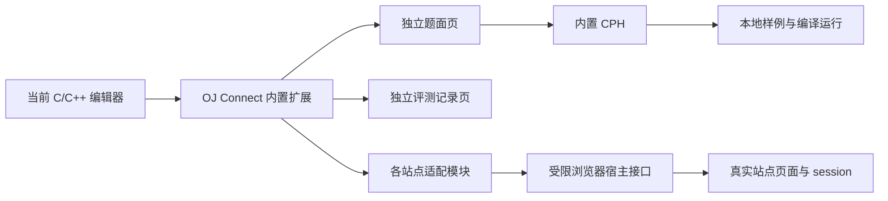

# OJ Connect 技术架构

[产品与开发入口](README.md) · [开发指南](../development.md)

日期：2026-11-15。负责人已确认“统一内置扩展负责刷题业务，浏览器宿主保留真实会话，CPH 负责本地测试”。AtCoder 第一阶段快捷键闭环已获负责人确认；当前源码另已实现洛谷／AtCoder 的共同导入、题面与评测页，并按最新要求直接裁剪复用 vscode-luogu4.20.0 的保留前端及宿主 Markdown 渲染链。共同流程设计和实施计划均已批准，实际网站验收仍按新构建分别进行，不能继承旧 MVP 或协议窗口的验收。

## 当前双站如何组织

源码当前由 `extensions/becoder.oj-connect/src/extension.ts` 装配两个适配器和同一个 `workflowController.ts`；未使用的适配器注册表和控制器重导出已移除。`domain.ts` 统一题目、语言、正式记录、结果及发送状态；`problemResolver.ts` 按直接父目录优先和文件名解析。

| 所有者 | 当前职责与入口 |
| --- | --- |
| 共同工作流 | `workflowController.ts` 固定源码、语言、草稿确认、取消与并发；`recordController.ts` 读取明确 ID，AtCoder 2秒间隔，洛谷适配器等待推送，2分钟一轮 |
| 站点适配 | `src/adapters/{luogu,atcoder}/adapter.ts` 将原站业务封装在临时任务内；`site-scripts/` 仅保留 AtCoder 固定网页操作 |
| 共同界面 | `src/views/` 与 `webview/`；题面绑定源码和题目，评测页绑定正式 ID，Webview 消息不决定源码路径／正文／任意命令 |
| 受限宿主 | `browserOjConnectFeature.ts` 固定命令和本窗口页面；`atcoderBridge.ts`／`luoguBridge.ts` 管理不可伪造句柄与正式回执；`browserViewMainService.ts` 执行固定 recipe、真实 session、取消和只读核对 |
| AtCoder 事务 | `atcoderTransaction.ts` 提前返回正式 ID，保留原生表单事务和合成回归包装；旧实验工具栏已移除；原表单、基线排旧、源码核对等保护保留 |
| 洛谷传输 | `luoguSessionClient.ts` 编排固定操作；`luoguSessionTransport.ts` 从持久 BrowserSession 读取凭据，以 Node HTTPS 发送固定请求，验证码与提交共用该路径；显式退出保留 Session.fetch 的 Cookie 清理。同次提交已输入的验证码被明确拒绝三次后停止，并提示转内置浏览器手动提交／认证，不增加新认证。`luoguCsrfTokenManager.ts` 迁入上游管理器，`luoguProtocol.ts` 转换语义数据，原生主进程建立带同会话凭据的推送连接 |
| Import／CPH | 浏览器双站 Import→`importController.ts`／`sourceStore.ts`→源码与题面；题面明确调用 CPH `importSamplesForSource`，其他站既有直接 CPH 导入保留 |
| 登录管理 | `views/loginView.ts` 提供双站登录／退出与真实摘要；宿主观察普通持久浏览器会话与导航／加载事件合并刷新，不轮询；未接入三站明确不可用 |

语言与最近记录只存在于当前扩展窗口；没有持久题目绑定库，没有独立账号存储。站点脚本、Webview bundle、样式和字体均来自本扩展静态构建。`webview/luogu/` 直接迁入固定版本的题面、提交区、记录、控件及 CSS，`main.tsx` 只装配共用状态；UUID 请求回复仅消费面板动作白名单。按钮与快捷键共用站点／语言族偏好。

洛谷常规题面、准备、提交、账号摘要与记录查询不创建或依赖网页标签，按浏览器当前存储范围选择同一持久 Session；登录仍打开官网，验证码沿用上游的图片面板和输入框，留空刷新。HTTP 单次超时与人工等待分离；明确验证码错误继续原源码，未知回执不自动重交。关闭记录仅释放推送，重开按正式 ID 重新查询。AtCoder 继续使用已有网页事务和页面生命周期保护。当前源码实现不等于两站新构建的负责人验收，见 [当前状态](README.md#当前实现状态)。

洛谷 HTTP 直连限定原有固定端点，每次读取浏览器当前 `_uid`／`__client_id`，不增加独立 Cookie 存储，不修改浏览器或系统代理设置。当前候选保持浏览器 User-Agent 不变，单独验证传输差异；不跟随重定向、不做网络失败后的传输回退。登录和退出仍以浏览器会话为准。该改动是验证码 P0 的待验收候选，真实读取成功不能替代正确验证码提交的验收。

2026-11-15 的后续实测仍收到 `InvalidCaptchaException`，该候选未通过验收。相同浏览器凭据下，上游 User-Agent、Axios 1.20.0、原始 `submitCode`／`getCaptcha` 源码以及扩展宿主 HTTP 代理补丁的独立对照均未取得正式回执；这些结果不能证明根因。原插件实际运行时还会受到扩展宿主 `@vscode/proxy-agent` 接管，因此源码中的 `proxy:false` 不能单独作为“实际上游必定直连”的依据。

2026-11-16 负责人判断该情况涉及洛谷交互式认证，明确不引入新认证形式，改为若干次失败后提示浏览器手动提交。源码据此将本次图片验证码答案失败上限设为三次；首次无答案的挑战、留空刷新与取消不计数。只对精确“验证码错误”且无正式 rid 的明确拒绝计数；未知受理仍不得重发。该产品收尾决策不等于独立证明网站内部认证机制，也不宣称已经修复该机制的自动认证能力。当前渲染统一仅作[只读方案](rendering-review-2026-11-16.md)。

## 目标所有者



| 所有者 | 目标职责 |
| --- | --- |
| OJ Connect 扩展 | 快捷键与命令、插件设置、目录／文件名识别、导入编排、站点选择、登录摘要侧栏、独立题面与评测页 |
| 各站点适配模块 | 原生题目标识、页面／接口规则、语言目录解释、状态和详情解析；按站点能力使用已验证的路线 |
| 浏览器宿主 | 页面／窗口所有者、真实 session、导航和销毁观察、受限读写执行、单次发送防重及请求资源清理 |
| CPH | 将题目样例关联到已有源码，管理本地测试与结果比较；继续复用 Runner 的编译运行入口 |

扩展不持有 Electron `webContents` 或导出的登录 Cookie。站点适配的固定页面脚本可以作为内置扩展的受信任构建资源组织，由宿主从固定位置加载并在隔离世界执行；扩展通过结构化操作调用，不能提交任意脚本。代码的业务归属和实际执行进程需在模块中写清楚。

当前扩展组织如下，不为尚未接入站点建立空实现：

```text
extensions/becoder.oj-connect/
  package.json            命令、快捷键、设置、侧栏贡献
  README.md               当前已实现的用户说明
  src/
    extension.ts          激活、命令与生命周期
    problemResolver.ts    目录／文件名猜题和输入回退
    importController.ts   浏览器导入及既有源码保护
    workflowController.ts 提交任务与取消、防重边界
    browserHost.ts        类型明确的宿主调用
    views/                登录摘要、独立题面、独立评测页
    adapters/{luogu,atcoder}/  双站适配
  site-scripts/           AtCoder 固定原站操作
  webview/luogu/          裁剪复用的上游 React 组件／样式
  webview/main.tsx        共同状态装配
  test/                   路由、导入、状态与界面测试
```

未来各站点放在同一扩展的 `adapters/` 下，复用用户流程和界面。题目标识、官网会话与语言 ID 按站点解释，不将不同站点的同名状态或题号强行等同。未知、部分结果、字段缺失均保留原始信息。统一体验不要求全部站点采用相同 HTTP 或推送协议。

共同层拥有题目、提交任务与评测记录的表达，以及共用题面和记录页面；站点提供内容和更新，不各自维护整套页面。页面句柄、表单检查属于需要浏览器的适配路径，不成为所有站点必须经历的通用步骤。任务发送与记录跟踪分开，无法确认是否受理时只查证，不自动重发。侧栏只显示登录摘要；题库、社交、题解与比赛管理／监控均从洛谷接入范围移除。

## 宿主接口边界

接口围绕已知业务操作设计，不开放通用 `executeJavaScript`、任意带登录态请求或 Cookie 导出。所需语义为：

| 操作 | 结果与约束 |
| --- | --- |
| 打开／取得站点页面 | 返回绑定当前窗口与真实 session 的页面句柄；宿主确定所有者，扩展不能指定其他窗口身份 |
| 读取题目 | 验证站点题目标识，执行固定适配，返回结构化题面与样例；AtCoder 观察网页生命周期，洛谷直接使用 Session |
| 检查提交表单 | 返回当前有效语言、是否已有网页草稿及就绪状态，不返回验证凭据 |
| 准备并发送本次解答 | 接收明确题目与源码快照，验证目标与有效语言，保留草稿保护；一次逻辑任务最多生成一条已受理记录；明确验证码拒绝按原插件续交，受理不明只查询 |
| 读取本次正式记录 | 返回明确 ID 的状态与可得详情；保留来源链接和与本次源码核对的结论 |
| 停止请求 | 释放等待、读取与页面观察；停止跟踪不等于撤回已发出的解答 |
| 读取站点登录摘要 | 返回当前会话可确认的登录状态及必要显示信息；失败／未检查不冒充已退出 |

这些操作当前已有双站固定接点与编译期 DTO；三站未接入的能力仍不计为完成。核心只保留宿主需要的权限与执行职责，不把完整用户流程重新塞回 `BrowserViewMainService`。

提交的不可逆发送边界由宿主持有。扩展重复调用、取消后验证晚到，都不能造成自动重发。扩展停用或宿主连接结束时终止该请求后续动作；AtCoder 另观察网页关闭／导航，洛谷任务不随普通网页关闭而结束。发生不确定状态时允许重新读取正式结果，不自动重新提交代码。洛谷登录使用官网，验证码优先复用插件图片交互；不再向网页插入自制验证码表单。

源码快照取自当前编辑器，记录来源文档及其版本；异步等待期间不混入后来编辑的另一版代码。解答提交不自动保存或改写 `.cpp`。提交事务内保存用于防重与核对的临时状态，不扩张为持久题目绑定库。

## 导入、目录与 CPH

浏览器菜单的 Import 应路由到 OJ Connect，先读取题目并在当前工作区的配置站点目录下创建／打开源码，再打开独立题面。目标不存在时创建目录与文件；同名源码存在时仅打开，保护未保存稿。多工作区根或没有打开文件夹时需要取得明确导入根，不能猜写入位置。

目录设置是站点子目录名，需验证为合法、互不歧义的子目录，写入目标必须留在所选工作区内。设置修改影响后续导入与目录识别，不自动迁移用户文件。目录与文件名规则从同一解析入口取得，题面命令和提交命令不各自实现一份。

CPH 原有 `_becoder.cph.importProblem` 组织自己的源码与样例导入；当前 OJ Connect 使用另一个窄接口 `_becoder.cph.importSamplesForSource` 复用已有 `.cpp`：读取／写入样例仍归 CPH，源码路径由本次用户操作明确传入，覆盖保护仍由 CPH 校验。点击题面“导入 CPH”以前，不自动初始化 CPH 数据。

复用已有题面解析与样例结构，保持空白、换行、单位及官网提供的上下文。页面到题目解析、题目到源码文件、题目到 CPH 是不同边界，应分别验证，不能用一次页面解析成功替代全部导入验收。

## 迁移与验收边界

以下保留迁移与验收的依赖顺序。前四项的双站源码已实现，构建与负责人真实验收分列：

1. 建立内置扩展与受限宿主接点，迁移 AtCoder 用户命令。确保 Ctrl+Alt+S 只有一个有效所有者，避免旧核心与新扩展重复发送。
2. 将站点规则与界面职责收敛到扩展，保留宿主执行和防重边界。以真实 AtCoder 自动提交路径复验，不只验证“扩展命令调用旧核心命令”。
3. 完成简单题号识别、目录设置、浏览器 Import、独立题面与显式 CPH 衔接；保护现有源码和样例。
4. 完成独立评测记录页与五站登录摘要。其他站点逐一补齐能力和真实证据，未接入时明确状态，不宣称五站已完成。

验收应覆盖：目录／文件名匹配与失配、配置目录、首次和重复导入、未保存源码、本地 CPH 样例、验证码延迟就绪、一次发送、取消后晚到验证、导航／关闭、旧记录排除、新 ID 与源码核对、错误结果和缺失字段。合成测试与真实网站验证分开记录。

既有 AtCoder [回归测试](../../scripts/test-atcoder-shortcut.cjs)与 [MVP 验收记录](../oj-connect-basic-flow.md)是迁移基线。负责人已确认记录 `80777721` 全程无需额外点击 Submit；该记录不证明目标独立题面、独立评测页或其他 OJ 已交付。

扩展迁移后负责人再次确认“快捷键交题闭环依旧达成”。新构建的提交 ID、最终判定及源码字段未另行采集，不以旧记录补齐。当前共同层实施继续保护该闭环，新前端仍须按本次构建分别验证两站。

新增内置扩展还需接入根 [package.json](../../package.json) 的 OI 编译链、[扩展构建分类](../../build/lib/extensions.ts)、包内容验证、[组件来源清单](../../resources/oi-defaults/BUNDLED-COMPONENTS.json)及许可证记录。只新增扩展目录不构成随包交付；涉及宿主接口的版本仍需重建 BeCoder。源码检查、staged 构建、包检查和负责人真实验收分别成立。

本轮代码实施按已批准计划执行源码、渲染、Electron、staged 和直接包验证，不构建 Setup 或提交／推送 Git。实施遵循 [AGENTS.md](../../AGENTS.md) 与 [开发指南](../development.md) 完成相关检查。

## 许可与产品边界

本轮采用 vscode-luogu 核心交题流程；评测读取迁入 fetchResult 的同 ID `_contentOnly=1` 与 data/currentData 选择，并以浏览器 session 替换原请求管线。已保留 MIT 声明并登记来源；前端另直接迁入其 React 组件、复制样例控件和 CSS，固定版本／源码、裁剪及依赖清单见扩展 UPSTREAM.md。上游 README 中的洛谷图标另有使用限制，不能随代码许可一并假定可用。CPH 与其他组件继续遵守既有来源和许可证要求。

OJ Connect 是用户主动操作的扩展，Beacon 不取得登录、提交解答或改写学生源码的工具。既有只读题目／记录材料需求保持其原本边界，不在插件迁移时顺带扩张。
