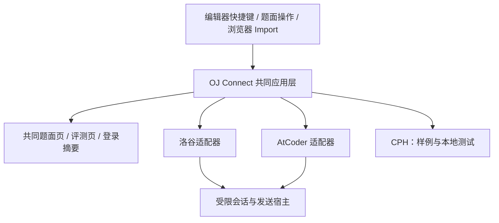

# OJ Connect 共同流程与洛谷接入设计

[产品入口](README.md) · [技术架构](architecture.md) · [AtCoder 第一阶段](atcoder-extension-plan.md)

日期：2026-11-12。负责人已逐节确认本文的裁剪范围、共同层职责、数据边界与交互规则，对应[实施计划](luogu-shared-workflow-plan.md)随后获批实施。下文“目的与现状”保留设计形成时的源码快照，不是当前完成清单；最新实现与负责人验收见[开发入口](README.md#当前实现状态)。2026-11-16 的 [AtCoder 体验设计](../superpowers/specs/2026-11-16-atcoder-experience-design.md)进一步确认其持久语言偏好、独立表单和发送后不提供取消入口，覆盖本文早期的相关细节。

## 目的与现状

OJ Connect 面向 BeCoder 中以当前 C/C++ 源码为中心的练习流程。用户以快捷键看题、提交和查看结果；在内置浏览器找题并导入源码，再按需将样例导入内置 CPH。洛谷插件是核心刷题体验的参考，各站最终呈现统一、和谐的操作和界面。

当前扩展已接管 AtCoder 快捷键提交。源码检查、staged 构建与含编译器的直接包验证已通过；负责人随后确认“快捷键交题闭环依旧达成”。本次新构建的提交 ID、最终判定与源码字段未另外采集，不能用旧记录 `80777721` 补齐。当前结果仍是官网详情加应用摘要；独立题面、独立评测页、登录摘要侧栏及洛谷适配尚未交付。

当时的 `SubmissionController` 直接依赖 AtCoder 桥、任务 URL 与表单类型，`browserHost` 仍是 AtCoder 固定命令传输；前者已由共同工作流替代。设计选择通过 AtCoder 和洛谷两个实际消费者提炼共性，保护已验收的自动提交、防重与记录核对行为。

## 选择的组织方式

共同应用层拥有用户流程和展示，各站适配器实现原生业务语义，宿主执行涉及真实 session 与发送的受限操作。

不并排嵌入完整的站点插件，不建立统一网页操作引擎，也不为尚未接入的站点预建空实现。抽象只覆盖真实消费者已有的共同需要；新站点应接入既有流程与界面，新增字段或扩展点需由实际差异说明必要性。

| 所有者 | 职责 | 不取得的职责 |
| --- | --- | --- |
| 共同应用层 | 命令与快捷键、目录和题号解析编排、源码快照、语言选择、导入、操作生命周期、错误动作 | 网站 DOM、认证参数、具体 HTTP 或推送协议 |
| 共同展示层 | 题面与记录布局、共同按钮、进度、可选详情组件、登录摘要 | 直接调用站点接口或依据站点名重写整套页面 |
| 站点适配器 | 题目标识、读取与转换、有效语言、认证需求、原生发送流程、正式记录确认、结果解释与更新 | 注册第二套快捷键、复制整套题面或评测界面 |
| 浏览器／请求宿主 | 实际 session、窗口与页面所有权、受限执行、发送防重、取消与资源释放 | 决定用户题目、导入路径或整套刷题产品流程 |
| CPH | 为明确的已有源码管理样例与本地测试，维护样例覆盖保护 | 决定 OJ Connect 的提交目标或另建解答副本 |

适配器的业务归属与执行进程分开说明。洛谷即便使用接口，涉及登录态的请求仍需走与实际浏览器会话一致的受限宿主能力；不会额外建立扩展 Cookie 存储和独立登录体系。AtCoder 可以继续执行已验证的浏览器事务。两站无需采用相同网络协议。

## 洛谷能力裁剪与解耦

| 上游能力 | 处理 |
| --- | --- |
| 文件猜题、输入回退、看题、提交、查看记录 | 拆入共同流程与洛谷适配，不沿用第二套命令入口 |
| 题面、公式、图片、样例、提交操作区、记录详情 | 参考并择需复用组件，接入共同数据和共同操作 |
| 语言目录、题目标识、认证与 CSRF、提交接口、记录推送和解析 | 留在洛谷适配；具体通信路线必须实测 |
| 独立账号提供者、全局 Cookie 客户端、全局当前题号 | 拆除对产品流程的依赖，使用本窗口操作上下文和宿主会话 |
| 题面绑定浏览历史侧栏、我的专栏侧栏 | 移除这些入口及必需初始化依赖；侧栏仅保留登录摘要 |
| 通过本地端口转发 CPH、CPH 元数据优先覆盖猜题 | 改用内置 CPH 的明确源码接口；沿用已确认目录／文件名规则 |
| 打卡、犇犇、绘板、专栏／文章管理 | 移除，不注册命令、设置、视图或后台任务 |
| 题库筛选、随机题、题单、题解浏览、比赛列表／管理／监控 | 移除，不作为洛谷接入的默认候选功能 |
| 比赛监控向提交目标隐式注入上下文 | 移除；提交目标由本次明确识别或输入的题目标识决定 |

题目原生身份需要的比赛标识仍属于定位信息，例如 `abc086/abc086_a`；这不引入比赛管理功能。洛谷目录下的 `CF1234A` 或 `AT_abc086_a` 表示洛谷收录的题目，不能静默切换成原站账号提交。

上游证据包含用户提供的 `yltx.vscode-luogu-4.18.2.vsix`，以及已查看的 [看题入口](https://github.com/yltx/vscode-luogu/blob/master/src/features/viewProblem/index.ts)、[提交入口](https://github.com/yltx/vscode-luogu/blob/master/src/features/submit.ts)、[记录模块](https://github.com/yltx/vscode-luogu/blob/master/src/features/record.ts)和[题面实现](https://github.com/yltx/vscode-luogu/blob/master/src/features/viewProblem/webview.ts)。master 会变化，实施复用前必须固定实际来源版本，不能将网页源码与 VSIX 视作相同版本。

## 共同数据边界

共同页面消费 OJ Connect 的结构化数据，不直接接收洛谷 `ProblemData`／`RecordData` 或 AtCoder DOM 对象。以下定义语义边界；具体 TypeScript 签名、RPC、资源加载和模块改动由实施计划确定。

### 题目

共同部分是站点、站点内完整标识、原题链接、标题、正文与样例；时间和内存限制等由站点实际提供。

正文支持有序章节和多语言内容，保留数学公式、图片及附加说明。不能要求每站具有洛谷固定的章节字段。样例保留原始空白与换行，不能经 Markdown 展示再反解析为测试数据。资源地址相对于明确的原题来源解析；正文与资源仍按外部内容处理，渲染时隔离脚本并校验链接。

站点内完整标识由适配器解释；共同层不从一个通用字符串猜出所有站点规则。目录优先与文件名回退共用一个解析入口，不建立持久的源码—题目绑定库。

### 提交任务

共同部分是明确的目标题目、来源文档及版本、按提交动作取得的源码快照、选中的站点语言选项、进度与取消状态。

语言选项标识由站点解释，不把各站的数字 ID 或 O2 参数视为通用协议。偏好按站点和 C／C++ 分别记忆，使用前校验当前仍可用；不在此设计中新增跨重启偏好数据库。语言不存在时要求重新选择，不静默改为其他版本。

源码快照在快捷键或题面“提交”动作发起时取得，不能在登录、选语言、验证码等待后重新读取另一版文本。题面按钮需有明确的来源文档；来源失效时提示选择，不能因为焦点变化提交另一份文件。操作期间不自动保存或改写解答。

### 评测记录

共同部分是站点、正式提交 ID、明确题目、语言、来源链接、当前阶段及原始判定。可得时显示分数、耗时、内存、编译信息、测试点和分组。

缺失字段不伪造，不把无分数的成功补为 100，不把不同站点的原始状态强制解释成同一种判定。展示单位转换必须明确，并保留原始含义。详情以有限的明确组件表达，不增加适配器可注入任意 HTML 或独立页面的扩展口。

正式 ID 必须来自本次发送的有效回执，或由该站已验证的记录关联流程确认。直接得到 ID 的站点无需照搬 AtCoder 的候选列表算法；需要候选核对的站点不得用账户最新记录代替确认。源码核对结论与正式记录身份分开表达，未取得源码时不能宣称已核对。

登录摘要是实际会话的可确认状态及必要用户显示信息；未知、不可用与已退出分开。共同层不接收密码、Cookie 或验证码凭据。

## 适配器的最小业务契约

| 操作 | 适配器向共同层提供的语义 |
| --- | --- |
| 解析题目标识 | 从已确定站点的文件名、输入或链接取得完整身份，或明确失配 |
| 读取题目 | 返回共同题目内容，保留来源和可得附加内容 |
| 取得登录摘要 | 返回实际会话的确认状态，不凭 Cookie 存在推断成功 |
| 准备提交 | 返回有效语言、必要的草稿保护及登录／验证要求 |
| 发送一次并确认 | 消费明确题目、源码快照和语言，返回正式记录引用或明确的发送状态 |
| 读取／跟踪记录 | 为已确认 ID 提供可取消的结构化更新；可使用请求、页面或推送 |

共同层不要求所有适配器先打开表单、取得页面句柄再提交。页面句柄只属于需要浏览器路径的实现；确认方式、认证步骤和数据更新方式留在各站内部。通过固定业务操作访问宿主，不开放任意脚本、任意带登录态请求或 Cookie 导出。

在验证站点读取、发送及结果路线前，不能因发现接口名称便宣称可用。登录和人工验证由用户在官网完成；任务有效时继续原操作，若页面关闭、目标变化或会话身份改变，明确终止或要求重新发起，不能继续向失效目标发送。

## 统一交互与状态

### 用户看到的流程

1. 聚焦当前 C/C++ 源码，Ctrl+Alt+P 打开共同题面页。
2. 可在题面明确点击“导入 CPH”，将样例关联到同一份源码。
3. 编写调试后按 Ctrl+Alt+S，或点击题面“提交”，进入同一提交流程。
4. 按需选语言；需要登录或网页验证时显示对应官网，完成后继续原任务。洛谷图片验证码沿用上游面板与输入框，连续明确拒绝达到上限后提示转浏览器手动提交／认证。
5. 确认本次正式 ID 后打开共同记录页，持续显示评测进度和最终结果。

各站共用题面标题、正文、样例和操作区布局；共用记录页及详情组件。原题、站点与原始结果清楚可见，可选信息按实际数据呈现。统一效果也包括英中同步文案、相同动作名称与可辨识的焦点，不为每个站点建立一套操作习惯。

左侧侧栏仅展示五站登录状态。找题使用内置浏览器，必要的认证和原站操作留在官网。

### 提交任务与记录分开

提交任务表达准备、等待登录／验证、发送中、正式记录已确认，以及取消、失败、发送结果待确认。取得正式 ID 后，评测记录独立表达排队、评测中和站点最终判定。发送失败不能伪装成评测失败。

| 状态 | 共同界面与后续动作 |
| --- | --- |
| 尚未发送且失败／取消 | 明确未发送，用户可修正后重新发起 |
| 等待登录／验证 | 显示官网与等待状态；完成后在原任务有效时继续 |
| 已尝试发送但无法确认是否受理 | 明确结果待确认，只继续查证，不自动重发 |
| 已有正式 ID，结果读取失败或超时 | 保留 ID 和正式链接，提供继续查询；不再次提交源码 |
| 正式最终判定 | 展示原始状态与可得详情，结束本轮跟踪 |

读取可按站点规则重试；发送不得因为网络错误、推送断开、超时或刷新页面自动重试。取消不等于撤回已受理的提交，恢复查询也不等于重新交题。

## 生命周期与资产保护

保留现有每窗口同一时间一项提交任务的约束，不建立跨窗口全局任务队列。窗口、实际 session、页面世代与任务所有者由宿主核对，不能由扩展伪造。扩展停用、连接结束、请求取消及浏览器路径的导航／关闭需要到达实际执行方；晚到验证码或异步回调不能复活发送。同一逻辑任务最多生成一条正式记录。明确验证码拒绝后按洛谷插件行为等待人工验证再继续；受理不明不重发，用户手动 Submit 后也不能补发。

任务状态用于本次操作的防重和确认；重启不恢复自动发送。关闭记录页释放其跟踪资源，已经发送的记录继续以正式 ID 为准。后续显式查询只读取记录。

浏览器 Import 在当前选定工作区下按配置的站点子目录创建／打开源码；已有同名文件和未保存稿均保留。多根／无根时明确选择导入根。配置目录修改不移动文件；不增加重命名关联修复系统。点击“导入 CPH”以前不自动建立本地测试数据，重复导入仍尊重 CPH 的样例保护。

## 实施与验证边界

下一实施计划须将共同数据、流程、视图、洛谷适配和必要宿主操作逐项落到实际模块与契约，并列明依赖顺序。先对照 AtCoder 和洛谷提炼需要的接口，再迁移消费者；不要只把 `AtCoder` 类型改名后仍让所有站点经历同一表单步骤。

实施前核实洛谷当前题面、认证、有效语言、发送回执及记录更新方式。旧 VSIX 与源码提供参考，不证明当前网站可用。题面读取、真实发送、记录确认、结果跟踪分别建立证据；未验证的步骤明确报告，不以替代页面冒充独立题面或结果页。

| 验证层 | 必需证据 |
| --- | --- |
| 共同流程与适配契约 | 相同入口消费两站数据；按键时快照；语言按站点隔离；取消、失败和结果待确认不重发 |
| 页面与资源 | 共用题面／记录布局；公式、图片、多语言、样例保真；缺失字段和可选详情正常；外部内容隔离 |
| 导入与 CPH | 目录／文件名一致；首次与重复导入保护源码、编辑稿和样例；CPH 不再生成第二份解答 |
| 宿主与原站 | 实际会话一致；验证码晚到、导航、关闭、扩展结束及人工 Submit 不重复发送；本次正式 ID 关联可靠 |
| 分发与许可 | 英中文案、内置构建、包内容、依赖、版权、许可证和对应源码记录完整 |
| 负责人真实验收 | 两站在相同操作路径下看题、导入、快捷键交题并查看本次结果；分别记录构建、题目、ID 与可得核对结论 |

保留现有 AtCoder 合成回归及真实闭环，不用洛谷接入成功替代 AtCoder 回归。合成测试、源码检查、staged、包验证与真实网站验收分别成立。人工验收只在明确授权的练习题与源码范围内提交，不自动扩展到其他站点或比赛。

若复用洛谷代码，固定版本，保留其版权与 MIT 声明，登记实际复用文件和依赖；图标、字体、图片单独核实许可，不默认随代码可用。设计确认时尚未复制；当前已按下节决议迁入核心前端组件，实际文件及来源见扩展 UPSTREAM.md。

本节保留设计确认时的范围；设计及实施计划现已批准开发。当前实施与验收状态在开发入口单列，不自动提交／推送 Git 或构建 Setup。Beacon 的读写、登录与交题边界保持原有约束。

## 2026-11-14 已确认的体验收敛

负责人确认“按照洛谷插件的效果即可”。本节覆盖旧界面描述，以用户提供的 vscode-luogu4.18.2 原包前端与命令流程为标杆。

- 主流程为源码→快捷键看题→编写／调试→快捷键提交→自动显示本次记录；CPH 是可选分支。
- 保留紧凑的题面标题／原题链接、限制、正文、公式和样例；题面提交区为“提交当前文件名＋语言选择”，快捷键和按钮使用同一提交动作与语言偏好。
- 移除独立品牌抬头、重复源码说明行、“查看结果／打开原题”等成排通用按钮。原题链接并入标题／编号。
- 正常看题直接呈现共同题面；浏览器在需要登录或人工验证时才显现，不作为常规中转步骤。移除旧 AtCoder Prepare Submission、Choose Source、Refresh Languages 等实验工具栏。
- 记录页采用紧凑信息表、彩色原始判定、测试点和编译信息；正常状态自动更新，异常时才给重试。常规界面不显示源码核对技术状态，不常驻继续查询／停止跟踪按钮。
- 保留 Ctrl+Alt+P／S、五站仅登录侧栏、目录／文件名识别、浏览器 Import 创建源码与题面、题面明确传送至 CPH。不恢复已裁剪的题解、社交、比赛等外围功能。

实现沿用现有模块和数据边界，只添加提交区必需的实际语言选项及验证显现通知。聚焦验证覆盖按钮与快捷键共用语言、记录正常／错误状态、后台读题不打开浏览器、验证时显现，以及两站原提交保护。最终以原包截图与新版实际渲染对照，源码／构建／包检查和负责人真实验收分开。

负责人随后明确“可以直接复用代码”。实现据此迁入 v4.18.2 的 React 题面、提交区、记录页、原生控件、可复制样例及相应 CSS，代替自写相似界面。保留上游 MIT 版权，固定源码提交；必要变化限于共同站点数据、命令白名单、CPH、文案与已确认裁剪。记录中的时间、代码长度、可见源码和编译状态从已读取的原站字段映射，不为还原布局而伪造。完整映射及依赖见扩展 UPSTREAM.md。

后台页面由提交租约和记录跟踪保有；空闲页每站只保留当前一个，完成记录保留本窗口快照，关闭记录释放后台跟踪引用。原用户可见浏览器页不随后台回收关闭。
