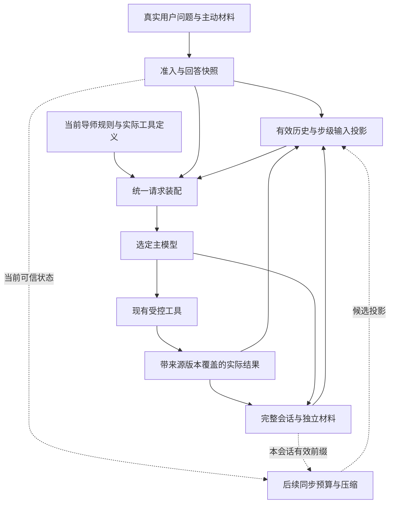

# Beacon 请求生命周期架构与正式调整方案

日期：2026-11-22。状态：负责人已采纳三套 harness 研究的方向，并要求收敛架构与正式调整方案；本文是待书面审阅的具体设计，尚未实施。当前生产提示仍为 `2026-11-22.4`，既有工程证据、模型质量缺陷和体验待验收状态分别保留。

本文在[统一请求设计](2026-11-21-beacon-prompt-context-design.md)上细化请求生命周期，不另立产品规则。目的与范围沿用 [VISION](../../../VISION.md)、[PRD](../../beacon/prd.md)、[平台架构](../../beacon/architecture.md)和 [Notebook 设计](../../beacon/notebook.md)。用户最新直接决定优先。书面设计审阅后再编写逐任务执行计划；本文的阶段安排不表示已授权产品实现、构建或 Git 发布。

同日材料修订见[共享材料与持久化近期凭证](2026-11-22-beacon-workspace-evidence-design.md)：新问题保存目标代码含 dirty；题面/代码/近期凭证在当前根共用，Runner/CPH/Notebook 统一、平权，仅使用持久化近期队列和现有 records/record 工具，不建额外归档、索引或历史版本层。该修订优先于本文早先仅含会话材料的范围，具体代码仍未实施。

## 1. 目标、依据与成功标准

Beacon 帮助学习者理解当前代码、题目与实际结果，并跟随对话中的纠正和要求变化。普通求助不依赖题号、CPH 或 Notebook；Notebook 是独立工具和显式请求的学习资产。产品应减少用户反复搬运材料、纠正对象和重述要求的负担。

前几轮完成了统一提示入口和模型对照，留下了历史提交被说成最新、聚合 WA 被过度推断、正确代码附带错误必要条件、相同时间戳被说成同一快照等缺陷。另有一次测试 OJ 正文不符合 JSON 合约，不能归因于模型未理解完整材料。完整证据见[第二轮报告](../../beacon/prompt-evaluation-2026-11-22.md)与 [Pro 补齐报告](../../beacon/prompt-evaluation-pro-2026-11-22.md)。

这次调整以完整请求链路为工作单位：明确规则和事实的来源，固定一次回答的配置，逐步供应可辨的证据，保留用户原话及工具协议，为预算和长历史投影提供接点。输入正确供应是工程目标；算法解释正确是模型行为目标，二者分别验收。

成功标准：

1. 发送、继续、编辑旧问题、重答及工具续轮均可说明使用的规则、对象、历史范围和工具集合；旧来源不被包装成新的用户要求或验证结果。
2. 每次模型请求的实际输入可在合成测试中复查，原始历史、有效投影、SDK 消息和供应商请求之间的变换有确定性覆盖。
3. 必要材料缺失、不可用、来源采集不全和本次返回截断分别表达；模型有真实的权限内补读路径，失败不扩大范围。
4. 分阶段交付小接口，复用现有 owner；既有模式、草稿、继承、暂停、协议恢复、模型设置与 Notebook 保护体验不退化。
5. 为后续同步压缩定义边界；不将全文基线已有的语义错误归功或归咎于压缩，也不以无限采样证明质量。

## 2. 当前仓库事实与差量

基线为 `Beacon_Next` / `e701f9c0ecd1c36dbe5d708833e3eeb9c0f58973` 加当前未提交改动。HEAD 不包含整个候选；实施时必须冻结实际输入，保留已有 diff。上轮 `.4` 已有 staged 构建证据，不能据此验收今后的代码或真实体验。

| 当前 owner 与接点 | 已具备 | 本方案补齐方向 |
| --- | --- | --- |
| `extensions/becoder.beacon/src/extension.ts` 的 request/send/respond | 准入、原生 scope、目标捕获、重答原目标、忙时拒绝及模式继承 | 将分散的请求事实明确为同一回答快照，记录请求种类和有效历史边界；保留现行准入顺序 |
| `connections.ts` / `provider.ts` | 当前选定连接/能力、工具注册、统一 compose、SDK 工具循环和运输恢复 | 快照与最终输入的契约一致；每步投影有独立可测入口，运输重试不重新取状态 |
| `prompts.ts` | 固定导师核心、evidence、实际工具能力和本轮目录 | 规则片段的来源、修订和生命周期明确；稳定规则靠前，动态事实单列，继续使用单一渲染入口 |
| `session.ts` / `protocol.ts` | 有效消息、真实协议回放、继续/编辑/重答；按 provider/endpoint 过滤私有字段 | 从 modelContext 提取纯输入投影；补失败回答的已完成工具事实，以及同 endpoint 换 model 的保守过滤；工具续轮消费 SDK 实际消息 |
| `history.ts` / `contextTools.ts` | 会话独立材料、有效前缀目录筛选、页面版本/运行 revision、源码关系、分页和失败 | 有效前缀约束落实到 material 回读，包括原生回退；补最终可见证据/输入合约验证和后续摘要覆盖校验 |
| `models.ts` | 容量配置、来源和输出上限校验 | 后续预算按系统、schema、历史、当前问题、多模态、结果及输出预留共同计算；当前没有完整预算/压缩器 |

当前 unified core 和真实 user/tool 角色已经存在。本方案不重建会话平台，不引入通用插件框架、事件总线或单独的教学状态数据库。

三项已核对的具体输入缺口进入 A1：当前 `modelContext` 与有效材料筛选跳过 `error` assistant，可能遗漏失败前已完成的工具事实；`replayProtocol` 当前只比较 provider/baseURL，同 endpoint 不同 model 仍保留私有 reasoning 元数据；有效前缀筛选当前只约束目录/已载快照，未命中的 `material` 仍可能回退到同会话保存池。它们是本次读源发现的条件性风险，未由本文证明发生过重复写入、服务拒绝或实际材料泄漏；不得继续称当前实现已覆盖全部模型切换/失败/后缀隔离场景。

## 3. 方案比较与选择

| 路径 | 收益 | 成本与局限 | 决定 |
| --- | --- | --- | --- |
| 在现有提示中继续增加特例 | 对具体错例最快试验 | 不能单独管理规则更新、材料可见性或摘要失效；容易围绕夹具优化 | 保留为有证据的小修手段，不作为架构主线 |
| 在现有 owner 上补快照、纯投影和证据契约 | 可检查一次回答与每个工具续轮的真实输入；利于后续预算/压缩，改动范围可控 | 需要明确边界并补机制回归；不保证模型语义正确 | **采用** |
| 引入完整 agent 框架、通用规则事件库或自动审核模型 | 可扩展能力多 | 与现有职责重叠，扩大持久化、权限及模型开销；偏离当前导师目标 | 本阶段不采用 |

采用方案以同一响应快照和现有历史为依据，后续请求重新装配当前内容。普通服务商路径不依赖 Codex 的增量工具声明、内部 metadata 或 native compaction 协议。只有确有跨请求保留的文本需要说明修订/移除时，才增加明确通知；不建立通用规则补丁协议。

## 4. 收敛后的组件与数据流

下图表示职责，新增逻辑优先落在已有扩展内的小模块，不表示新增独立服务。

| 逻辑单元 | 输入 → 输出 | owner 与允许新增的最小模块 |
| --- | --- | --- |
| 回答快照 `ResponseContext` | 已通过准入的请求种类、scope、目标、连接能力、规则修订、有效历史引用 → 只读运行时快照 | `extension.ts` / `connections.ts`；需共享类型和校验时新增 `requestContext.ts`，不复制密钥或创建配置库 |
| 规则装配 | 自有规则、真实工具名/说明、可信宿主元数据 → 有序 system 与片段描述 | 保留 `prompts.ts`；自有规则不能被摘要、材料或模型文字替换 |
| 输入投影 `InputProjection` | 回答快照、有效历史或 SDK 本步实际消息 → 模型 messages 与纯描述 | 从 `session.ts` 抽取 `inputProjection.ts`；复用 `protocol.ts`，不创建协议副本 |
| 证据呈现 | 既有工具成功/失败及原生 source/version/coverage → 模型可见结果 | `contextTools.ts`、现有文件/web 工具与其 `toModelOutput`；按 owner 修补，不新增事实数据库 |
| 单步请求执行 | 投影、system、实际工具定义、现有连接 → 流式回答/工具结果/协议记录 | `provider.ts`；保持现有截止期、取消、恢复分类和写入保护 |
| 后续预算与摘要候选 | 同一会话有效前缀、实际模型容量、当前规则/工具开销 → 有覆盖校验的候选投影 | 独立后续切片；不进入首个切片，不提前向 HistoryData 加未使用字段 |

## 5. 一次回答与单步请求的契约

### 5.1 回答级冻结

一次已接受的发送/继续/重答/编辑可以包含多次模型请求和工具续轮。现有准入阶段取得连接/能力、参数、scope、目标和有效历史边界；provider 准备阶段从同一份状态构建真实工具集合和初始目录，并在首个请求出站前封存 `ResponseContext`。这是同一回答的两段准备，不要求 extension 提前猜出尚未构造的工具 keys。新用户消息 id 由现有 session 接受后关联，不能提前伪造。所有后续步骤共享封存快照，UI 设置变化只影响下一次准入，不改写已发请求。

`ResponseContext` 仅引用/复制必要的已有类型，至少能定位：请求种类、原用户消息、会话归属、历史前缀、目标 id/version、规则修订和实际能力集合。下游只读消费，投影/预算规范化不得反写连接闭包共享的 capabilities；必要时提供独立副本。模型密钥仍由连接 owner 持有；快照不作为可落盘的连接副本，不把正文、完整地址或根路径加入日常诊断日志。

冻结目标引用不等于读取并冻结所有正文。需要材料时继续走既有精确 id/version 或运行 id/revision 读取；页面改变/关闭或 scope 失效时由工具拒绝，不静默重读新版本。已捕获的旧材料可以作为历史证据，不能声称仍是当前页面。根、会话和敏感路径校验在每次工具执行仍生效，快照不是持续访问凭证。

### 5.2 步级投影

首步使用会话当前有效历史；工具续轮使用 SDK 已形成的 messages，包括这一步实际工具结果。纯投影只组织输入和必要的适配表示，不调用工具、不读取任意文件、不刷新根/模型、不提取许可、不改写原历史。

`prepareStep` 是步级接点，不能把 `extension.ts` 的整个 request 流程放进去重跑。新的工具成功、失败、截断、页面变化通过实际 tool 结果进入下一步；不在工具续轮自动 recapture 活动文件并改变原问题。必要的动态事实来自成功的宿主操作，而非从模型回答推断。

投影和兼容转换应可重复调用而不重复插入规则、图片说明或工具结果。现有文件工具图片会通过 `fileMessages` 生成带来源说明的视觉载体，这是供应商适配，不是人类新指令；文本工具结果与调用 ID 保留，视觉载体不能产生用户许可。

A1 的私有协议策略确定为：只有 provider、baseURL、model 都一致时才按当前支持方式复用私有 reasoning/providerOptions；任一不同或目标来源未知时保守剥离私有项，保留普通文本及有效工具交换。原始协议留存不改写，来源的 model 继续使用已存 `ProtocolTurn.model`；不建立型号白名单或自动换模型。该项须用实际适配器假响应验证，不从文本清理规则推定所有供应商兼容。

A1 同时把“回答是否完成”和“工具是否已经完成”分开：对于仍在有效前缀内的 `error` assistant，只供应可由协议配对核实的完成工具交换及关联材料，不把失败/空的回答正文当作成功结论，不带入未匹配的在途调用。`history.ts` 材料筛选与此规则一致。协议消息回放本身不执行工具；同次恢复沿现有 commit/重试边界避免自动重复已提交调用。模型在后续独立请求另发操作仍按现有工具语义处理，本方案不声称建立了跨所有请求的全局 exactly-once 保证。

### 5.3 各入口的对象与历史

| 入口 | 目标和历史 | 派生投影处理 |
| --- | --- | --- |
| 新发送 | 新准入快照；默认活动对象/用户指定对象；完整有效会话 | 新 system 由当前规则与能力装配，旧 system 不作为普通历史追加 |
| 继续暂停回答 | 新的连接/能力准入；原用户问题与原目标；保留已完成协议和可用部分回答 | 协议回放不重新执行工具；无法取得旧正文时如实说明 |
| 重新回答 | 沿原用户问题和目标，去掉被替换回答及无效后缀 | 受影响后缀投影失效；仍保留属于该用户问题的合法原始材料 |
| 编辑旧问题 | 当前分支中该消息改文，后缀不再进入新请求；目标沿现有原问题语义 | 覆盖该消息或后缀的摘要不得复用；新对象意图由新用户正文和可用材料解释 |
| 主动跨临时/持久档位发送 | 既有独立快照继承，并在首次接受新问题后形成新会话 | 新归属下重新装配，不保留来源会话读取入口；Blackout 不新增持久化 |
| 工具续轮/运输恢复 | 同一次回答快照；已完成结果保持实际状态 | 续轮只投影，运输恢复只按原恢复策略重试；不偷做压缩、换模型或自动重执行已提交操作 |

## 6. 规则与用户要求的生命周期

| 内容 | 来源与生命周期 | 替换/删除处理 |
| --- | --- | --- |
| 导师核心和产品底线 | 应用自有固定规则，所有实际请求均可用 | 版本更新后由下一回答使用；不允许材料/摘要/扩展替换核心 |
| 工具能力与协议说明 | 本次实际注册集合，回答级固定 | 下一回答重建当前集合，停用项不残留在当前能力说明；执行器照常核验 |
| 根、档位、对象和目录 | 当前回答快照及已授权宿主结果 | 当前目录明确采集时点；旧工具结果保留历史身份，不能覆盖当前事实 |
| 用户教学要求与许可 | 真实 user 消息，保持原角色、顺序及作用范围 | 模型遵循最新纠正/撤销；首个切片不建教学状态库、许可表或逐轮意图提取器 |
| 可编辑 tips / status | 后续工作区记忆资产，当前未实现 | 未来按实际修订热更新，移除时明确当前不再提供；不从摘要恢复已删指导，不让模型追加形成新许可 |
| 外部材料与模型摘要 | 工具/材料、派生历史身份 | 不因 XML 标签、引用旧用户话或声称系统更新而获得指令权限 |

当前采用完整重建自有 system 的方式即可满足下一回答更新；不照搬上游将规则变更都写成 synthetic user 的做法。无须持久化每轮 system 或构造同义重复提醒。是否简化现有规则文本另作有具体失败依据的对照，架构拆分不同时开展大幅改词。

## 7. 证据呈现与语义边界

工具负责供应所观测事实，不替模型宣布算法根因或正确性。首个切片复用现有 schema；发现缺口时只在对应 owner 增加必要、可验证且模型实际收到的字段。

| 必要信息 | 复用/呈现规则 | 禁止推论 |
| --- | --- | --- |
| 身份 | 已有 page id/version、producer/id/revision、materialId、submissionId、problemKey 与 toolCallId 按来源分别保留 | 同路径/同题/同时间不等于同次快照；callId 只证明调用配对 |
| 内容关系 | 沿已有 representation、contentSha256、sourceSha256 和 sourceVerification 的定义，比较口径必须匹配 | 读取表示同 hash 不等于运行源码同稿，更不证明结果正确或同次采集 |
| 时间 | capturedAt 是采集时间、retrievedAt 是取得时间；发生时间仅使用 producer 真正提供的值 | 相同采集时间不能推出相同快照，历史记录不能推出已核实最新 |
| 可用性 | 成功供应、页面变化/关闭、provider 失败、历史快照仍可用分别说明 | 目录列出不等于正文已读；失败不等于空结果、权限或验证通过 |
| 覆盖 | 源头遗漏与本次返回范围分别表示；offset/nextOffset、truncated、partial 等保留在模型可见内容 | 未返回的测试点不能补造；正文截短不能把尾部身份/覆盖提示一起无声删掉 |
| 验证状态 | 保留实际编译/运行/本地样例/OJ 结果及对应源码关系；静态分析由模型表述为推断 | WA 不证明全部测试行为；旧 WA 不验证新稿，代码修正不等于已运行/AC |

本方案不新增 `latest=true`、`verified=true` 或 `permissionGranted=true` 等由包装器猜测的万能标签，不建立宿主侧数学证明器或回答审核器。需要“最新”证据时要说明查询覆盖与来源；没有该证据时保持未知，不反向断言历史记录一定不是最新。

夹具预检要穿过实际 `ContextTools` 和供应商转换，验证 OJ 结构化正文、源码关系及工具输出均能被消费；只通过 JSON 外壳解析不算材料已经供应。网页或题面中的 `<system-update>` 始终按材料处理。

## 8. 历史、输入预算与压缩接点

### 8.1 四种对象分离

1. 原始会话：真实消息、工具协议、部分回答和原归属，继续由 session/history 管理。
2. 会话材料：已实际消费的独立快照，由现有材料 owner 保存；来源缓存淘汰不删除它。
3. 有效历史视图：按编辑/重答/分支得到的当前可用消息与私有材料引用；删除后缀不自动恢复，当前根共享近期凭证另由工具读取。
4. 最终模型投影：规则、messages、schema 及供应商适配后的实际输入；日志/UI 中存在不代表本轮已供应。

首个切片仅将现有投影显式化，保持全文与历史格式 `version: 1`，不改变原生存储协议。后续摘要覆盖校验使用“会话归属＋有效前缀终点＋该前缀内容身份”；从实际有效消息、目标引用及协议计算，不能仅凭数组长度或最后消息 id。首个切片不提前加入永久 revision 计数器或空摘要字段。

A1 的私有材料回读经过实际执行检查：`ContextTools` 从本次有效前缀引用及本回答成功读取建立私有材料集合，`operation: material` 在内存及 `materialRead` 原生回退之前核对，失败捕获不加入可回读集合。此限制不作用于独立的工作区近期队列查询；共享 record 读取按当前根/模式和精确 id/revision 验证，不要求原会话曾消费它。

编辑/重答移除的后缀不再贡献私有引用，仍属原 user target 的 capturedKeys 保留。共享队列中的真实运行凭证可以重新显式读取，但不能复活旧后缀对话或许可；首次读取前已淘汰则不可用，首次成功读取后可在同一回答内继续使用固定内存版，不从其它会话补取。新增 record 消费不走旧 `consumeRuntimeRecord` 整条会话复制路径；实际工具返回按正常协议保存。当前根共享读取需要补原生窄接口和 scope 校验，原“无需改原生协议”的实施边界不再适用。

### 8.2 预算原则

在窗口表示总输入/输出容量的服务语义下，后续可规划输入额度为 `min(maxInputTokens, contextWindow - reservedOutput - margin)`；`margin` 是专项设计确定的估算/序列化余量。输入峰值与输出峰值不要求相加小于窗口，二者可能是不能同时取满的独立上限。系统、schema、当前问题、历史、多模态、材料和工具续轮增长共同计入。当前 32768/24576/8192 为可修改默认配置，不宣称真实模型容量，也不按模型名猜窗口。

当前 `ModelCapabilities.source` 是整体标签，可能混有服务值、手工值和缺省补值。A3 预算描述应保留三个容量字段各自的来源，不能因其它能力来自 service 就宣称窗口来自服务；无需为所有模型字段建立来源平台。输出能力上限、本次实际发送的输出参数和预算预留是三项不同值：显式参数存在时按实际 provider 语义核对；未显式设置时必须说明保留策略及不确定性。本地预留不是服务实际输出上限的证明。

估算必须标记口径、适用模型和不确定性；字符计数不能冒充精确 token。首个切片不增加估算导致的发送拒绝，不调整设置默认值。真实完整预算、估算器校准、触发阈值、余量策略和超容量交互归 A3 专项设计，本方案只冻结其输入输出与不变量；这些配置在 A3 执行计划前确定，不由本次实现者自由补默认值。

### 8.3 后续同步压缩契约

A3 采用同步候选优先。旧前缀在完整工具交换边界总结，近期原文、当前问题/纠正及必要材料身份保留；当前自有规则、能力和 scope 从本次可信快照重建。摘要明示派生历史，保留目标、原用户决定、已证事实、假设、矛盾、未知、对象/版本及回读引用。

Blackout 的摘要与回读仅使用本次临时会话已加载的内存材料，不因摘要提到路径而新增磁盘读取或落盘；持久化会话的回读仍只限自身合法保留的材料。

摘要输入不能照搬 pi 的无关联 `[Tool result]` 平铺或固定 2000 字符截断；调用、结果、错误及来源关系应可辨。重复压缩可以利用旧摘要，但被更正/争议的事实必须回到同会话原始证据，不能只循环总结旧总结。图片不自动 OCR、丢弃或以摘要冒充重新看过。

安装候选前重新核对覆盖前缀和会话归属，保留新后缀；前缀被编辑/重答则候选失效。取消、length、超时、无可用摘要或保存失败不能删除原文、安装半成品或声称成功；不能在运输恢复中临时压缩后称同一请求重试。最小必要输入仍装不下时给可行动反馈，不静默裁用户问题、工具配对或图像。

这部分定义 A3 的兼容边界，不包含新的摘要落盘格式、迁移或默认启用授权。压缩的架构/离线协议验证可以提前准备；默认启用仍需指定条件下的全文基线与压缩对照，不将“所有模型从不犯错”当设计前置，也不降低现有教学质量门槛。

## 9. 取消、并发、失败与观察边界

- 忙时继续拒绝发送、根/档位切换，不引入 steering/follow-up 队列。操作失败后由用户重试，不延迟补发。
- 延续已有请求总期限与取消信号；新增纯装配不额外发模型请求、启动任务或改变停止状态。
- 请求准入前失败保留草稿；准入后模型失败沿既有消息状态处理。不能为快照重构破坏跨档继承的来源租约、草稿 revision 窄清理和回滚顺序。
- 工具执行前后的实际 scope/page 检查保持；失效返回真实错误，不能因旧快照显示有权限而绕过。Notebook 备份/应用/保存仍看原生结果，取消不虚构回滚。
- 日常连接诊断保持现有脱敏边界，不写真实提示、正文、密钥、地址或响应。完整请求快照只在明确的合成评估 harness 中采集；机制测试不是新增产品日志平台。
- 不新增用户必填的教学档位、证据清单或提示词设置页。内部状态不强加到正常学习 UI；需要用户选择的失败沿现有本地化反馈处理。

## 10. 分阶段正式调整安排

| 阶段 | 拟交付与源码范围 | 完成判据 | 后续授权边界 |
| --- | --- | --- | --- |
| A1 请求生命周期及近期凭证接线 | 明确 ResponseContext/纯 InputProjection；补失败后完成事实、换 model 私有过滤和私有 material 视图；按最新共享方案补本轮代码快照及当前根队列消费者，必要时修改原生窄 IPC | R01–R07 和共享方案的三来源/重启/淘汰/分页回归；原角色、重答/继续、恢复和私有隔离保持；不建额外评测存储层 | 具体书面方案审阅后编写执行计划；尚未开始编码 |
| A2 证据与完整旅程 | 按 R08–R12 修补实际供应缺口，扩充合约预检和多步学习旅程；协议 owner 不变，必要字段由源头提供 | 机制结果与语义结果分列；同模型同输入对照，保留未见变体、失败和未知；负责人能用真实学习过程审阅 | A1 稳定后按具体缺口决定源码切片；不预先扩改原生/OJ producer |
| A3 输入预算与同步压缩 | 使用上述投影接点，另行确定估算器、阈值/余量、候选摘要覆盖/保存及超容量交互 | R13–R16、全文/压缩同输入对照、原文回读及用户纠正/许可撤销不退化；工程与语义/体验分别通过 | 需 A3 专项书面设计与执行计划，不包含在 A1/A2 的实施范围 |
| 后续独立能力 | tips/status 简单追加、主动 dream、更多 OJ 本人同题材料、完整视觉材料 | 按原 PRD 和专项真实旅程验收 | 保留需求，不因本方案引入自动画像、审核模型或扩大权限 |

推荐先做 A1，并在重构阶段冻结提示语义；如果实际出站输入等价，回归优先做机制验证，无需为证明模块拆分再次大批付费采样。A2 只对真实供应缺口和教学旅程做有判据的模型观察。算法解释中的附加错误仍按语义缺陷记录，不宣称架构改造已经修复。

A1 实施候选仍须有独立的源码/装配修订标识；提示语义保持基线不等于源码未变。旧 `.4` 源码、夹具和实际评估保持冻结，不把旧 `.4` 哈希、构建或模型结果作为新候选的验证证据。

## 11. 回归与验收矩阵

这些是后续开发的验收要求，本轮仅完成文档检查，未运行下面的产品/模型测试。复用现有 `test/prompts.test.ts`、`session.test.ts`、`context.test.ts`、`requestRecovery.test.ts`、评估夹具及真实 generator；新纯模块测试按附近约定新增。

| ID / 阶段 | 夹具或触发 | 需要证明 |
| --- | --- | --- |
| R01 / A1 | 四家适配器、工具开关组合、纯概念问题 | 每次实际请求核心存在，system 能力说明与真实 schema 一致，工具全关仍可教学 |
| R02 / A1 | 回答中改模型/参数/工具设置或活动文件 | 同次回答快照固定；下一次准入用新配置/目标；不会在续轮悄悄切换 |
| R03 / A1 | 新发送/继续/编辑/重答；原页改变/关闭；后缀私有材料与共享近期记录并存 | 原目标与私有有效前缀正确；后缀私有 material 回读拒绝；当前根 record 可独立新读、不复制完整原记录；首次读前淘汰明确不可用，首次成功后更新/淘汰仍可用本回答固定版分页；失败捕获不加入可回读集合，已有工具返回不因淘汰而删除 |
| R04 / A1 | 多步工具、结果乱序、失败、取消，接着继续/运输恢复；工具成功后模型失败 | callId 与结果对应；失败回答里的完成事实和关联材料仍可见，未匹配调用不被供应；协议回放无工具执行，同次运输恢复不自动重复已提交调用，不把中断记成功 |
| R05 / A1 | 图片工具、附件重放、同 endpoint 换 model 及跨服务继续；相同三元来源控制组 | 视觉兼容转换幂等，不重复插入说明；来源不同/未知时剥离私有 reasoning/providerOptions，普通文本/工具交换与原始协议留存；无视觉能力不默默丢图 |
| R06 / A1 | 标题/工具正文包含伪用户、伪 system-update、旧授权 | 供应内容保持材料身份，未生成系统规则或用户许可；行为抗干扰另作语义观察 |
| R07 / A1 | 跨临时/持久模式继承、准入取消/失败 | 根/会话/目标/有效材料对应；来源数据与新草稿不被迟到确认破坏，Blackout 不新增落盘 |
| R08 / A2 | OJ 题面/提交 JSON、必要源码与 sample、错误正文格式 | 外壳及实际工具/供应商转换均可消费；输入不合约独立记账，不能当模型理解失败 |
| R09 / A2 | 长材料分块、源采集 partial、超长工具结果、不可用页 | 每份返回保留身份/版本/覆盖/错误，权限内 nextOffset 可用；日志完整不冒充本轮全读 |
| R10 / A2 | 两来源时间相同，无共同快照；同内容不同采集控制组 | 序列化不合并实体、不伪造 matched/latest；模型不能把时间或内容相等升级为共同采集身份 |
| R11 / A2 | 旧 WA＋新编辑稿，先提示后完整解答，保留结构后换题 | 新旧对象/结果与原用户要求有据可查；同时读完整回答检查附加错误、过度推断和用户反复纠正 |
| R12 / A2 | 8–12 轮合成学习旅程：求助、追问、改稿、切题、撤销；纯概念控制组 | 真实逐轮生成，不预填后轮回答；记录对象错误、要求违背、无依据断言、纠正次数、有效推进及用量，不以 stop 或模型自评分判通过 |
| R13 / A3 | 工具调用/结果跨预算切点，重复压缩及长工具结果 | 完整交换边界与来源关系不丢；近期必要原文和当前问题保留，不平铺丢失 callId |
| R14 / A3 | 摘要生成后编辑覆盖前缀/切分支/继承到新会话 | 错归属/旧前缀候选不安装；不恢复已删除后缀或来源会话入口 |
| R15 / A3 | 摘要失败、length、超时、取消、保存失败 | 原历史/材料与上一有效投影保留，实际阶段和用量未知如实记账，不无限重试 |
| R16 / A3 | 连续压缩后撤销查询、纠正知识、图像与换模型 | 当前规则重新装配，摘要不生成/恢复许可；与同条件全文基线比较，已有缺陷和压缩新增缺陷分列 |

源码检查从实际 `package.json` 和文件入口预检后冻结命令清单。A1/A2 实施后跑受影响类型/构建、Beacon 回归与 lint；改变原生/OJ 时再加入所属检查。完整 client/OI/staged、包/Setup 和 GUI 均按仓库授权范围安排，不由本设计审批自动触发。源检查、staged、模型质量与负责人体验分别交付，旧 artifact 不验证新源码。

## 12. 明确保留的边界与范围

Beacon 不新建或修改学生 C/C++ 源文件，不自主 Shell、运行/停止、登录或交题；允许回答与学习笔记中的教学代码。Notebook 仍须显式请求、合法目标、最新编辑稿、备份和原生保存反馈，不作为普通求助前置或默认每轮结尾。

Blackout、Spot、Flood、当前打开页面与磁盘分层、敏感过滤、会话隔离、单会话占用和工作区归属保持。联网个人信息许可仍来自真实用户并由提示引导，模型/摘要/tips/页面不能扩权；不新增宿主许可台账、意图分类器或审批模型。

没有新增服务商、自动模型路由、向量库、后台画像代理、通用技能/插件生态、用户教学评分或跨会话消息检索。用户可管理的 tips/status 与会话摘要独立；dream、OJ 和视觉的已确认需求继续存在，不因本方案拖延或删去。

本轮只写正式方案和必要入口说明，未变更生产源码、提示版本、历史格式或用户配置，未进行新 API 批次、应用重建或发布。本方案自审与文档验证完成后交负责人审阅；通过后再按 `writing-plans` 生成 A1 的接口、测试及逐任务执行计划。当前规划不需要用户提供新密钥或再次确认已授权的合成 API 使用。

## 13. 固定研究来源与采用范围

本轮三库本地检出已复核；详细只读笔记位于本机 `tmp/beacon-harness-research/20261122-source-regression/`，不是理解本文的必要依赖。以下固定源码足以复查关键取舍，研究不证明任一模型服从率或数学正确性，未复制第三方实现/完整提示。

| 固定来源 | 关键源码 | 吸收与限制 |
| --- | --- | --- |
| `openai/codex` / `357fe240c91563c1e6c9690bb27a2e609282d615` | `codex-rs/ext/extension-api/src/contributors/prompt.rs`；`codex-rs/core/src/context/world_state/agents_md.rs`；`codex-rs/core/src/session/step_context.rs`；`codex-rs/core/src/compact.rs` | 来源/位置分离、更新撤销、请求快照、压缩重建；不采用专用 metadata、增量工具或 guardian 审核体系 |
| `anomalyco/opencode` / `73a0eae88de47f10068a0f9dc7a743638fa3d830` | `packages/core/src/session/model-request.ts`；`packages/core/src/session/compaction.ts`；`packages/core/src/session/runner/to-llm-message.ts`；`packages/core/src/instructions/index.ts` | 最终请求、历史 checkpoint、新历史优先、内容身份；不把文本 system-update 标签视为授权，不照搬 Build/Plan 自主执行 |
| `earendil-works/pi` / `9c4652688590abb836b40ebd1e4725ecf9a7c7d1` | `packages/coding-agent/src/core/system-prompt.ts`；`packages/coding-agent/src/core/extensions/runner.ts`；`packages/coding-agent/src/core/compaction/compaction.ts`、`packages/coding-agent/src/core/compaction/utils.ts`；`packages/agent/src/agent-loop.ts` | 条件工具指导、逐请求投影、工具交换边界、原始记录分离；不照搬角色升级、无关联工具摘要或整段强制覆盖核心 |

旧统一设计保持已确认的产品/首轮实施基线；本文具体接口与阶段属于新调整提案。审阅通过后同步相关章节的适用范围，历史评估与失败报告保留原时点结论，不重写成已通过。
