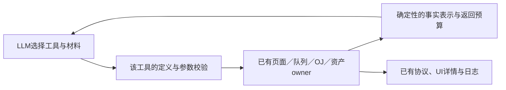

# Beacon 工具接口减法设计：负责人审阅稿

日期：2026-11-23。版本：审阅稿 0.1。

**状态：负责人已采纳工具层减法方向，并授权编写本稿；本文的具体接口、参数、返回字段和范围仍待负责人审阅。尚未进入实施筹划或产品开发。**

本文供项目负责人逐项把关。技术审阅只能发现合同问题，不能代替负责人对工具设计和实际体验的认可。正文所有新工具名均为提案，不描述当前已实现能力。

[现行需求](../../beacon/prd.md) · [总体架构](../../beacon/architecture.md) · [底层合同](../../beacon/foundation-design.md) · [代码与快照](../../beacon/code-snapshots.md) · [压缩合同](../../beacon/context-compaction.md) · [实现状态](../../beacon/implementation-status.md)

## 1. 本次要解决什么

Beacon 跟随学生当下的学习活动，按需取得代码、题目和真实执行结果，再作算法与编程教学。模型负责选择讨论对象和需要读取的材料；工具负责准确取得事实。工具接口应让这两种责任容易配合。

本次调整目标是减少一次调用需要作出的无关判断：一个清楚的动作、适用于该动作的参数、能据此继续工作的结果。复用已有生产者、队列、权限、会话和协议，不再增加材料库、别名表、工具搜索服务或通用代理框架。

### 1.1 已取得的事实

研究基线为 `Beacon_Next`，Git HEAD 为 `c54e9e4970c59fb1553b38581dc951fc3fb9d8fa`，实际候选仍含未提交内容。当前工具与提示词分别见 [provider](../../../extensions/becoder.beacon/src/provider.ts)、[参数合同](../../../extensions/becoder.beacon/src/contextToolContract.ts)、[ContextTools](../../../extensions/becoder.beacon/src/contextTools.ts)、[prompts](../../../extensions/becoder.beacon/src/prompts.ts)。不能用 HEAD 代替整个工作树的身份。

当前正式工具为 `inspectContext / inspectFiles / browseWeb / editNotebook`。其中 `inspectContext` 合并 11 个 operation；其模型 schema 展示可用 operation 所需字段的并集，执行时再检查具体 operation 的字段集合。

已完成的正式 DeepSeek Flash 测试中，候选上下文交换正常返回 2188/2339，历史快照读取正常返回 90/129；该操作的 26 次参数错误中，23 次含不允许的 `part`。这表明存在明确的接口改进空间，但不能推断拆工具后一定提高多少。

来源为 [上一轮正式结果](../../beacon/evaluation/2026-11-23-tool-information-flow-report.md)及本机离线复核 `tmp/beacon-tool-flow/tool-layer-snapshot-failures.json`。调用返回成功、所需材料充分、模型理解正确和教学质量分别统计。

### 1.2 这次文档的范围

| 对象 | 本稿处理 |
| --- | --- |
| 上下文入口、目录、参数和模型结果 | 提出完整的新接口与旧入口映射，待审阅 |
| 工具描述、错误、模式裁切、压缩取材、旧历史 | 写清配套合同，避免只换名字；R02明确提出READ01的首发目录变更，待单独批准 |
| 普通文件、公开联网、Notebook 事务 | 列出完整保护接口；主方案保持其输入和业务语义，供负责人决定本轮范围 |
| 底层队列、生产者、会话归属 | 沿现行合同，不重新定义存储 |
| 摘要算法、后台压缩、教学核心规则 | 保持当前边界；仅适配工具声明及模型可见格式 |
| 工具可视化 | 保留真实事件及 UI 详情接口；具体界面另审，不将其加入本稿交付承诺 |

## 2. 负责人先审阅的六项决定

以下均为**技术建议，等待负责人决定**。可以分别标记“通过／修改／继续讨论”；认可某一项不自动批准其他项，也不自动授权实施。

| 编号 | 需要把关的选择 | 本稿推荐 | 主要代价／替代方案 |
| --- | --- | --- | --- |
| R01 | 模型可见工具如何拆分 | 第4节的 8 个上下文工具，加现有3工具，共11个；内部 owner 不拆成11套系统 | 比现在工具名多；替代是保留 operation 并使用条件 schema，但需验证各提供方实际请求形态 |
| R02 | 首发目录是否精简，是否批准变更现行READ01 | 首发只带模式与活动代码元数据及目录入口说明；其他材料通过 `listContext(source)` 按需读取 | 会改变现行“首发打开页面元数据＋材料目录”合同；查历史可能多一次列表调用。未通过则保留现行目录，不能先删后补批 |
| R03 | `readRecord` 是否继续统一各来源 | 保留一个凭证读取工具，直接复制精确 `ref`，只在此保留真实业务 selector | 它仍是最复杂的读工具；替代为五个来源专用读工具，总数由11增至15，减少来源条件但增加声明体积 |
| R04 | 保存题面与联网题面是否明确分开 | 保存的 Get Problem 题面走 `readRecord`；联网只走 `fetchProblem(url, ...)`，继续受现有联网开关控制 | 移除“一个入口自行读本地或联网”的便利；模型需要明确选择读取意图 |
| R05 | 模型结果与 UI 活动如何分层 | 采用第6节的最小事实表示；保留身份、版本、覆盖、必要摘要指纹及完整续读，UI从同次结果投影现有活动与协议 | 不另存完整原生结果给UI；需要人工审阅真实结果，防止删掉必要信息或换名后全部透传 |
| R06 | 本轮是否同时重做其余三个工具 | 保留 `inspectFiles / browseWeb / editNotebook` 的输入和功能，仅接统一调用观测与提示装配 | 本稿并非一次拆掉所有 operation；文件／笔记进一步拆分可在单独接口审阅后纳入 |

第5节给出主方案的全部接口；第14节给出负责人参与节点。未通过的决定保留为提案，不静默采用推荐值。

## 3. 设计依据与取舍

### 3.1 三项目提供的启发

| 固定源码 | 可借鉴机制 | 应用于 Beacon 的位置 |
| --- | --- | --- |
| Codex `357fe240c91563c1e6c9690bb27a2e609282d615`；`codex-rs/tools/src/tool_executor.rs`、`tool_output.rs` | 声明和执行由同一工具契约提供；模型输出、日志和宿主状态分别表示 | 单份工具定义派生参数说明和执行校验；区分结果投影与日志 |
| OpenCode `73a0eae88de47f10068a0f9dc7a743638fa3d830`；`packages/core/src/tool/runtime.ts`、`tool/plugin/read.ts` | 参数错误给出字段路径和可操作反馈；读结果说明当前范围和下一次位置 | 错误反馈、范围与续读；其 raw schema 校验存在回退边界，不能当作 Beacon 放宽验证的依据 |
| pi `9c4652688590abb836b40ebd1e4725ecf9a7c7d1`；`packages/agent/src/types.ts`、`packages/ai/src/utils/validation.ts`、`packages/coding-agent/src/core/tools/read.ts` | content 与 UI/details 分开；单工具描述、参数及规则靠近工具；错误也形成结果 | 模型视图、可用工具提示和调用结算；其参数类型转换不直接用于 Beacon 身份字段 |

本次为固定版本源码研究，未运行三项目测试，不声称覆盖线上最新版本。工具搜索、Code Mode、额外输出文件库或参数自动猜补不是本稿建议。

### 3.2 比较过的接口形式

| 方案 | 好处 | 代价 | 判断 |
| --- | --- | --- | --- |
| 动作独立、目录合并、凭证统一 | 代码／快照／网络不再共享无关参数，复用现有 owner；真实凭证仍平权 | 工具数量增加；record 保留必要来源条件 | **主方案，R01／R03待审** |
| 保留万能入口，增加复杂条件 schema | 表面工具名少，可以在 schema 描述 operation 与字段依赖 | 需要提供方兼容试验；仍需模型先选 operation 再理解条件，运行时验证不能取消 | 作为对照，不预先实施 |
| 所有来源分别一个工具 | 每份 schema 很窄 | 队列来源、题面与 Notebook 等工具声明更分散，容易重复说明 | 仅作为 R03 替代，不默认扩张 |

工具数量本身不作为简洁程度的验收。验收对象是实际填写参数的难度、调用往返、事实充分性与错误恢复。

## 4. 工具全表与最小调用链

### 4.1 主方案工具全表

| 工具 | 唯一主要职责 | 原入口 |
| --- | --- | --- |
| `listContext` | 列出一个明确来源的可读目录，不读正文 | overview/pages/records/codeSnapshots，以及 overview 中的私有材料目录 |
| `readCurrentCode` | 取得当前打开 C/C++ 编辑器的真实代码；许可时同次保存对话快照 | currentCode |
| `readCodeSnapshot` | 读取当前对话仍保留的一个历史快照 | codeSnapshot |
| `readRecord` | 读取一个精确共享凭证及其指定部分，包括已存 Get Problem 题面 | record、problem 的保存题面路径 |
| `getProblemHints` | 给出一个代码文件的独立题目候选及来源状态 | problemHints |
| `fetchProblem` | 通过五站 OJ Connect 解析器作一次只读联网题面观测 | problem 的联网路径 |
| `readPage` | 读取允许的非 C/C++ 普通页面或 PDF 物理页 | page 的非代码路径 |
| `readMaterial` | 读取当前对话有效分支已授权捕获的私有材料 | material |
| `inspectFiles` | 保留普通文件读取／目录／查找／搜索 | 当前同名工具 |
| `browseWeb` | 保留公开信息搜索／单页获取 | 当前同名工具 |
| `editNotebook` | 保留用户明确要求的笔记事务 | 当前同名工具 |

普通读取不注册 `inspectContext` 兼容执行入口；旧历史如何保留见第11节。模型不能通过统一网关绕过单工具 schema。

### 4.2 请求前最少元数据（R02）

保留当前模式及活动代码页的 `pageId/fileName/filePath` 观测，可为空。该观测不指定讨论对象，也不为调用固定版本。根／权限所需目录继续由 `inspectFiles` 自身描述提供，不在这里重复整份目录。

**合同变化：**现行[READ01](../../beacon/prd.md)要求首请求提供打开页面元数据、来源／版本／覆盖及材料目录入口。本节建议不再首发其他页面和各类近期目录，是对其首发组织方式的明确替换提案，不是现行合同已经允许的实现细节。R02未通过时保留旧首发目录；通过后才同步修改PRD及架构对应段落。

初始装配不读取五类近期目录、代码历史列表或它们的正文；不自动调用题目解析；不为普通概念问题增加目录取材。没有活动代码时，`readCurrentCode({})` 明确失败；模型可列 pages 或根据用户话语指定对象。

首发活动元数据与listContext使用同一敏感过滤：隔离资产、凭据路径或被owner确认受保护的页面不泄露标题／URI，activeCode置空；普通合法页面只是未加载／provider不可用则可以显示安全的不可读状态，不授予正文。首发同时用一条简短说明告知可用listContext的source集合，不重复注入材料目录。

```json
{
  "mode": "spot",
  "activeCode": {
    "pageId": "page-17",
    "fileName": "maximum.cpp",
    "filePath": "C:/practice/maximum.cpp"
  }
}
```

例中 ID 和路径仅演示字段，实际由宿主提供。工具目录、材料目录和讨论对象分别拥有不同语义。

### 4.3 所有者与调用链



模型视图不由另一个 LLM 改写，不替模型判断“应讨论哪道题”，不把正确性结论塞入工具结果。内部仍可复用 `ContextTools` 的读存、固定版本、过滤和原生调用；模型工具名不要求一一对应新的原生服务。

## 5. 输入合同与逐工具接口

### 5.1 通用约定

下列TypeScript形状用于书面审阅，`integer/positiveInteger`表示本节的整数约束，不是可执行产品代码。字段名与互斥关系按本稿给定；实际schema和校验在获批后的实施中从同一合同生成。

1. 所有新输入均为普通 JSON 对象；未声明字段拒绝，不静默丢弃。字符串不接受空白值或显式 null；整数不接受数字字符串、浮点数或 null。不猜填 ID、producer、revision、operation 或业务选择。
2. `id/pageId` 最多256字符；`version`、文件 URI、块／input 标识及 locale 的现有字符串安全边界继续保留，URL 最多2048字符。`revision` 为正安全整数。
3. 除单独说明外，`offset` 为非负安全整数，单位是返回文字表示的 JavaScript UTF-16 code unit；默认0。`limit` 默认32768，同单位，范围1–131072。它们不是 UTF-8 字节或模型 token。单份快照上限仍为262144个 UTF-8正文字节。
4. budget 可减少实际返回长度，不能放宽输入上限。续读以实际返回的完整参数为准；对摘要读取，limit 上限另裁为8192。
5. 参数 schema、字段说明、默认值和运行校验从同一工具定义派生，不再把代码、快照、页面、题面等无关动作的字段放进同一个并集。`readRecord`仍有来源相关语义条件，必须同时写入该工具参数说明和校验；共享schema不能消除所有状态条件，不能声称它已等价于五份来源专用schema。单独的真实 owner 权限／身份／语义校验仍保留。
6. 参数只选材料，不能输入目标工作区、会话、模式或 epoch；这些由宿主捕获并在真实操作时校验。

### 5.2 listContext

```ts
listContext({ source: 'pages' | 'code_snapshots' | 'runner' | 'cph'
  | 'notebook' | 'oj' | 'problem' | 'materials' })
```

唯一参数 `source` 必填；无 offset、limit、query 或默认全选。不读取各队列正文，不因为列目录首次固定记录，不触发代码捕获。对已确认的有界队列直接列全部保留元数据，不另造分页状态；来源次序只表示时间／队列次序。

| source | 输出条目最少需要的字段 | 身份与次序 |
| --- | --- | --- |
| pages | pageId、kind、title、version、可用时fileName/filePath、active、实际不可读原因；PDF页数如已知 | 当前窗口已打开且允许的页面；代码页指向 readCurrentCode，其他页指向 readPage |
| code_snapshots | id、fileName/filePath、capturedAt、lastObservedAt；首捕获version与lastObservedVersion分别标明 | 当前对话队列，最新观测在前；历史读不晋升 |
| runner/cph/notebook/oj | `ref`、sourceUri、capturedAt、真实state、实际problem身份（如有） | 当前根该来源最多20条，最近在前；活动额外保护按原合同 |
| problem | `ref`、题目身份、sourceUri、viewedAt、capturedAt | 当前根最多13条；用户查看时间不能写成模型读取时间 |
| materials | id、材料类型、标题／真实来源、实际捕获时间（如有） | 当前有效分支已授权私有材料，排除其他对话和弃分支 |

`ref` 即既有 `{ producer, id, revision }`，目录中完整返回，模型可直接复制进 `readRecord`；不生成短期别名、令牌或另一张引用表。目录不重复给一份同内容的“下一次调用指令对象”。

目录返回 `{ok:true, kind:'directory', source, items, count}`，count为本次实际条目数。单来源所有可授权元数据在现有结果预算内完整返回，不增加列表游标；页面／materials过多而外壳装不下时明确预算失败，不静默丢条目或把未返回数算作不存在。这一容量代价列入R02的实际样本审阅。

空目录成功返回 `items: []`；来源被模式禁止则报权限错误，不能伪装成空。已知受保护页面及隔离资产完全不列；普通合法页面的provider尚未就绪、PDF未加载、格式不支持等只返回安全元数据和原因。Notebook／OJ功能页不作为材料正文入口；普通文本形式的笔记页可给出content-owner不可读状态，但readPage仍拒绝。任何目录项都不授予backing file读取，不能列出其他聊天。

### 5.3 readCurrentCode

```ts
readCurrentCode({ pageId?: string, version?: string, offset?: integer, limit?: integer })
```

- 省略 pageId，读取**调用当下**活动代码页；显式 pageId 读取该打开的 C/C++页。页面 ID 与对话快照 ID不能混用。
- offset=0 是一次新的真实观测，允许同一回答再次读到 dirty 改稿。version 如提供，表示调用者明确要求该页面版本，必须校验；未提供则读当下稿。
- offset>0 是未保存原稿的受限续读，必须同时提供原 pageId/version；不再次保存或晋升快照。页面关闭／变版则失败，不退回活动页，也不把新版内容拼在旧稿后。
- Spot/Flood在 offset=0 时以同次完整观测保存本对话队列，再按预算返回；不为保存第二次读取。不支持 `part`、sourceUri、producer、revision、problem或独立保存开关。
- 已存成功的续读给出 `readCodeSnapshot`；未存／Blackout的续读给出同 pageId/version 的 `readCurrentCode`。来源事实和快照保存状态分别返回。

保存状态沿用既有三种类型：`saved {id,reused}`、`not-saved {reason:too-large|save-failed}`、`disabled {reason:blackout}`。not-saved 不使实际读取失败，不能提供虚假可回读ID，也不改变原队列。saved 只表示对话快照，不表示学生文件已保存。

**需实施时验证的源码差量：**当前入口只在续读时应用 expectedVersion；新接口将显式 version 在 offset=0 时也作为约束。该变化是字段语义收敛，不允许用初始元数据强制填写 version。负责人可以在 R01 中要求保持旧语义或去掉首读 version，但不能让字段表与运行行为相反。

### 5.4 readCodeSnapshot

```ts
readCodeSnapshot({ id: string, offset?: integer, limit?: integer })
```

id 必填，仅当前对话有界队列。允许字段只有 id/offset/limit；`part:all`、`part:code`、pageId、version、sourceUri、revision均拒绝。该最小形状直接针对已观察的字段混用。

这份新工具的可审schema如下。模型提供方是否支持严格采样不替代执行时校验；默认值由同份工具合同应用，不依赖提供方自动填充。

```json
{
  "type": "object",
  "properties": {
    "id": { "type": "string", "minLength": 1, "maxLength": 256,
      "description": "Exact snapshot id from this conversation's code_snapshots directory." },
    "offset": { "type": "integer", "minimum": 0,
      "description": "UTF-16 offset in the returned text representation. Default 0." },
    "limit": { "type": "integer", "minimum": 1, "maximum": 131072,
      "description": "Maximum UTF-16 code units to return. Default 32768." }
  },
  "required": ["id"],
  "additionalProperties": false
}
```

读取不晋升、不再保存，不额外 pin；后页前已淘汰则返回 `beacon-record-evicted`。返回真实首捕获信息及最近再次观测信息，两者不能混写为“刚刚捕获的新版本”。编辑旧问题／重答不使本对话队列里尚存的快照不可读；不借此恢复旧分支的用户许可、文字或其他材料。

### 5.5 readRecord（重点审阅 R03）

```ts
readRecord({
  ref: { producer: 'runner' | 'cph' | 'notebook' | 'oj' | 'problem',
         id: string, revision: positiveInteger },
  part?: 'all' | 'code' | 'events' | 'compile' | 'input'
    | 'output' | 'expected' | 'verdict',
  sampleIndex?: positiveInteger, blockId?: string, inputId?: string,
  stream?: string, locale?: string, sectionIndex?: positiveInteger,
  offset?: integer, limit?: integer
})
```

ref 必填且三个字段完整；省略 part 默认 all。父对象和 ref 均拒绝额外字段。数据来自既有单条共享凭证，不从当前代码、功能页或其他记录补齐。

本工具只承接“已确认凭证的部分读取”，不接受网络 URL、refresh、pageId、编辑器 version、保存参数或跨聊天查找。目录不证明正文已读；读取输入中的 revision 不能被替换为最新值。

| producer | 有意义的 part | 可用业务选择 | 必须保持的行为 |
| --- | --- | --- | --- |
| runner | all/code/events/compile/input/output/verdict，实际缺项仍可失败 | stream仅配output | 编译稿、真实输入、stdout/stderr／合流、终态及缺失分别保留；来源没有的内容不猜 |
| cph | 同上；expected配指定样例 | sampleIndex；stream仅配output | 原始样例号来自sampleNumbers，不能把原第7例重标为第1例；sampleIndex+all同版返回该例输入、期望、实际、stderr、判词及已捕获事件；保留合法空字符串 |
| notebook | all/code/events/compile/input/output/verdict，按实际部分可用性 | blockId、inputId；stream仅配output | 验证真实块／输入身份，不混同名input；不从笔记outputs或关联当前源码取代执行稿 |
| oj | all/code/compile/verdict | 无样例／块／流／locale selector | 只读实际提交／尝试记录；源码、判词、分数、CE及sourceVerification保持实际可得性，不推隐藏点 |
| problem | all；input/expected配sampleIndex | locale、sectionIndex，或sampleIndex | 读取用户Get保存正文；实际viewedAt和代码文件关联保留，无联网兜底 |

`sampleIndex` 不与 blockId/inputId组合；locale/sectionIndex只用于problem。题面选样例时不同时选locale/sectionIndex：若实现发现原语义存在组合优先级，迁移时必须明确报参数冲突，不能忽略字段。该新排斥规则是本稿提案，等待 R03审阅。

stream 仅是来源真实提供的流名；模型不得猜能拆分原本合流。给不适用来源／part传 selector 直接返回字段错误；字段合法而真实部分没有保留则返回 part-unavailable，不能改读另一条记录。新接口只保留part=output，移除同义actual参数；CPH组合结果中的actual字段继续保留，旧工具历史的actual参数不改写。

OJ 的 verdict 选取既有正式判题表示，不能让 compile/code等无关部分被误称“全部已读”。`availableParts` 按本次实际选择计算；缺少源码不抹掉已知WA。运行结果的数值、空白、换行和超JS安全整数文本保持原样，不解析或标准化成另一个值。

**各part必须兑现的投影：**下表是新接口合同，并非当前源码已经精确实现；当前runtime的verdict等路径可能返回更宽文档，实施时不能原样转发却声称已满足窄范围。

| part | 正文范围 |
| --- | --- |
| all | 返回该来源原生结构的读取表示；加sampleIndex时返回该例input/expected/actual/stderr/exitCode/verdict及已采集事件，加Notebook块／输入选择时仅该真实子对象；不合并别次记录 |
| code | 仅该次实际编译稿／提交稿字符串；没有可靠来源就失败，不用当前编辑稿补齐 |
| events | 仅经过业务selector过滤的实际事件数组；不把完整code再次装入；事件内真实详情按来源保留并过滤敏感信息 |
| compile | runtime只返回实际编译phase/compiled事件；OJ只返回实际compileMessage，不混运行流，不从缺消息推断编译通过 |
| input | Runner／Notebook返回真实已保留输入；CPH必须sampleIndex，返回该原样例输入；题面必须sampleIndex，返回题面样例input |
| expected | 仅CPH／题面指定sampleIndex的已保存期望输出；空字符串合法 |
| output | runtime只返回实际运行流／结果；指定CPH样例且有完成结果时优先该例实际stdout（stream=stderr时对应stderr），尚无完成结果则仅其实际已捕获流；整轮输出按sample/stream分组，不拼成伪造单一标准输出 |
| verdict | runtime返回该选择范围的sample-finished判定及真实finished.outcome／已知状态；排除code和流正文；没有对应判定则part-unavailable。OJ返回phase/rawStatus、实际score/time/memory、compileSucceeded、testCaseSummary/groups及sourceVerification等已有判定字段，排除source和compileMessage；仅有队列／未知状态仍按原状态返回 |

编译／终态相关的空数组和“没有采集过该部分”不得混淆。input若来源只能证明已观测片段，随sourceCoverage保留不完整性，不制造完整stdin。event内部若含原生sourceSnapshot字节，只给既有受控读取表示，不以base64绕过code、预算和脱敏。

**一致性：**首次成功取得精确ref后，本回答内固定该版本，后续part/分页不受队列更新或淘汰混版；首次成功前变版／淘汰明确失败，新回答重核。相同ref的并行首读继续合并为同一原生观测。固定原始记录不意味着其全文都送给模型。

**保留复杂度的理由：**样例、Notebook输入和部分读取已有明确需求。主方案将这些条件限制在这一个工具；若负责人认为仍过重，可选择按五个producer拆成五份窄schema，复用完全相同的读取实现和队列，而不创建五套新服务。

### 5.6 getProblemHints

```ts
getProblemHints({ pageId?: string, sourceUri?: string })
```

pageId与sourceUri最多提供一个；都省略时使用调用当下活动代码页的URI。pageId必须是本窗口当前可用代码页。路径资格按下列两条执行：

1. 当前合法打开代码页的URI：沿页面owner及敏感过滤确认该身份，取得URI后仅作现有规则字符串解析；此路径不调用普通文件authorize。Blackout只允许这种URI（显式URI也须匹配同一合法打开页），不得读取CPH／Get／邻近磁盘文件。
2. 不属于当前打开页的sourceUri：仅Spot/Flood可用，先沿现有FileTools.authorize及当前scope检查真实源码路径，再调用获准的现有关系／路径解析；被模式／根／敏感过滤拒绝就失败。一个模型输入字符串本身不产生文件读权。

省略参数也找不到合法活动代码页时返回不可得，不猜另一份文件；Blackout不因支持路径解析而重新开放普通磁盘读取。

返回 Get Problem 行为、CPH已有关系、现有文件名／目录解析的独立候选。每个候选保留来源、题目site/nativeId/url、实际依据和时点；Get候选有viewedAt及可读ref时保留。来源状态区分 matched/no-match/unavailable/mode-disabled；单个来源失败可返回其他真实候选，不强推唯一对象，不硬编码优先级。

本工具不读取代码正文、不保存快照、不联网、不Get／导入／改文件。Blackout只供既有路径解析，Get／CPH持久来源不调用。元数据不足以消除歧义时，由LLM询问用户。

### 5.7 fetchProblem（重点审阅 R04）

```ts
fetchProblem({ url: string, part?: 'all' | 'input' | 'expected',
  sampleIndex?: positiveInteger, locale?: string,
  sectionIndex?: positiveInteger, offset?: integer, limit?: integer })
```

url 必填；仅五站现有解析器支持的明确题目URL。工具内部使用OJ Connect现有URL解析取得准确ProblemRef；模型不再同时重填site/nativeId/url，不接受任意网页、个人提交列表或登录接口。样例选择和语言／章节选择不组合；input/expected要求sampleIndex。没有样例选择时part只允许all。

每次调用始终是一次新的只读联网观测，不先查Get队列、不回写持久题面或查看时间、不创建源码／导入／展示面板。返回标准题面内容、实际题目标识和observedAt，保留缺失、解析不全及站点错误；失败不返回旧正文冒充新读。

默认题面取材策略仍是Spot/Flood优先读用户已保存材料，确实需要时才fetch；Blackout直接fetch。策略由工具说明与LLM执行，不在harness自动替它选择。

网络结果没有单独缓存，跨调用offset只表示**这次新观测**中的位置，不能承诺重取后的正文版本不变。返回range与缺失说明，**不提供稳定continuation**；需要后部时模型可选具体章节／样例或发起新观测，并保留该区别。

此接口保持现有联网开关的真实含义：[extension接线](../../../extensions/becoder.beacon/src/extension.ts)在OJ题面readProblem调用前也检查 `webEnabled`。关闭时browseWeb和fetchProblem均不注册，执行边界也拒绝联网；已保存题面的readRecord不因此关闭。Blackout仍受该开关约束，关闭后不能从持久题面或页面兜底。联网开关和工作区／模式是不同裁切条件，本稿不提出将OJ题面联网另行解耦。

### 5.8 readPage

```ts
readPage({ pageId: string, version: string, pageNumber?: positiveInteger,
  offset?: integer, limit?: integer })
```

pageId/version必填；PDF必须提供1-based物理pageNumber，非PDF不接受pageNumber。读取已加载、获授权的非C/C++普通页面，不打开、导航、刷新或读取 backing file。PDF文字不是OCR，也不保证完整视觉内容；未加载／尚不可读要如实失败。

代码页应通过readCurrentCode读取；readPage收到C/C++页返回 `beacon-wrong-tool` 和保持原pageId的改用建议，不绕行产生另一种代码捕获。此项是模型入口调整，原代码读取能力继续由专用工具提供。

目录与执行均排除Notebook／OJ功能页面作为运行／判题来源；readPage对普通文本形式打开的`.bcnb/.bcnb-backup`也继续按当前页面owner拒绝（content-owner），不新增页面安全投影或raw JSON/base64回退。合法的普通文件读／搜索沿inspectFiles的既有Notebook内容投影排除outputs/attempt/executionSummary；合法笔记资产编辑沿editNotebook，Blackout不以页面补读。已捕获的其他普通页面材料可沿现有私有材料流程保留，Blackout不写持久来源；不建立新镜像队列。

page续读保pageId/version及物理pageNumber，源关闭或变版时失败。页内容是否可转为readMaterial续读，仅按现有已完成、合法捕获的材料入口判断，不为了绕过关闭／变版检查创建新入口。

### 5.9 readMaterial

```ts
readMaterial({ id: string, offset?: integer, limit?: integer })
```

id必填，只能来自本对话当前有效分支已有材料目录／历史合法引用。命中已捕获内存和owner回读均作有效分支、会话及模式校验，不增加其他对话搜索、全盘路径或首次消费共享凭证的途径。

引用失效明确失败；不由名称、相似文本或其他分支补证。Blackout不注册、不调用持久材料来源。它与代码队列整段对话可读的例外保持分开。

### 5.10 三个保护工具的完整输入

以下是当前输入的保护合同；本稿主方案不拆其事务／文件操作，不将它们算作新设计已通过。

```ts
inspectFiles({ operation: 'read' | 'list' | 'find' | 'search',
  path: string, offset?: integer, limit?: integer, query?: string })

browseWeb({ operation: 'search' | 'fetch', query?: string, url?: string })

editNotebook({ operation: 'create' | 'begin' | 'read' | 'apply' | 'finish' | 'cancel',
  path?: string, sourcePath?: string, handle?: string, revision?: integer,
  offset?: integer, limit?: integer, cellId?: string, part?: 'content',
  cells?: Array<{ id?: string, kind: 1 | 2, source?: string,
    language?: 'c' | 'cpp' | 'becoder-input', name?: string }> })
```

| 工具 | 必须保持的操作依赖、范围与返回 |
| --- | --- |
| inspectFiles | operation/path必填；find/search需非空query；list单目录；find/search最多检查2000项、最多200结果，search每文件前128KiB；read文本128KiB／二进制原字节8KiB的hex／支持图片4MiB；每回答8MiB。磁盘offset字节与打开编辑器offset字符的现有区别继续说明。保ok/path/kind/contents及真实nextOffset/错误；敏感过滤、真实root和Notebook内容投影不退让 |
| browseWeb | operation必填；search需query≤500字符，fetch需明确公开URL≤2048字符；保6次／32000来源字符、单页8000字符、5摘录及原始source标题URL时间和截断。保ok/sources或真实error；公开信息和个人查询范围继续按现行规则，不授登录／提交／本地文件能力 |
| editNotebook | create用path或sourcePath二选一及完整cells，新建不覆盖；begin(path)先备份最新完整稿、返回handle/revision；read读所捕获内容，part仅content；apply提交全序cells与revision；finish只保存该目标，cancel只释放。保已有cell ID及附件归属、不伪造outputs/attempt、不执行；saved=false和未释放状态如实返回。handle仅本请求已登记句柄，不能由别的请求继承 |

文件图片经实际模型能力转换，非视觉模型的失败保持；连接测试只用短文本探测，不注册上述工具。保护工具仍使用自己的结果形状，不能为追求一个“大统一返回对象”扩大本轮重构。

## 6. 模型结果、UI详情与范围（R05）

### 6.1 新上下文读工具的共同事实字段

模型结果继续为可解析JSON，不将全部正文转成无结构聊天。下表是字段合同，具体工具只输出相关项；省略未知可选项，不用null／空字符串伪装来源缺失。

| 字段 | 适用范围与意义 |
| --- | --- |
| ok | 此次请求的主要读取／查询是否成功；代码快照保存失败不等于代码读取失败 |
| kind | directory/code/record/problem_hints/problem/page/material，标明返回类型 |
| contents | 实际送给模型的正文字符串；可能为合法空字符串，也可能是来源结构的可读JSON片段 |
| source | 最小身份与事实：代码的文件名／路径／真实版本／观测时间，记录的精确ref及执行／取得时点，题面的明确身份及saved/network来源。页面继续保可识别的kind=page、id/version/pageNumber和真实表示；私有材料保原materialId／snapshotKey所需身份。owner内部scope、epoch和锁不透传 |
| selection | 仅record／题面的实际part与业务选择；省略的默认part按all回显，不声称读过其他部分 |
| range | `{offset, returnedCharacters, totalCharacters}`；描述本次选定表示，三项同为UTF-16单位。不能用它证明原生来源完整 |
| sourceCoverage | 保实际完整／部分／未知及源遗漏信息，区分采集省略、保留头尾和显示分页。未知不填complete |
| redacted | 正文是否经过脱敏；脱敏也不改变“实际采集时已有多少内容”的事实 |
| continuation | 如可继续，给出 `{tool, arguments}`，包含完整身份、业务选择及下一个offset/limit。不让模型从几个散落字段重建 |
| snapshotSave | 仅readCurrentCode首读；沿既有三态。saved给可用快照ID，不表示保存学生文件 |
| availableParts、sampleNumbers | 仅实际record；反映真实可读部分和原样例号，不能由相邻号猜 |
| contentSha256、sourceDigest | 只有原owner确实提供时保留，同时保留既有指纹口径；用于辨认读取表示／编译字节／规范文本，不据相同路径或不同口径hash推定同稿 |

sourceCoverage沿既有coverage数据及来源表示给出事实，不能新增一套主观“可信分数”；指纹比较必须同口径。代码快照还需保留capturedAt/lastObservedAt、首捕获version/lastObservedVersion；减少展示元数据不能抹掉真实观测差异。时间沿现有owner的Unix毫秒时点，不用模型推算的时间。UI／日志只能保授权且经相同敏感过滤的详情，不因“内部表示”而绕过密钥保护。

不把上表包装成一套新的通用资源存储或执行层。当前UI的ToolActivity只含id/type/path/status/安全error，本轮继续从同次真实结果投影这些现有字段；协议保存实际送给模型的调用／结果，不额外持久化未送出的原生全文或UI details副本。未来完整工具可视化可从现有活动和协议派生；若确需额外保存字段，另列必要性、生命周期并由负责人审批。模型结果以此次实际投影为准，日志不反向补证“模型看过全文”。

### 6.2 页、部分、来源完整性分开

1. range.offset=0 且 returnedCharacters=totalCharacters，只说明本次所选表示完整返回。
2. part=input全部返回，不说明code/output/整条记录已读；选择的第2例完整，也不说明其他样例存在或已读。
3. 原始采集只保留头尾时，分页完成仍不能恢复中间；`sourceCoverage`必须继续标明缺口。
4. 网络新观测没有稳定continuation，不能仅因没给continuation便宣称全文返回；需看range。
5. 按真实来源和业务selector确定读取表示，沿既有相邻流合并／字节decode／敏感过滤后再序列化和分页；不能切片后才单独脱敏而漏掉跨边界敏感文字。组合CPH视图同样不得绕过这条路径，数字和空白不被擅自改写。

### 6.3 续读与保存示例

下面为形状示例，`snapshot-A`等只代表示例ID，不是新增别名机制。

```json
{
  "ok": true,
  "kind": "code",
  "contents": "int main(){return 0;}",
  "source": { "fileName": "main.cpp", "pageId": "page-17", "version": "8", "observedAt": 1795428000000 },
  "range": { "offset": 0, "returnedCharacters": 21, "totalCharacters": 21 },
  "redacted": false,
  "snapshotSave": { "state": "saved", "id": "snapshot-A", "reused": false }
}
```

有后页且成功保存时，continuation.arguments只含readCodeSnapshot的id/offset/limit；不能再携带原page version、part或旧operation。未保存时，续读保原pageId/version；读取成功但保存失败仍可依已返回内容教学。

### 6.4 结果预算

沿已确认的完整请求预算计量，保8MiB每回答工具结果总边界及动态剩余输入额度；正文默认32768、最大131072字符不是必须返回额度。工具外壳、目录、指纹和continuation也计入实际输入，新增工具schema要计入首发及续轮。

单个共享记录本回答固定的原始来源仍沿已有有界预算；本稿不扩大它、不把原始大对象全量送进模型。一次结果适配经过统一计量出口，不能因某个代码读取分支提前return而绕过结果预算。裁剪不能截坏JSON外壳、丢掉来源遗漏说明或把未返回正文变成成功空值。

## 7. 参数错误、真实失败与调用结算

### 7.1 新上下文工具错误形状

```ts
{ ok: false, code: string, error: string,
  issues?: Array<{ field: string, message: string }>,
  allowedFields?: string[] }
```

错误码复用当前来源码；新增加 `beacon-wrong-tool` 仅表示选了错误的专用工具。参数错误使用既有 `beacon-invalid-context-input`。返回简短的实际原因与该动作允许字段，不回显密钥或敏感原文；日志保原始合法范围内的调用身份。

```json
{
  "ok": false,
  "code": "beacon-invalid-context-input",
  "error": "readCodeSnapshot does not accept part. Keep the same id and remove part before retrying.",
  "issues": [{ "field": "part", "message": "This tool reads code snapshots only." }],
  "allowedFields": ["id", "offset", "limit"]
}
```

该反馈是模型可理解的修正信息，不是harness自动删字段重试；不把格式错误转换成另一个目标。错误中的文字和外部材料仍不能生成权限。

### 7.2 必须区分的状态

| 状态 | 返回／结算 | 后续行为 |
| --- | --- | --- |
| 缺字段／无关字段／类型错 | 字段级参数失败，owner不执行 | LLM可明确修正原调用 |
| ref尚未固定已变版 | beacon-record-changed | 重新列目录并由模型决定读取什么，不能自动追新revision |
| 已淘汰／页面关闭／不可读／部分未保留 | 保持对应真实错误 | 不换来源补成功，不转为合法空值 |
| 根、模式、会话归属变化 | 上下文变化／权限失败 | 终止旧scope读取，不借新scope继续旧调用 |
| 读取成功但快照没存 | ok=true和真实snapshotSave | 允许根据已读代码作答，无假ID |
| 来源只部分采集 | ok=true、实际内容和sourceCoverage | 说明缺口，不能把来源缺失当工具失败或完整来源 |
| 执行前用户取消 | 取消终态，不执行owner | 不生成成功事实 |
| owner已真实完成后取消／模型断线 | 保已完成结果和真实副作用 | 按有效分支保存，不重读、不重存、不声称撤销 |
| 取消与完成竞态无法确认 | 标记取消／结果未知，保可确认事实 | 不补造“没有保存”或成功，不在别的回答补发 |
| 内部协议／不变量异常 | 可诊断的内部失败并停止当前生成 | 不把内部破坏包装成可以反复纠参数的普通错误 |

已取得完整调用身份的调用保真实callId、工具名、阶段和最终状态；重复事件不能重复提交工具交换。SDK解析／校验失败即使没进入工具execute，也需在既有诊断／测试观测中保留，不能只数成功进入owner的调用。这不要求增加独立调用账本或持久化失败参数库。

**解析前失败与协议配对分开：**若SDK实际交付可确认的callId／工具名及对应失败结果，沿SDK实际交换保存配对；若只有未解析的参数流／失败事件，缺少合法调用或身份，则只记录真实诊断，按未解析事件单列，不能捏造JSON参数、调用ID或工具结果来补齐统计。缺少可唯一识别调用的事件也不能强行计入某个工具的逐次成功率；评估报告必须单列这部分未知。

能确认的错误结果与原调用成对，供后续模型理解；无法形成合法续轮时结束本轮，不把孤立／伪造交换发给模型。用户拒绝、取消或权限撤销不通过重试恢复授权。晚到回调不覆盖另一个请求。复用已有协议与取消机制，不引入等待队列或自动补发。

## 8. 工具与提示词靠近但不重复

每个新工具定义同时维护 name、用途description、参数schema／字段说明、参数校验及调用适配。可以是已有模块里的小对象／函数，不为此增加插件注册框架、第二份DTO或跨模块泛型系统。

| 层 | 保留内容 |
| --- | --- |
| 导师system | 教学目的、用户要求、证据与权限总原则；每次正式请求保留 |
| 工具description | 何时用、取得什么、必要身份／续读语义；仅实际可用工具加入 |
| 参数说明 | 该工具实际接受的字段、单位、依赖和默认值 |
| 本次结果 | 实际来源、范围、缺口、保存状态及续读 |

Beacon现有capability段作对应迁移和去重，不把导师规则移到偶尔才读取的材料，也不把同一完整操作手册在system和description各贴一遍。模型不支持tools时不注册工具、不加入它们的能力规则；元数据不冒充正文。

### 8.1 建议的模型工具description原文

这些是供负责人审阅的简短英文协议原稿；字段详细约束留在各自schema，不作为已经发布的新提示词版本。

| 工具 | description提案 |
| --- | --- |
| listContext | List one authorized source of context metadata. This does not read bodies or choose the discussed problem. Copy listed identities exactly when reading. |
| readCurrentCode | Read an open C/C++ editor at call time, including unsaved edits. Omit pageId for the active code editor. The same complete observation is saved as a conversation snapshot when allowed; snapshotSave never means saving the student file. Use the returned continuation for more text. |
| readCodeSnapshot | Read a retained code snapshot from this conversation. Use its exact listed id. Reading does not refresh retention; an evicted snapshot cannot be replaced by current code. |
| readRecord | Read one exact retained record or a selected part. Copy the complete ref from its directory. The first successful read fixes that revision for this answer. Follow selection, availableParts and continuation; an unread part is not absent. |
| getProblemHints | Get independent problem candidates for a code file from authorized Get Problem history, existing CPH association and path parsing. These are clues, not a selected discussion object. This does not read code or fetch a statement. |
| fetchProblem | Make a new readonly OJ Connect observation of the exact supported problem URL. This does not persist Get Problem history, log in, import, submit or open a panel. Each call is a new observation, including reads with offset. |
| readPage | Read an authorized loaded non-code page at its exact pageId and version. PDF pageNumber is a 1-based physical page. Extracted text is not OCR. Use readCurrentCode for C/C++ editor pages. |
| readMaterial | Read an already authorized private material of the current effective conversation. This grants no other branch, conversation, file or execution-result access. |

题面原文、网页、代码注释、工具结果和目录标题始终是参考数据；旧摘要和已读代码不能恢复许可。模型根据提问决定何时使用这些工具，不编排固定“先读代码再看题再查结果”流水线。

## 9. 模式、工作区与压缩矩阵

表中“持久模式”指有效所选Beacon根＋Spot/Flood且会话归属合法。软件采集资格与下表模型权限继续独立。

| 工具／来源 | 普通回答：持久模式 | 普通回答：Blackout或无可用根 | 压缩：持久模式 | 压缩：Blackout |
| --- | --- | --- | --- | --- |
| listContext pages | 可用 | 可用，仍过滤页面 | 不开放 | 不开放 |
| listContext code_snapshots | 可用 | 不注册该source | 可用，不晋升 | 不开放 |
| listContext 各record来源／materials | 可用 | 不注册该source | 不开放新的来源目录 | 不开放 |
| readCurrentCode | 可用，同次读存 | 可用，仅真实返回、不存 | 不开放 | 不开放 |
| readCodeSnapshot | 可用 | 不注册 | 可读仍保留队列，淘汰如实失败 | 不开放 |
| readRecord | 可用 | 不注册 | 仅已在普通回答固定的精确ref；不得首次固定 | 不开放 |
| readMaterial | 当前有效授权材料 | 不注册 | 仅已有且有效授权材料 | 不开放 |
| getProblemHints | Get／CPH／path独立线索 | 仅既有path解析；不读Get／CPH持久来源 | 不开放 | 不开放 |
| fetchProblem | 联网开启时五站只读网络 | 联网开启时五站只读网络 | 不开放 | 不开放 |
| readPage | 当前合法页 | 当前合法页，仍无功能页旁路 | 不开放 | 不开放 |
| inspectFiles | Spot根范围／Flood普通文件范围 | 不注册 | 不开放 | 不开放 |
| browseWeb | 依现有联网开关和实际工具能力 | 依现有联网开关和实际工具能力 | 不开放 | 不开放 |
| editNotebook | 明确请求和合法目标／原生事务 | 不注册 | 不开放 | 不开放 |

普通Spot/Flood主方案最多11工具，Blackout最多6工具；联网关闭时两者分别最多9／4工具，模型不支持tools则为0。压缩只开放3个读工具加一个source受限目录入口；每片最多8192字符，共用原20步预算，不开放新快照、网络、首次固定或写资产。

模式／根在调用期间变化仍由真实执行层拒绝；不能只靠schema隐藏。Blackout即使仍选正常根，也不读旧内存命中或持久目录；软件对该正常根内Get Problem及四类执行／测评的采集继续。切回持久模式只看到队列仍保留内容，不补采旧行为或旧Blackout代码。

## 10. 兼容、内部接线与不扩大的实现边界

### 10.1 旧接口映射

| 原inspectContext操作 | 新模型入口 | 内部复用 |
| --- | --- | --- |
| overview | 取消大首发目录；最少环境元数据＋listContext | scope与页面元数据；不自动listRecent/listCodeSnapshots |
| pages | listContext(source=pages) | 现有页面owner与过滤 |
| currentCode | readCurrentCode | 原currentCode和saveCodeRead；显式version约束见5.3 |
| codeSnapshots | listContext(source=code_snapshots) | 本对话队列目录 |
| codeSnapshot | readCodeSnapshot | 本对话队列读取 |
| records | listContext(source=producer) | 当前根该producer目录 |
| record | readRecord(ref, ...) | 原固定版本及recordValue等语义，但由专用定义给参数 |
| problemHints | getProblemHints | 原Get／CPH／路径解析；互斥参数约束见5.6 |
| problem saved | readRecord(ref.producer=problem) | 已保存题面，无隐式联网 |
| problem network | fetchProblem(url, ...) | 原五站resolveUrl/readProblem，无完整Get副作用 |
| page | readPage或readCurrentCode | 原页面及代码owner；C/C++改用专用入口 |
| material | readMaterial | 原有效私有材料与分支校验 |

### 10.2 复用什么，减掉什么

复用原生Store／Coordinator、producer结构、全局近期队列、本对话快照、固定记录的有界读取、decode／脱敏、普通文件和Notebook owner、ChatHistory及ProtocolRecorder。

减掉面向模型的大operation并集、初始全来源目录读取、重复目录入口，以及一个题面入口内部自行决定本地或网络的混合意图。新的continuation由当前工具合同生成，只含目的工具接受的参数。

schema渲染与校验一处定义，实际请求按mode／phase挑选可用工具；owner独立校验真实权限。模型可见结果投影不改磁盘原记录，不另建reference数据库、通用游标、临时替代快照或跨回答固定缓存。运行冲突仍直接拒绝，无等待与自动重放。

工具名、描述及模型投影改变会改变契约指纹和输入预算，须重建usage锚点；原摘要内容的长期适用性继续按有效前缀校验，而不是仅因prompt字符串改名就删历史。

## 11. 旧工具历史与中断恢复

1. 已存 `inspectContext` 调用／结果保持原名、原参数、原正文和配对；旧 `save` 不回写成 `snapshotSave`，不能用新投影覆盖过去已看见的内容。
2. 对旧历史的协议重放不执行旧或新工具，不重新保存快照、固定记录或抓网页。活动回答在开始时固定本次工具契约，工具定义切换只影响后续新生成，避免半轮换名。
3. 新普通请求不注册一个可执行的旧inspectContext来“兼容”；旧结果中续读参数只能作为历史数据。当前模型需要继续读取时应使用新工具，运行层不自动重演旧调用。
4. 实施前必须验证目标提供方接受“历史中存在旧工具名、当前tools提供新工具”的合法会话。此为迁移门，不是当前已验证事实。若某提供方不兼容，阻断该提供方迁移并提交具体兼容方案给负责人，不静默把工具结果改成普通用户文本或重新开放万能执行入口。
5. 换模型／分支私有字段继续按完整provider/baseURL/model来源过滤。新工具声明不恢复旧分支消息、其他聊天、旧许可或失效摘要。
6. 旧有效代码队列仍按当前对话可读，不因为工具名改动而重新落盘或隐藏；其他私有材料依原有效分支规则。`ChatHistory.effectiveContextAccess`当前仅识别inspectContext成功结果中的materialId及page源身份：迁移必须同时识别新旧实际成功工具的对应字段，不从普通文本或不相关工具结果授予材料访问权，弃分支仍排除。该识别点与模型结果格式共同审阅，不能把所有必要身份移到无法重建权限的UI字段中。归档／删除沿原owner执行，归档聊天不因新读存暗改队列。

## 12. 需要保住的事实与失败边界

| 编号 | 不因工具减法改变的合同 | 主要验证点 |
| --- | --- | --- |
| B01 | 讨论对象由LLM判断；发送／继续／重答零捕获 | 元数据不绑定目标；历史问题不强读当前稿 |
| B02 | 同次完整代码读存，10份／256KiB，dirty含在内 | 无第二次读取；超量／保存失败仍返回实际正文且原队列不变 |
| B03 | 代码历史整个对话可读、跨对话隔离 | 弃分支代码仍可读，弃分支许可／普通材料不可恢复 |
| B04 | 历史读不晋升；快照后页不额外pin | 淘汰就失败；未存稿必须原page/version，不拼新版 |
| B05 | 共享凭证当前根平权，Get13／四源各20 | 活动保护与未知收尾保真；列目录不固定记录 |
| B06 | 精确ref首次成功后本回答固定 | 首次读前变化失败；读后更新／淘汰不混版；并行首读同一观测 |
| B07 | 五站支持与用户Get／模型联网职责分开 | 默认保存题面；新网络观测无专门持久化、无Get／Import/UI副作用 |
| B08 | 根采集资格与模式消费分开 | 有效根Blackout软件仍写；模型持久目录／读写均关闭，内存无旁路 |
| B09 | 执行事实唯一一等来源是持久记录 | 无功能页、终端渲染、Notebook outputs/attempt或raw备份旁路 |
| B10 | 来源遗漏、脱敏、分页、空值和缺字段分开 | 64位整数、空格换行、编译字节、原样例序号及实际流保真 |
| B11 | 工具事实与协议不伪造 | 已完成读不重演；失败、取消、未知也有真实身份；迟到结果不污染新请求 |
| B12 | 同模型同步压缩与既定预算 | 只适配裁切工具；不改90%／60%、一次恢复，不删代码队列、不替换模型 |
| B13 | 学生源码和自主执行边界 | 不写C/C++、不Shell、不运行／停止／登录／提交；明确资产操作仍交原owner |
| B14 | 模型能力、附件与敏感过滤保护 | 不支持tools零工具；未知图片估算仍保图；页面／附件授权不扩普通磁盘权限 |

## 13. 实施后的验证与观察口径（尚未执行）

### 13.1 确定性工程检查

至少覆盖下列接口行为，不以已有304项通过替代新接口回归：

1. 对每份新工具定义，实际出站字段集合／required／额外字段策略与运行校验一致；快照 `part` 等错误在owner前拒绝。普通与摘要schema分别核对。
2. listContext列完整有界元数据、无正文／无首次固定／无代码保存；Blackout伪造来源被执行层拒绝，合法空目录成功。
3. 当前代码fresh／dirty再次读取、首读显式version及未存稿续读、成功保存转快照续读、保存失败／256KiB边界／取消竞态。
4. 快照首捕获与最近观测、同内容晋升、历史读不晋升、弃分支与跨对话、淘汰后页失败。
5. 五类record精确ref、首次固定前后变版／淘汰、并行首读、CPH组合与原样例号、Notebook块／输入及流、OJ源码不可得和部分判词。
6. JSON外壳和结果预算、原始大字节decode／脱敏、合法空值／长整数／空白、选择范围与原来源遗漏、指纹口径。
7. 保存题面与网络分离、相同题多文件、候选冲突、URL无法识别、站点失败、网络新观测offset语义、零专门持久化。
8. 页面关闭／变版、PDF加载与物理页、代码页改用工具、Notebook文件／普通文本页／备份反旁路。
9. SDK前置解析错误、未知工具、执行前取消、已完成后断线、结果配对、中途失败及整轮20步预算。
10. 旧工具名历史＋新工具声明、换模型、有效分支、压缩只读已有固定材料、每一步最终请求计量。

### 13.2 真实模型对照

先冻结旧候选、接口稿和场景，单独观察代码／快照、记录选择、题面三条链；保留未用于调优的案例。新旧使用相同DeepSeek配置、相同实际材料和固定重复，不因语义失败重跑或挑分。4B只作兼容冒烟，不把它的瓶颈作为强模型质量结论。

| 指标 | 统计方式 |
| --- | --- |
| 首次参数正确 | 从可确认模型实际提出的调用起计数，包含有身份的SDK前置失败；无完整身份的解析失败事件单列，不伪造分母；不以后续修正抹去首次错误 |
| 正常结果返回 | 区分目录、正文、真实权限拒绝／淘汰／未知，不能将所有失败都当模型参数错 |
| 首问及时取材 | 只认当前问题当轮，不用后续问题的读取补算首问成功 |
| 严格相关取材 | 逐调用标注对象／版本／selector正确、需要部分是否充分，以及是否重复无关读取；必要目录和合法空正文可有价值 |
| 结果理解 | 是否正确使用实际内容，区分旧稿／新稿、部分／完整、快照／学生文件保存、静态推理／真实执行 |
| 回答质量与连续性 | 人工审阅教学相关性、事实、推理与冗余；逐轮完整性单列，保留自动裁判争议 |
| 实际代价 | schema、初始目录、结果字节／token、调用往返及实际用量分开；不拿工具数量推断成本降低 |

权限、事实、来源或历史隔离出现破坏即不能验收；接口缩短不抵消此类失败。主要收益应由参数错配减少和相关充分取材证明，同时审阅教学质量是否退化。本稿不预先给出“改后应达99%”或宣称模型瓶颈已解决。

出现可复现的schema／owner缺陷时在获批范围内修正；模型已取得正确充分材料仍推理或教学失败时，记录为模型／提示质量问题，不通过放松ID、扩大取材或无限重试掩盖。具体测试批次、阈值与执行方式留到负责人批准本稿后的实施计划。

## 14. 负责人参与与停止点

### 14.1 本轮文档审阅

建议先审第2节R01–R06，再审第5.3–5.7节（代码、凭证、题面）和第6–7节（真实返回、错误）。可直接针对一条参数、一个结果字段或一个失败场景批注；不要求一次认可所有接口。

| 审阅状态 | 负责人意见 |
| --- | --- |
| R01 工具拆分与总表：待审 | 尚未取得本稿书面决定 |
| R02 初始元数据与目录：待审 | 尚未取得本稿书面决定 |
| R03 凭证读取与selector：待审 | 尚未取得本稿书面决定 |
| R04 本地／网络题面拆分，保现有联网开关：待审 | 尚未取得本稿书面决定 |
| R05 模型／UI结果及错误：待审 | 尚未取得本稿书面决定 |
| R06 范围和配套保护：待审 | 尚未取得本稿书面决定 |

### 14.2 拟在实施阶段保留的本人把关点

1. **接口稿通过后才写实施计划。** 计划列具体源码、测试、分批接口范围与停止条件，再交负责人审阅并选择执行方式；方向认可不自动视为计划通过。
2. **第一份真实模型请求／结果成形后先审样本。** 提供实际出站schema、工具调用、模型确实收到的结果及失败纠正，不只展示改好的TypeScript类型；负责人确认可读性后再展开大批对照。此节点是本次新要求的建议落实方式，待R06确认。
3. **对照后先报事实，再决定是否扩大。** 提供固定案例的新旧原答、逐调用相关性及失败分层，由负责人把关回答质量；出现新边界或模型瓶颈时暂停该项并讨论。
4. **合并、构建、验收与Git各按授权。** 本轮仅写设计，无产品实现、API测试、构建或Git提交。后续已有dirty候选与学习资料继续保留，不能将设计审阅当运行验收。

## 15. 文档与源码入口

- [当前Beacon源码](../../../extensions/becoder.beacon/src/contextTools.ts)、[参数定义](../../../extensions/becoder.beacon/src/contextToolContract.ts)、[provider装配](../../../extensions/becoder.beacon/src/provider.ts)、[提示装配](../../../extensions/becoder.beacon/src/prompts.ts)、[压缩工具](../../../extensions/becoder.beacon/src/compaction.ts)。
- [原生类型](../../../src/typings/becoder-beacon.d.ts)、[页面owner](../../../src/vs/workbench/contrib/becoder/electron-browser/beaconPages.ts)、[协调器](../../../src/vs/platform/beacon/node/beaconCoordinator.ts)、[Store](../../../src/vs/platform/beacon/node/beaconStore.ts)。
- [文件工具](../../../extensions/becoder.beacon/src/fileTools.ts)、[Notebook工具](../../../extensions/becoder.beacon/src/notebookTools.ts)、[OJ Connect解析](../../../extensions/becoder.oj-connect/src/problemResolver.ts)。
- [前轮工具专项设计](2026-11-23-beacon-tool-information-flow-design.md)、[结论](../../beacon/evaluation/2026-11-23-tool-information-flow-conclusions.md)、[输出质量问题](../../beacon/review/2026-11-23-output-quality-improvements.md)。

本稿保持来源真实性、所有权、队列、权限及执行保护合同；R02明确提出替换READ01的首发目录组织，须单独批准后同步现行文档，其他注明的新参数语义同样以书面审阅为准。在负责人审阅、实施与验证前，现有使用说明和实现状态继续描述原候选。
